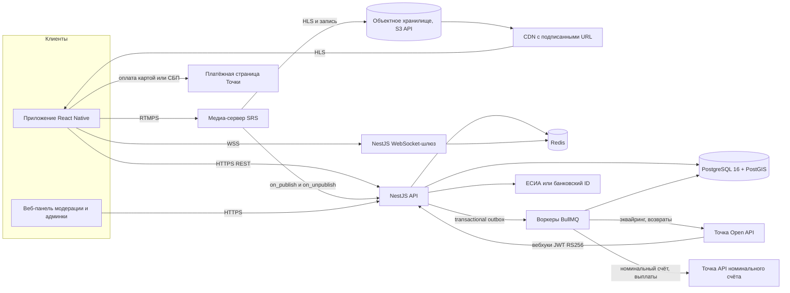
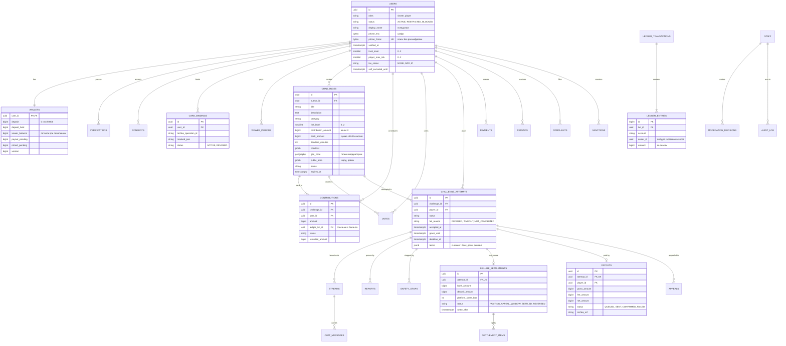
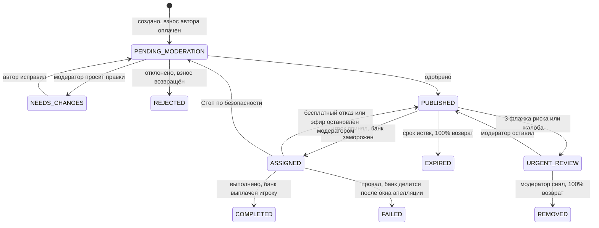
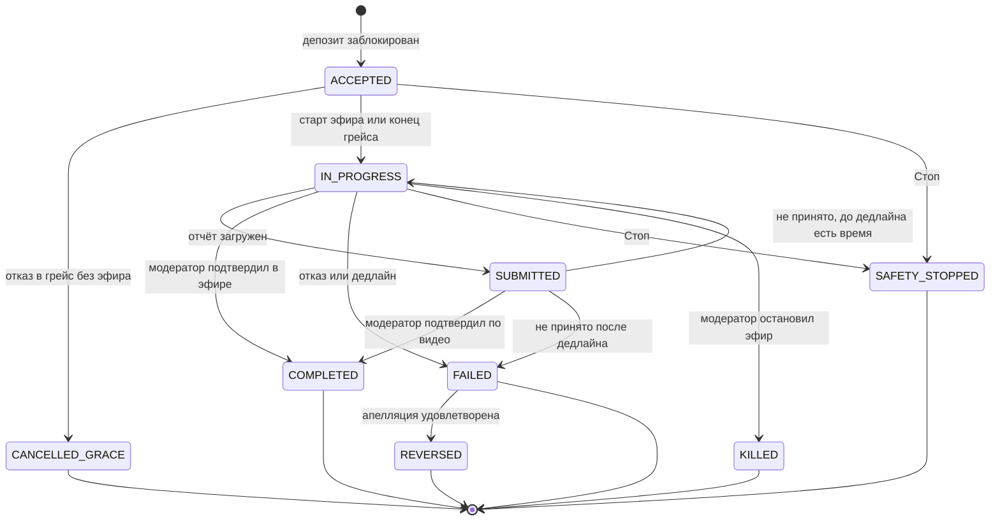

# ТЗ MVP: платформа челленджей Pluck

> Концепт: механика в духе фильма Nerve (2016). Зрители платят за просмотр,
> предлагают задания, складываются в банк задания и голосуют. Игроки вносят
> депозит, выполняют задания на камеру и сразу после выполнения получают
> банк. Провал стоит игроку депозита. Отличие от фильма: риск заданий
> ограничен, каждое задание и каждый эфир проверяет человек, а «Стоп» по
> безопасности ничего не стоит.
>
> Версия 0.3 · 30.10.2026 · статус: черновик для команды и юриста.
> Документ — техническое задание, **не юридическое заключение**. Разделы 2
> и 12 — карта рисков для юриста, а не замена ему. Нормы указаны в действующей
> редакции на дату написания; перед запуском проверить на consultant.ru /
> pravo.gov.ru.

### Что изменилось в 0.3

| Было в 0.2 | Стало в 0.3 |
|---|---|
| Плата зрителя 500 ₽ раз в 30 дней — допущение | Подтверждено владельцем: 500 ₽ списываются при регистрации и продлеваются автоматически (период — 30 дней, параметр) |
| Каждый взнос списывается с карты | У зрителя есть **баланс**: пополняется картой или СБП, взносы и создание заданий оплачиваются с него, возвраты приходят на него, остаток в любой момент возвращается на карту |
| Взнос 100–5 000 ₽ | Взнос 100–15 000 ₽: с баланса можно создавать более дорогие задания (потолок банка прежний — 15 000 ₽) |
| Депозит при провале делится 50/50 — допущение | Владелец не определился. По умолчанию — **компенсация вкладчикам в пределах их потери, остаток — в благотворительность, платформа депозит не получает** (2.5) |

### Что изменилось в 0.2 (решения владельца продукта)

| Было в 0.1 | Стало в 0.2 |
|---|---|
| Депозит игрока 5 000–15 000 ₽, удержание 30–50% награды | При регистрации игрок привязывает карту, с неё списывается **депозит 500 ₽**. Провал — депозит **обнуляется**, для новой игры нужен новый депозит |
| Подписка зрителя 499 ₽/мес, 95% в общий призовой фонд | Зритель привязывает карту и **платит 500 ₽ за просмотр** (допущение: раз в 30 дней). Общего призового фонда нет |
| Вознаграждение из призового фонда | **Банк задания**: автор задания назначает взнос, другие зрители присоединяются тем же взносом. Банк = взнос × число вкладчиков |
| Удержание — в призовой фонд | **Провал: банк делится 50% платформе / 50% вкладчикам**. Депозит игрока делится так же (допущение, раздел 15) |
| Выплата после проверки отчёта, вывод по заявке | Банк за вычетом комиссии **уходит игроку сразу** после подтверждения выполнения, без заявки на вывод |
| Автофильтр слов и ML-модерация + люди | **Только ручная модерация.** Автофильтров по словам и действиям нет |
| Абстрактный банк-партнёр | **Банк «Точка»**: эквайринг (карта, СБП), вебхуки, номинальный счёт, выплаты самозанятым (6.7) |

## Содержание

0. [Резюме](#0-резюме)
1. [Продукт: проблема, цели, не-цели, допущения](#1-продукт)
2. [Решения по механике и денежная модель](#2-решения-по-механике-и-денежная-модель)
3. [Роли и права](#3-роли-и-права)
4. [Модель риска заданий](#4-модель-риска-заданий)
5. [UX/UI: экраны, сценарии, механики безопасности](#5-uxui)
6. [Архитектура и интеграция с «Точкой»](#6-архитектура)
7. [Данные: ER-диаграмма, сущности, состояния, проводки](#7-данные)
8. [API: эндпоинты, DTO, примеры JSON, кнопки → запросы (8.5)](#8-api)
9. [Алгоритмы (псевдокод)](#9-алгоритмы-псевдокод)
10. [Безопасность](#10-безопасность)
11. [Модерация (только ручная)](#11-модерация-только-ручная)
12. [Юридические риски](#12-юридические-риски)
13. [Roadmap](#13-roadmap)
14. [Метрики успеха](#14-метрики-успеха)
15. [Открытые вопросы](#15-открытые-вопросы)
16. [Чек-лист первых 2 недель](#16-чек-лист-первых-2-недель)
17. [Соответствие обязательным проверкам репозитория](#17-соответствие-обязательным-проверкам-репозитория)
- [Приложение А. Глоссарий](#приложение-а-глоссарий)
- [Приложение Б. Где проверить самостоятельно](#приложение-б-где-проверить-самостоятельно)

---

## 0. Резюме

**Твёрдый вывод.** Модель 0.2 реализуема на заданном стеке и банке «Точка»
примерно за 5 месяцев до публичной беты в одном городе. Главный риск
модели — **платформа получает 50% банка, когда игрок проваливается**: при
успехе она берёт 10–15% комиссии, при провале — 50%. Платформа зарабатывает
на провалах в 3–5 раз больше, чем на успехах, и при этом сама решает, был ли
провал. Для суда и магазинов приложений это сильнейший признак азартной
игры с организатором. В ТЗ правило 50/50 реализовано, как решил владелец, но
это два параметра. Рекомендованные значения (12.6) дают почти ту же выручку
и не зависят от исхода.

**Аналогия.** Банк задания — складчина на подарок: все скидываются поровну,
именинник получает всё. Депозит игрока — бронь столика: не пришёл — бронь
сгорела. Но если ресторан забирает себе половину денег за подарок каждый раз,
когда именинник не пришёл, и сам решает, пришёл ли он, — ресторану выгоднее,
чтобы гость не дошёл. Это уже не ресторан, а тотализатор.

**Что делать первым:**
1. Открыть в «Точке» счёт и номинальный счёт, получить доступ к песочнице,
   задать менеджеру вопросы из 6.7.4.
2. Решить, оставить ли правило 50/50 или выровнять долю платформы (12.6).
3. Пройти чек-лист первых двух недель (раздел 16).

---

## 1. Продукт

### 1.1 Проблема и ценность

- **Игрок** хочет зарабатывать на коротких творческих и публичных
  активностях. Сейчас для этого нужно месяцами растить аудиторию.
- **Зритель** хочет влиять на контент в реальном времени: предлагать
  задания, складываться в банк и смотреть, как их выполняют. Донаты на
  стримах не гарантируют, что задание будет сделано.
- **Риск рынка:** механики «челленджей за деньги» скатываются в эскалацию
  опасности. Продукт выживет, только если безопасность встроена в экономику,
  а не добавлена поверх неё.

### 1.2 Цели MVP (проверяются через 8 недель после публичной беты)

| # | Цель | Метрика и порог |
|---|---|---|
| G1 | Ни одного вреда здоровью и правонарушения из-за задания | 0 подтверждённых инцидентов; 100% заданий прошли ручную премодерацию |
| G2 | Честная экономика: провалы — исключение | Успешные попытки ≥ 70%; доля выручки платформы от провалов ≤ 15% |
| G3 | Игрок получает деньги сразу | Медиана от подтверждения выполнения до отправки выплаты ≤ 5 мин; до зачисления на карту ≤ 1 ч |
| G4 | Зрители остаются | Конверсия «установка → оплата просмотра» ≥ 5%; продление на 2-й период ≥ 60% |
| G5 | Модерация успевает | Премодерация задания ≤ 2 ч (p90) в рабочие часы; реакция на жалобу «угроза жизни» в эфире ≤ 2 мин (p95) |

Пороги — гипотезы для беты.

### 1.3 Не-цели MVP

| Не делаем | Почему |
|---|---|
| Автоматические фильтры слов и действий, ML-модерацию | Решение владельца: только ручная модерация |
| Задания с уровнем риска выше L2 (раздел 4) | Основной источник вреда и юридического риска |
| Личные сообщения зрителей игрокам | Канал для давления, преследования и поиска местоположения |
| Банк задания с разными суммами взносов | Решение владельца: все вкладчики вносят столько же, сколько автор |
| Несколько стран и валют | Сначала РФ, один город на бете |
| Собственная биометрическая проверка | 572-ФЗ; используем ЕСИА или банковский ID |

### 1.4 Допущения (если неверны — см. раздел 15)

- Оператор — российское юрлицо с расчётным и номинальным счётом в банке
  «Точка». Пользователи — граждане 18+ в РФ, валюта RUB.
- Все деньги в системе хранятся в **копейках** (`bigint`). В API «Точки»
  суммы передаются в рублях числом — переводит только адаптер (6.7).
- Плата зрителя 500 ₽ списывается при регистрации и продлевается
  автоматически; период — 30 дней (параметр `viewer_fee_period`).
- Баланс зрителя — его деньги на номинальном счёте; потолок 30 000 ₽
  (параметр `viewer_balance_cap`): ограничивает потери при взломе аккаунта
  и риски по 115-ФЗ.
- Обнулённый депозит игрока — компенсация вкладчикам задания в пределах
  их потери, остаток — в благотворительность (2.5).
- Комиссия с успешного банка — 12% (в концепте 10–15%).
- Бета — один город, эфиры только в часы дежурства модераторов.
- Игрок и зритель — одна учётная запись с двумя ролями, каждая оплачивается
  отдельно. Персонал — отдельные учётные записи с 2FA.

---

## 2. Решения по механике и денежная модель

### 2.1 Правила из фильма, которые сохраняем

- Зрители платят за просмотр, предлагают задания и голосуют.
- Вознаграждение приходит игроку сразу после выполнения.
- Провал стоит игроку денег («провалил или слился — проиграл»), но теряет он
  только депозит 500 ₽, а не всё заработанное.

### 2.2 Правила из фильма, которые НЕ переносим

| В фильме | В продукте |
|---|---|
| Игру держат личными данными и доступом к счетам игрока | Только депозит 500 ₽; доступа к внешним счетам нет |
| Отказаться от задания нельзя | 15 минут на бесплатный отказ, «Стоп» по безопасности в любой момент |
| Задания подбираются по данным из соцсетей, на страхи и желания | Данные соцсетей не собираем; задания на страхи и личные данные запрещены |
| Приложения нет в официальных магазинах | Публикуемся в App Store, Google Play и RuStore — значит, выполняем их правила (12.2) |
| «Доносчиков» превращают в «пленников» | Жалоба и «Стоп» — норма, без последствий для игрока |
| Награды растут вместе с опасностью | Риск ограничен уровнями L0–L2; банк задания не больше 15 000 ₽ |
| Зрители находят игроков физически | Задержка эфира, только район, никаких карт |
| Финал решает голосование анонимной толпы | Голос влияет только на порядок в ленте; решения принимают модераторы |

### 2.3 Денежная модель

| Событие | Что происходит с деньгами |
|---|---|
| Регистрация игрока | Привязка карты, списание **депозита 500 ₽**. Без депозита нельзя принимать задания |
| Регистрация зрителя | Привязка карты, списание **500 ₽ за просмотр** (доход платформы), автопродление раз в 30 дней |
| Пополнение баланса | Картой или СБП, от 100 ₽, пока баланс не превысит 30 000 ₽. Баланс — деньги зрителя на номинальном счёте |
| Вернуть баланс | Остаток в любой момент возвращается на карту или по СБП |
| Зритель создаёт задание | Задаёт **взнос** X (100–15 000 ₽), X списывается с его баланса. Задание уходит на ручную премодерацию. Отклонено — X возвращается на баланс |
| Другой зритель присоединяется | Вносит ровно X с баланса (сумму задаёт сервер, не клиент). Банк растёт на X. Потолок банка — 15 000 ₽ |
| Вкладчик передумал до принятия задания | Взнос возвращается на баланс полностью (закон о защите прав потребителей, ст. 32) |
| Игрок принимает задание | Депозит блокируется, банк замораживается (новые взносы не принимаются), условия фиксируются в попытке |
| Отказ в первые 15 минут без эфира | Ничего не списывается, задание возвращается в ленту |
| **Выполнено** (модератор подтвердил) | Игроку **сразу** уходит банк − 12%, платформе — 12%. Депозит разблокирован |
| **Провал** (отказ после 15 минут, дедлайн, отчёт отклонён окончательно) | Депозит обнулён. Через 72 ч (окно апелляции): **банк — 50% платформе, 50% вкладчикам** на баланс; депозит — компенсация вкладчикам в пределах их потери (2.5). Задание закрыто |
| Стоп по безопасности | Не провал: депозит разблокирован, банк возвращается в ленту, задание — на повторную модерацию |
| Модератор остановил эфир | Не провал: награды нет, депозит разблокирован, банк возвращается в ленту, игроку — санкция по тяжести нарушения |
| Задание истекло, никто не выполнил | Вкладчикам возвращается **100%** взносов на баланс |
| Игрок уходит из игры | Депозит 500 ₽ возвращается, если нет активной попытки (ГК ст. 381.1) |

Все суммы и доли — параметры (`deposit_amount`, `viewer_fee`,
`viewer_fee_period`, `viewer_balance_cap`, `contribution_min/max`,
`bank_cap`, `payout_fee_bps`, `failure_platform_share_bps`,
`deposit_failure_split`), а не константы в коде.

### 2.4 Что меняется в остальном относительно концепта

| # | В концепте | В ТЗ | Почему |
|---|---|---|---|
| 1 | Выход без штрафа — только при ЧС с вызовом 112 | «Стоп» доступен всегда. Стоп по безопасности **никогда** не считается провалом. Злоупотребление (> 2 в 30 дней) разбирает модератор и наказывает только ограничением доступа, не деньгами. 112 — отдельная кнопка, не условие | Платформа получает 50% при провале, поэтому решение «был ли Стоп оправдан» не должно влиять на деньги. Требование «вызвать 112» провоцирует ложные вызовы (КоАП ст. 19.13) |
| 2 | `POST /challenges/{id}/fail` | Публичного эндпоинта нет: провал фиксирует планировщик по дедлайну или модератор | Иначе любой может «провалить» чужое задание |
| 3 | Списание с `challenge.creator_id` | Отдельная сущность `ChallengeAttempt` с `player_id` | В псевдокоде концепта деньги списываются с автора задания, а не с игрока (9.0) |
| 4 | Баланс в полях `users` | Учёт по двойной записи (ledger) + кэш `wallets` с `CHECK ≥ 0` | Сверка с «Точкой», защита от гонок |
| 5 | Фото документа + селфи-матчинг | 18+ через Госуслуги (ЕСИА) или банковский ID | 572-ФЗ (биометрия), 152-ФЗ ст. 11 |
| 6 | Деньги на счёте платформы | Балансы зрителей, взносы и депозиты — на номинальном счёте в «Точке» (ГК ст. 860.1) | 161-ФЗ: переводы денег делают банки (6.7.3) |
| 7 | AWS S3 + CloudFront | S3-совместимое API у российского провайдера | 152-ФЗ ст. 18 ч. 5 (локализация). AWS с 2022 г. не принимает новых клиентов из РФ (проверить) |
| 8 | Гео-метка в ленте | Зрители видят город и район. Точные координаты — только модератору, с аудитом, 30 дней. Задержка эфира ≥ 30 с | В фильме зрители физически находили игроков |
| 9 | Голос «интерес/риск» | Интерес 1–5 + флажок «кажется опасным». 3 флажка — задание в срочную очередь модератора (решает человек) | Сигнал риска от людей, без автоматики |
| 10 | — | ≤ 3 принятий в сутки; после провала — пауза 12 ч; самоограничение | Против желания «отыграться» |

### 2.5 Куда уходит обнулённый депозит игрока

В фильме депозита не было: игроки входили бесплатно, а «провалил или
слился» означало выбывание из игры. Кому достаются деньги провалившегося
игрока, фильм не показывает, поэтому правило выбираем сами:

| Вариант | Плюсы | Минусы |
|---|---|---|
| 50% платформе, 50% вкладчикам | Выручка платформы чуть выше | Платформа зарабатывает на провале ещё больше — усиливаются признаки игры с организатором (12.2) |
| 100% платформе | Проще всего | То же, сильнее |
| 100% в благотворительность | Никто не получает деньги игрока | Вкладчикам сорванный заказ ничем не компенсирован |
| **Компенсация вкладчикам в пределах их потери, остаток — в благотворительность (по умолчанию)** | Деньги получают те, чей заказ сорван, — это обычная неустойка в пользу заказчика (ГК ст. 330), а не выигрыш. Вкладчик никогда не зарабатывает на провале. Платформа депозит не получает. Ближе всего к идее концепта «штраф делится между зрителями», но только между теми, кто платил | Расчёт чуть сложнее |

Правило по умолчанию: каждый вкладчик получает поровну из депозита, но не
больше своей потери на этом задании (взнос минус возврат из банка); то,
что не поместилось, — в благотворительность. При правиле 50/50 и банке от
1 000 ₽ потеря вкладчиков (половина банка, от 500 ₽) всегда покрывает
депозит, и он целиком уходит вкладчикам.

Параметр `deposit_failure_split`: `COMPENSATE_CONTRIBUTORS` (по
умолчанию), `AS_BANK` (50/50), `CHARITY`. Меняется в настройках без
изменения кода.

---

## 3. Роли и права

| Роль | Возможности | Ограничения | Где проверяется |
|---|---|---|---|
| Гость | Описание, правила, документы | Не видит эфиры и ленту | Без токена — только `/legal/*`, `/plans` |
| Игрок | Лента, принятие, подготовка, эфир, отчёт, Стоп, выплаты, апелляции | 18+, привязанная карта, активный депозит. Одна активная попытка. ≤ 3 принятий в сутки, пауза 12 ч после провала. Уровень риска открывается опытом (4.5). Нельзя принять задание, которое сам создал, в которое вкладывался или за которое голосовал, а также задание связанного аккаунта | Guard ролей и владельца, частичный уникальный индекс (7.5), RLS |
| Зритель | Каталог эфиров, просмотр, чат, баланс (пополнение, возврат на карту), создание заданий, взносы в банк, голосование, жалобы | 18+, привязанная карта, оплаченный период просмотра. Взносы — только с баланса, баланс ≤ 30 000 ₽. Создавать, вкладываться и голосовать — только в пределах уровня доверия (4.5). Один взнос и один голос на задание. ≤ 5 новых заданий в сутки | Guard оплаты и уровня доверия, уникальные индексы |
| Модератор | Премодерация заданий, наблюдение за эфирами, подтверждение выполнения, решения по отчётам и жалобам, остановка эфира, санкции, точная гео с причиной | Отдельная учётная запись с 2FA. Не модерирует связанные аккаунты. Апелляцию разбирает другой модератор. Оплата и KPI модератора **не зависят от доли провалов** | Guard персонала, `account_links`, аудит |
| Администратор | Тарифы, доли, лимиты, правила, метрики, сверка | Изменение денежных параметров — по правилу «двух ключей». 2FA, вход из allowlist сетей | Guard персонала, `settings_changes` |
| Сервисы (воркеры) | Дедлайны, расчёты по провалам, выплаты, возвраты, обработка видео | Отдельные роли БД; деньги меняет только роль `app_ledger` | Роли PostgreSQL, RLS |

---

## 4. Модель риска заданий

### 4.1 Уровни

| Уровень | Где | С кем | Примеры (допустимо) |
|---|---|---|---|
| **L0 «Дом»** | Дома или в своём пространстве | Один | Спеть песню на заданном языке; нарисовать портрет зрителя за 10 минут; приготовить блюдо по рецепту из чата |
| **L1 «Город»** | Общественные места, открытые для посещения | Без взаимодействия с незнакомцами | Сыграть на уличном пианино; снять 5 памятников за час; станцевать на разрешённой площадке, никому не мешая |
| **L2 «Люди»** | Общественные места | Незнакомцы — **только с их явного согласия**, без физического контакта | Попросить прохожего научить фразе на его языке (с согласием на съёмку); уличное выступление |
| L3+ | — | — | **Запрещено в MVP** |

Уровень задаёт модератор при премодерации. Размер банка от уровня не
зависит; потолок банка — 15 000 ₽ для всех уровней.

### 4.2 Запрещённые категории (правила для модераторов)

Модератор отклоняет задание, если оно требует или допускает:

- угрозу жизни и здоровью: высоту, крыши, краны, воду и лёд, огонь,
  транспорт (дороги, рельсы, вождение, езду «зацепом»), экстремальные
  температуры, лишение сна, еду и питьё на скорость или в объёме, острые и
  «опасные» продукты, лекарства, алкоголь, никотин, наркотики;
- насилие, оружие (включая игрушечное и муляжи), драки, «пранки» с испугом;
- нарушение закона: кражи (включая «вынести и вернуть»), проникновение на
  закрытую территорию, порчу имущества, граффити, нарушение ПДД, мелкое
  хулиганство, публичные мероприятия, пикеты, политическую и религиозную
  тематику, запрещённую символику;
- вторжение в частную жизнь: съёмку конкретного человека без согласия,
  поиск личных данных, задания «на» знакомого или публичное лицо, розыгрыши
  с обманом посторонних, выдачу себя за сотрудников (полиция, охрана,
  персонал);
- физический контакт с незнакомцами, сексуальный контент, обнажённость;
- самоповреждение, задания на страхи игрока или на его личные данные (в
  фильме задания строились на страхах, собранных из соцсетей);
- детей и животных как участников (кроме своего питомца в бытовой ситуации
  без стресса, L0, по решению модератора);
- финансовые действия: кредиты, ставки, переводы третьим лицам, покупки
  дороже 500 ₽;
- места, где съёмка запрещена законом или правилами владельца.

### 4.3 Памятка автору задания

Статичный текст на экране создания задания (не автоматическая проверка):

| Так не пройдёт модерацию | Так пройдёт |
|---|---|
| «Залезь на крышу и сними закат» | «Сними закат со смотровой площадки, открытой для посетителей» |
| «Поцелуй незнакомца» | «Попроси прохожего научить тебя комплименту на его языке» |
| «Выйди из магазина в чужой одежде» | «Собери образ из вещей до 1 000 ₽ в секонд-хенде» |
| «Проедь на самокате без рук» | «Найди 3 велодорожки и расскажи про каждую» |

### 4.4 Требования к формулировке

- Результат, который можно проверить по видео (чек-лист из 1–10 пунктов).
- Длительность выполнения от 30 до 1 440 минут; модератор проверяет, что
  дедлайн реалистичен (платформа получает долю при провале — нереальный
  дедлайн недопустим).
- Никаких адресов и имён частных лиц.

### 4.5 Уровни доверия

```text
Зритель (создаёт задания, вкладывается и голосует за задания уровня ≤ trust_level):
  T0 — новый                                          → L0
  T1 — ≥ 30 дней оплаченного просмотра, 0 нарушений   → L0–L1
  T2 — ≥ 90 дней, ≥ 3 одобренных задания, 0 нарушений → L0–L2

Игрок (принимает задания уровня ≤ player_max_risk):
  старт                                               → L0
  ≥ 2 выполненных задания                             → L1
  ≥ 5 выполненных и 0 нарушений правил                → L2
Подтверждённое нарушение понижает уровень на 1 на 90 дней.
```

---

## 5. UX/UI

### 5.1 Таблица экранов

**Общие (мобильное приложение, React Native)**

| ID | Экран | Ключевые элементы | Безопасность и правила |
|---|---|---|---|
| S01 | Приветствие «Ты игрок или зритель?» | Вместо фона — **живое изображение с фронтальной камеры** во весь экран с тёмным неоновым фильтром (бирюзовый, розовый). Поверх — название приложения неоном, вопрос «Ты игрок или зритель?» и две неоновые кнопки-рамки: **«ИГРОК»** (бирюзовая) и **«ЗРИТЕЛЬ»** (белая). Ниже мелко — «18+», ссылка «Правила» | Камера только для картинки на экране: кадр не записывается и не отправляется на сервер. Если доступ к камере не дан — тот же экран на тёмном анимированном фоне. Маркировка 18+ (436-ФЗ). Не используем название «Nerve» и шрифт постера фильма (12.2) |
| S02 | Вход | Российский номер → код из SMS | Лимит запросов кода; вход только по российскому номеру или ЕСИА (149-ФЗ в ред. 406-ФЗ) |
| S03 | Документы и согласия | Оферта, политика ПД, правила депозита и банка заданий, согласие на автосписания — **отдельные непредзаполненные чекбоксы** | Согласие до любого платежа; версия документа сохраняется |
| S04 | Подтверждение 18+ | «Госуслуги» / «Банк ID», статус | Без подтверждения нельзя привязать карту и платить |
| S05 | Привязка карты | Платёжная страница «Точки» (карта или СБП), первое списание (депозит или плата за просмотр) | Номер карты не попадает в приложение и на наш сервер |
| S06 | Профиль и настройки | Псевдоним, уведомления, приватность, самоограничение, удаление аккаунта | Настоящее имя не показывается |
| S07 | Поддержка и жалобы | Мои обращения, статусы, SLA | — |

**Игрок**

| ID | Экран | Ключевые элементы | Безопасность и правила |
|---|---|---|---|
| P01 | Онбординг игрока | Как работают депозит, банк, Стоп; квиз из 3 вопросов | Без квиза «Принять» недоступно |
| P02 | Депозит | 500 ₽, статус (активен / заблокирован / обнулён), «Внести снова», «Вернуть депозит» | Повторный депозит — отдельным подтверждением |
| P03 | Лента заданий | Фильтры: «рядом», «быстрые», «творческие», уровень. Карточка: **банк**, число вкладчиков, уровень, район, дедлайн | Координаты округляются на устройстве до ~1 км |
| P03a | **Входящее задание** (как в фильме) | Полноэкранная карточка поверх камеры: крупный заголовок («Примерь это платье»), картинка-пример от автора, **сумма банка, которую получит игрок**, таймер ответа (60 с), кнопки **«Отклонить»** и **«Принять»**. Приходит push-уведомлением подходящим игрокам рядом (уровень, район, нет активной попытки) | «Отклонить» бесплатно и не считается провалом (в фильме отказ = проигрыш — это не переносим). Под суммой мелко: «при провале депозит 500 ₽ обнуляется». «Принять» → то же подтверждение, что в P04. Не больше 5 входящих в час, ночью не приходят |
| P04 | Карточка задания | Описание, требования к видео, чек-лист, банк, «вы получите 88% банка сразу после подтверждения», «при провале депозит 500 ₽ обнуляется», «15 минут на бесплатный отказ». «Принять» → подтверждение | Видно, почему задание недоступно |
| P05 | Подготовка | Гео (если нужно), камера и связь, приватность (размытие лиц, задержка 30–120 с, отключение чата), чек-лист безопасности, таймер, «Отказаться бесплатно» (пока идёт грейс) | — |
| P06 | Эфир | Камера, таймер, статус, индикатор задержки, чат (можно скрыть), **«Стоп» всегда виден** | Стоп — максимум 2 нажатия |
| P07 | Стоп | Причины: небезопасно / плохо себя чувствую / против посторонние / попросили полиция или охрана / технический сбой / другое. Отдельно — «Позвонить 112» | 112 — помощь, а не условие. Текст: «Стоп по безопасности не считается провалом» |
| P08 | После Стопа | «Вы в безопасности?»: 112, поддержка, «я в порядке» | Эфир гасится на устройстве сразу |
| P09 | Отчёт | Загрузка видео (если задание без эфира или эфир прервался по связи), предпросмотр, гео, чек-лист | Метаданные с координатами вырезаются из публичной копии |
| P10 | Результат | «Выполнено — 3 168 ₽ отправлены на карту» или «Провал — депозит обнулён, апелляция до …» | — |
| P11 | Выплаты | Статус самозанятого («Мой налог»), куда платить (СБП по телефону), история выплат и чеков | Выплата только на реквизиты верифицированного игрока |

**Зритель**

| ID | Экран | Ключевые элементы | Безопасность и правила |
|---|---|---|---|
| V01 | Оплата просмотра | 500 ₽ за 30 дней, дата следующего списания, **как отменить — до оплаты** | Без пробного периода |
| V02 | Каталог эфиров | Фильтры: категория, город, рейтинг; превью-нарезки | Только город и район |
| V03 | Плеер | Видео и чат с задержкой, реакции, «Пожаловаться» | Модератор успевает скрыть сообщение до показа (5.3) |
| V04 | Создать задание | Категория, уровень (только доступные), описание, требования, **сумма взноса** (100–15 000 ₽), памятка 4.3, итог «спишем X ₽ с баланса»; не хватает — «Пополнить» | Списание — отдельным подтверждением |
| V05 | Мои задания и взносы | Статусы (модерация, в ленте, выполняется, выполнено, провал, истекло), «Забрать взнос» (до принятия игроком), возвраты на баланс | — |
| V06 | Голосование и банк | Карточки опубликованных заданий: банк, вкладчики, интерес 1–5, флажок «кажется опасным», «Вложить X ₽» | Только задания уровня ≤ уровня доверия |
| V07 | Управление оплатой | Отмена автопродления в 2 нажатия, история списаний и возвратов, чеки | Отменить так же просто, как оплатить |
| V08 | Баланс | Остаток, «Пополнить» (карта, СБП), история (взносы, возвраты, компенсации), «Вернуть на карту» | Пополнение и возврат — отдельными подтверждениями; потолок 30 000 ₽ |

**Модератор и администратор (веб-панель, React)**

| ID | Экран | Ключевые элементы |
|---|---|---|
| M01 | Очереди | Премодерация заданий, срочные (флажки, Стопы), отчёты, жалобы, апелляции; SLA-таймеры |
| M02 | Задание на модерации | Текст, история автора, решение, уровень, дедлайн, гео-зона, публичный район |
| M03 | Подтверждение выполнения | Эфир или видео, чек-лист, гео на карте, кнопки «Выполнено» / «Не выполнено» с обязательной причиной |
| M04 | Live-стена | Эфиры с чатом **до показа зрителям**, скрытие сообщений, «Остановить эфир» |
| M05 | Пользователь | История, связанные аккаунты, санкции, уровень доверия |
| A01 | Настройки | Денежные параметры (2.3), лимиты; изменения — с подтверждением второго админа |
| A02 | Финансы | Банки заданий, выплаты, возвраты, ежедневная сверка с «Точкой» |
| A03 | Метрики | Раздел 14, включая долю выручки от провалов |
| A04 | Аудит | Журнал действий персонала |

### 5.2 Сценарии

**Игрок: первый успешный цикл**

1. S01 «Я игрок» → S02 → S03 → S04 (18+) → S05: привязка карты и депозит 500 ₽ → P01.
2. Приходит входящее задание P03a (или игрок находит его в ленте P03 → P04): L0, банк 3 600 ₽ (12 вкладчиков по 300 ₽) → «Принять».
3. Сервер блокирует депозит, замораживает банк, запускает грейс 15 минут и дедлайн.
4. P05 → P06: эфир. Модератор видит выполнение и нажимает «Выполнено».
5. **Сразу**: игроку отправляется 3 168 ₽ (3 600 − 12%) через выплаты самозанятым «Точки», чек формируется автоматически; депозит разблокирован.

**Игрок: отказ, провал, Стоп**

- Отказ в первые 15 минут без эфира → ничего не списано, задание в ленте.
- Отказ после грейса или дедлайн без выполнения → депозит обнулён, апелляция 72 ч, затем банк делится 50/50. Чтобы играть дальше — новый депозит 500 ₽.
- Стоп по безопасности → не провал, депозит разблокирован, банк возвращается в ленту, задание — на повторную модерацию.

**Зритель**

1. S01 «Я зритель» → S02–S04 → S05: привязка карты, 500 ₽ за 30 дней.
2. V08: пополняет баланс на 1 000 ₽ → V04: создаёт задание со взносом 300 ₽ → списание с баланса → модерация → в ленте.
3. V06: другие зрители вкладывают по 300 ₽ со своих балансов; банк растёт до потолка 15 000 ₽.
4. Итог: выполнено — взносы ушли игроку; провал — на баланс вернулось 150 ₽ + 41,67 ₽ компенсации из депозита; истекло — 300 ₽ на баланс.
5. V08: «Вернуть на карту» — остаток баланса уходит на карту.

**Модератор**

1. M01 → M02: одобряет задание, задаёт уровень, дедлайн и район.
2. M04: смотрит эфир и чат до показа зрителям, скрывает сообщение с адресом, при опасности — «Остановить эфир».
3. M03: «Выполнено» → выплата уходит сразу. «Не выполнено» → обязательная причина, игрок может обжаловать.

### 5.3 Механики безопасности в интерфейсе (без автоматики)

- **«Стоп»**: на экранах P05 и P06 всегда в зоне большого пальца,
  1 нажатие + 1 подтверждение. Стоп по безопасности **не провал** — это
  написано на кнопке подтверждения.
- **Чат с задержкой**: сообщения показываются зрителям и игроку с той же
  задержкой, что и видео (30–120 с). Дежурный модератор видит их сразу и
  успевает скрыть адрес, телефон или давление до показа. Игрок может
  выключить чат. Автоматических фильтров нет.
- **Эфиры только при дежурном модераторе**: новый эфир не стартует, если на
  смене нет свободного модератора (на одного — не больше 4 эфиров
  одновременно, параметр). Без автоматики это единственный способ видеть
  каждый эфир.
- **Автоотмена по связи**: потеря связи > 3 мин ставит таймер на паузу;
  > 15 мин — попытка отменяется без провала. Эфиры L1/L2 — с 10:00 до 22:00
  по местному времени.
- **Против давления**: правила чата запрещают «слабо?», «залезь выше»;
  модератор скрывает такие сообщения и выдаёт страйк.
- **Против «отыграться»**: пауза 12 ч после провала, ≤ 3 принятий в сутки,
  самоограничение на 7/30/90 дней; повторный депозит — отдельным
  подтверждением с текстом «вы вносите депозит снова».
- **Терминология**: «депозит», «банк задания», «взнос», «вознаграждение».
  Не используются «ставка», «выигрыш», «пари», «штраф».

---

## 6. Архитектура

### 6.1 Компоненты



### 6.2 Стек

| Слой | Выбор | Комментарий |
|---|---|---|
| Мобильный клиент | React Native (Expo, prebuild), TypeScript strict | RTMP-публикация (HaishinKit для iOS, RootEncoder для Android), камера, геолокация с признаком mock, Keychain/Keystore, App Attest / Play Integrity |
| Веб-панель | React + Vite, TypeScript | Отдельный домен, 2FA, allowlist сетей |
| API | NestJS (Node.js LTS), TypeScript strict | Модули — 6.3; class-validator; OpenAPI из кода |
| Доступ к БД | Kysely поверх node-postgres | Явные транзакции, `SET LOCAL` для RLS, `SELECT … FOR UPDATE` |
| БД | PostgreSQL 16 + PostGIS | RLS + FORCE на каждой таблице (10.4) |
| Кэш и очереди | Redis 7, BullMQ | Rate limit, presence, pub/sub для WebSocket, отложенные задачи |
| Видео | SRS (RTMPS) → ffmpeg (ABR) → HLS → CDN | Задержка 30–120 с намеренно; запись для модерации и споров |
| Хранилище | S3-совместимое API у российского провайдера | Приватные бакеты, presigned URL |
| Банк | «Точка»: Open API (эквайринг, вебхуки), API номинального счёта, выплаты самозанятым | 6.7 |
| Push | FCM / APNs, RuStore Push как резерв | Без ПД в тексте |
| Наблюдаемость | OpenTelemetry, Prometheus, Grafana, Sentry (self-hosted) | Логи без ПД и секретов |

### 6.3 Модули NestJS

`auth`, `users`, `verification`, `consents`, **`ledger`** (единственный
модуль с ролью БД `app_ledger`), `wallet`, `tochka` (адаптер банка),
`billing` (депозиты, плата за просмотр, автопродление, пополнение и
возврат баланса), `challenges`,
`contributions` (банк задания), `votes`, `moderation`, `attempts` (машина
состояний), `settlements` (выплаты при успехе, расчёт при провале,
возвраты), `streams`, `reports`, `chat`, `complaints`, `notifications`,
`admin`, `audit`, `outbox`.

Воркеры: грейс и дедлайны, расчёт провала после окна апелляции, выплаты,
возвраты, истечение заданий, обработка видео (транскодинг, превью,
perceptual hash для поиска повторов, вырезание метаданных), автопродление
платы за просмотр, сверка с «Точкой», очистка по срокам хранения.

### 6.4 Видео

- Игрок получает адрес ingest и **одноразовый ключ эфира** при
  `POST /attempts/{id}/streams`. Ключ показывается один раз, в БД — только
  хэш. Ключ не пишется в логи.
- Только RTMPS: в обычном RTMP ключ идёт открытым текстом.
- `on_publish`: API сравнивает хэш ключа за постоянное время, проверяет
  попытку, игрока, окно эфиров и **наличие свободного дежурного модератора**.
- Kill switch: `POST /mod/streams/{id}/kill` → медиа-сервер рвёт сессию →
  клиенту `stream.status=KILLED`.
- Зрители получают HLS по подписанному URL CDN (TTL 5 минут).

### 6.5 WebSocket

- Socket.IO с Redis-адаптером, токен проверяется при подключении.
- Комнаты: `stream:{id}` (оплатившие просмотр), `attempt:{id}` (владелец и
  персонал), `user:{id}` (владелец), `staff`. **Каждый вход в комнату
  проверяется на сервере.**
- Чат: `chat.send` от зрителя → сразу в комнату `staff` → зрителям и игроку
  через `delay_seconds` эфира, если модератор не скрыл. Лимит 1 сообщение в
  3 с на зрителя.
- Сервер → клиент: `stream.status`, `chat.message`, `attempt.status`,
  `attempt.timer`, `wallet.updated`, `bank.updated`, `payout.sent`.
- События не содержат координат.

### 6.6 Окружения

`dev` → `stage` (песочница «Точки», тестовые телефоны) → `prod`. Секреты —
только в менеджере секретов облака, у каждого окружения свои. Миграции — в
CI с проверкой, что у каждой таблицы включены RLS и FORCE.

### 6.7 Интеграция с банком «Точка»

Официальный сайт документации «Точки» из среды, где писалось ТЗ, отвечал
ошибкой 503. Факты ниже взяты из открытого SDK и из найденных страниц и
выдержек документации; **перед реализацией сверить с документацией и
менеджером банка.**

#### 6.7.1 Что подтверждено

| Что | Как | Источник |
|---|---|---|
| Базовые адреса | Боевой `https://enter.tochka.com/uapi`, песочница `https://enter.tochka.com/sandbox/v2` (единый публичный тестовый токен из документации) | Документация «Песочница», открытый SDK |
| Авторизация | JWT-ключ из интернет-банка («Интеграции и API») + `client_id`; хранится только на сервере | Документация «Авторизация по JWT» |
| Оплата картой и СБП | `POST /acquiring/v1.0/payments` (или `/payments_with_receipt` — с чеком по 54-ФЗ). Поля: `customerCode`, `amount` (рубли), `purpose`, `paymentMode: ["card","sbp"]`, `saveCard`, `consumerId`, `merchantId`, `redirectUrl`, `failRedirectUrl`, `ttl`, `paymentLinkId` (наш номер заказа, ≤ 45 символов). Ответ: `operationId`, `paymentLink`, `status` | Открытый SDK |
| Статусы платежа | `CREATED`, `AUTHORIZED`, `APPROVED`, `ON-REFUND`, `REFUNDED`, `REFUNDED_PARTIALLY`, `EXPIRED`, `WAIT_FULL_PAYMENT` | Открытый SDK |
| Статус, двухстадийная оплата, возврат | `GET /acquiring/v1.0/payments/{operationId}`; `preAuthorization: true` + `POST …/{operationId}/capture`; `POST …/{operationId}/refund` (есть частичный возврат) | Открытый SDK |
| Регулярные списания | `POST /acquiring/v1.0/subscriptions` (`recurring`), `POST …/subscriptions/{operationId}/charge` (`amount`), `GET …/subscriptions/{operationId}/status` | Открытый SDK |
| Вебхуки | Регистрация: `PUT/POST/GET/DELETE /webhook/v1.0/{client_id}`. События: `acquiringInternetPayment`, `incomingPayment`, `outgoingPayment`, `incomingSbpPayment`, `incomingSbpB2BPayment`. Тело — **JWT с подписью RS256**, проверяется публичным ключом банка с `https://enter.tochka.com/doc/openapi/static/keys/public` (JWK) | Документация «Вебхуки», открытый SDK |
| Номинальный счёт | Отдельный API: JSON-RPC по пути `/v2/jsonrpc`, каждый запрос подписывается RSA (заголовки `sign-data`, `sign-thumbprint`, `sign-system`). Тестовый контур pre (там деньги возвращаются отправителю через 30 мин), боевой prod (на идентификацию входящего платежа — 96 ч). Есть выплаты по СБП по номеру телефона и метод идентификации платежей (`identification_payment`) | Документация номинального счёта |
| Выплаты самозанятым | Сервис «Выплаты самозанятым» с API: перед выплатой проверяет статус в ФНС, чеки формируются автоматически. Комиссия на странице банка — 1,5%, не менее 100 ₽ (могла устареть) | Страницы банка |

#### 6.7.2 Как используем

| Сценарий продукта | Механизм «Точки» |
|---|---|
| Привязка карты и первое списание (депозит игрока или плата зрителя) | Платёж с `saveCard: true` или подписка с `recurring: true`; храним только `operationId`, маску карты и id подписки |
| Плата за просмотр раз в 30 дней | `subscriptions/{operationId}/charge` по расписанию; уведомление за 1–3 дня до списания |
| Пополнение баланса зрителя | Ссылка на оплату (карта/СБП) или списание по привязке (`charge`) после подтверждения в приложении; выбор — после ответа менеджера (6.7.4) |
| Взнос в банк задания | Внутренняя проводка с баланса зрителя на банк задания — без обращения к эквайрингу, мгновенно и атомарно |
| Хранение балансов, взносов и депозитов | Номинальный счёт: бенефициары — зрители и игроки; баланс, банк задания и депозит — учёт по бенефициарам. Холд на карте не подходит: баланс пополняется заранее |
| Выплата игроку сразу после выполнения | «Выплаты самозанятым» (проверка статуса НПД, чек) или выплата по СБП с номинального счёта |
| Возврат вкладчику (100% или 50%) и компенсация из депозита | На баланс зрителя — внутренней проводкой |
| Вернуть баланс на карту | Возврат по платежам пополнения (`refund`, начиная с последних) или выплата по СБП с номинального счёта |
| Подтверждение оплаты | Вебхук `acquiringInternetPayment` (проверка JWT) + повторный `GET payments/{operationId}` перед зачислением в ledger |
| Сверка | Ежедневная выписка и сравнение с ledger |

Адаптер `tochka` — единственное место, где копейки переводятся в рубли:
`(kopecks / 100).toFixed(2)` через целочисленное деление и остаток, без
арифметики с плавающей точкой. Ответы и вебхуки переводятся обратно в
копейки строковым разбором.

#### 6.7.3 Почему не «просто расчётный счёт»

Балансы зрителей, взносы до исхода задания и депозиты игроков — чужие
деньги. Если они лежат на расчётном счёте платформы, а платформа переводит
их одним пользователям за счёт других, это признаки деятельности по
переводу денежных средств (161-ФЗ). С появлением баланса это стало ещё
очевиднее: без номинального счёта (ГК ст. 860.1) модель с балансом не
работает.

#### 6.7.4 Вопросы менеджеру «Точки» (до Ф1)

1. Можно ли зачислять оплату эквайринга (карта и СБП) сразу на номинальный
   счёт, или только на расчётный с последующим переводом?
2. Можно ли по одной привязке карты списывать разные суммы по действию
   пользователя в приложении (пополнение баланса), а не только регулярный
   платёж?
3. Как вести баланс каждого зрителя на номинальном счёте: отдельный
   виртуальный счёт бенефициара или общий учёт у платформы; есть ли
   ограничения на остаток и на внутренние переводы между бенефициарами?
4. Можно ли выплачивать самозанятым с номинального счёта с автоматическим
   чеком; лимиты и время зачисления по СБП?
5. Частичный возврат на карту вкладчика: сроки, комиссия.
6. Тарифы: эквайринг, номинальный счёт, выплаты, возвраты.
7. Нужен ли платформе статус платёжного агента при этой схеме.

---

## 7. Данные

### 7.1 ER-диаграмма



### 7.2 Сущности

| Сущность | Ключевые поля | Примечания и отличия от концепта |
|---|---|---|
| `users` | см. ER | Балансов здесь нет (концепт: `deposit_balance`, `payout_balance` → `wallets` + ledger) |
| `staff` | id, role, totp/webauthn, allowed_networks | Персонал отделён от клиентских аккаунтов |
| `wallets` | депозит, заблокированный депозит, баланс зрителя, к выплате, к возврату | Кэш над ledger; меняется только вместе с проводкой |
| `ledger_transactions` / `ledger_entries` | kind, ref; account, owner_id, amount | Двойная запись: сумма по транзакции = 0 |
| `card_bindings` | operationId привязки в «Точке», маска | Номера карты у нас нет |
| `viewer_periods` | user_id, paid_from, paid_to, payment_id, auto_renew | Оплаченные периоды просмотра |
| `payments` | type (`DEPOSIT`, `VIEWER_FEE`, `TOP_UP`), amount, `tochka_operation_id` `UNIQUE`, status | Зачисление в ledger — только после вебхука и повторной проверки статуса |
| `refunds` | payment_id, amount, reason (`BALANCE_WITHDRAWAL`, `DEPOSIT_RETURN`), status | Деньги уходят на карту только здесь; возвраты взносов идут на баланс проводкой |
| `challenges` | см. ER | `creator_id` → `author_id`; кто выполняет — в `challenge_attempts`; банк — в `contributions` |
| `contributions` | см. ER; статусы `HELD`, `PAID_TO_PLAYER`, `RETURNED_TO_BALANCE`, `SETTLED_ON_FAILURE`, `CANCELLED` | Новая сущность: банк задания. Один взнос на зрителя на задание; списывается с баланса в той же транзакции, поэтому «ожидающих оплаты» взносов нет |
| `challenge_attempts` | см. ER | Новая сущность: исправляет ошибку концепта (списание с автора) |
| `votes` | challenge_id, user_id, interest 1–5, risk_flag | Голос не связан с деньгами |
| `streams` | attempt_id, status, хэш ключа, playback_id, delay_seconds | `rtmp_url` с ключом не хранится |
| `reports` | attempt_id, видео, хэши, гео (шифр, 30 дней), чек-лист | `stream_id` → `attempt_id` |
| `safety_stops` | attempt_id, reason, comment, review_status | Стоп никогда не меняет деньги в пользу платформы |
| `failure_settlements` / `settlement_items` | см. ER; items: user_id, amount, kind (`BANK_SHARE`, `DEPOSIT_SHARE`) | `UNIQUE(attempt_id)` — двойной расчёт невозможен |
| `payouts` | см. ER | `UNIQUE(attempt_id)` — двойная выплата невозможна |
| `appeals` | attempt_id, status, first/second moderator | Второй модератор ≠ первый |
| `chat_messages` | stream_id, user_id, body, status (`PENDING`, `SHOWN`, `HIDDEN`), show_at | Хранение по требованиям ОРИ (12.2) |
| `complaints`, `moderation_decisions`, `sanctions`, `account_links`, `idempotency_keys`, `outbox`, `audit_log`, `settings`/`settings_changes` | как в 0.1 | `audit_log` — только INSERT |

### 7.3 Состояния

**Задание**



**Попытка**



`REVERSED`: депозит игроку возвращается, банк — в ленту, расчёт по провалу
отменяется (он ещё не выполнен — ждёт окна апелляции).

### 7.4 Проводки

| Операция | Откуда | Куда | Сумма |
|---|---|---|---|
| Депозит оплачен (вебхук) | `TOCHKA` | `DEPOSIT(p)` | 500 ₽ |
| Плата за просмотр оплачена | `TOCHKA` | `PLATFORM_REVENUE` | 500 ₽ |
| Баланс пополнен (вебхук) | `TOCHKA` | `VIEWER_BALANCE(v)` | сумма |
| Взнос (создание задания или присоединение) | `VIEWER_BALANCE(v)` | `BANK(ch)` | X |
| Задание отклонено, снято, истекло; вкладчик забрал взнос | `BANK(ch)` | `VIEWER_BALANCE(v)` | взнос |
| Баланс возвращён на карту | `VIEWER_BALANCE(v)` | `REFUND_PENDING(v)` → `TOCHKA` | сумма |
| Принятие задания | `DEPOSIT(p)` | `DEPOSIT_HELD(p)` | 500 ₽ |
| Бесплатный отказ / Стоп / остановка модератором / успех | `DEPOSIT_HELD(p)` | `DEPOSIT(p)` | 500 ₽ |
| **Выполнено** | `BANK(ch)` | `PAYOUT_PENDING(p)` (B − fee) + `PLATFORM_REVENUE` (fee) | B |
| Выплата отправлена | `PAYOUT_PENDING(p)` | `TOCHKA` | B − fee |
| **Провал** | `BANK(ch)` + `DEPOSIT_HELD(p)` | `FAILURE_CLEARING` | B + 500 ₽ |
| Окно апелляции прошло | `FAILURE_CLEARING` | `PLATFORM_REVENUE` (доля платформы из банка) + `VIEWER_BALANCE(вкладчики)` (их доля банка + компенсация из депозита) + `CHARITY_PAYABLE` (остаток депозита, если есть) | B + 500 ₽ |
| Апелляция удовлетворена | `FAILURE_CLEARING` | `BANK(ch)` + `DEPOSIT(p)` | B + 500 ₽ |
| Возврат депозита при уходе | `DEPOSIT(p)` | `REFUND_PENDING(p)` → `TOCHKA` | 500 ₽ |

Сверка раз в сутки: сумма клиентских счетов в ledger = остаток
номинального счёта по выписке «Точки». Расхождение — алерт и остановка
выплат до разбора.

### 7.5 Инварианты в БД

```sql
create table wallets (
  user_id        uuid primary key references users(id),
  deposit        bigint not null default 0 check (deposit >= 0),
  deposit_held   bigint not null default 0 check (deposit_held >= 0),
  -- баланс зрителя не уходит в минус. Потолок 30 000 ₽ проверяется только при
  -- пополнении: возвраты и компенсации могут его превысить и не должны падать.
  viewer_balance bigint not null default 0 check (viewer_balance >= 0),
  payout_pending bigint not null default 0 check (payout_pending >= 0),
  refund_pending bigint not null default 0 check (refund_pending >= 0),
  version        bigint not null default 0,
  -- один депозит 500 ₽: либо свободен, либо заблокирован попыткой
  check (deposit + deposit_held <= 50000)
);

create table contributions (
  id              uuid primary key default gen_random_uuid(),
  challenge_id    uuid not null references challenges(id),
  user_id         uuid not null references users(id),
  amount          bigint not null check (amount between 10000 and 1500000),
  status          text not null,
  refunded_amount bigint not null default 0 check (refunded_amount between 0 and amount)
);

-- Один действующий взнос зрителя на задание
create unique index one_contribution_per_user on contributions (challenge_id, user_id)
  where status <> 'CANCELLED';

-- Взнос автора задаёт сумму; банк не больше потолка
alter table challenges add constraint contribution_in_range
  check (contribution_amount between 10000 and 1500000);
alter table challenges add constraint bank_le_cap
  check (bank_amount between 0 and 1500000);

-- Одна активная попытка у игрока и одна у задания
create unique index one_active_attempt_per_player on challenge_attempts (player_id)
  where status in ('ACCEPTED', 'IN_PROGRESS', 'SUBMITTED');
create unique index one_active_attempt_per_challenge on challenge_attempts (challenge_id)
  where status in ('ACCEPTED', 'IN_PROGRESS', 'SUBMITTED');

create unique index one_vote_per_user        on votes (challenge_id, user_id);
create unique index one_settlement_per_try   on failure_settlements (attempt_id);
create unique index one_payout_per_try       on payouts (attempt_id);
create unique index one_idempotency_key      on idempotency_keys (user_id, scope, key);
create unique index one_tochka_operation     on payments (tochka_operation_id);

-- Сбалансированность проводки: отложенный constraint trigger
-- проверяет sum(amount) = 0 по txn_id в момент COMMIT.
```

### 7.6 Пример расчёта (допущения, не прогноз)

**Одно задание.** Взнос 300 ₽, 12 вкладчиков, банк 3 600 ₽.

- Выполнено: игроку 3 168 ₽ сразу, платформе 432 ₽ (12%).
- Провал: платформе 1 800 ₽ (50% банка). Каждому вкладчику на баланс
  150 ₽ + 41,67 ₽ компенсации из депозита (50 000 коп. / 12 = 4 166 коп.,
  остаток 8 коп. — по 1 коп. первым восьми по времени взноса). Компенсация
  меньше потери вкладчика (150 ₽), поэтому весь депозит уходит вкладчикам,
  в благотворительность — 0.

**Месяц при 1 000 зрителей.** 1 000 × 500 ₽ = 500 000 ₽ за просмотр;
200 заданий со средним банком 3 000 ₽ = 600 000 ₽ в банках; 80% выполнено.

| | Правило владельца: 12% при успехе, 50% при провале | Рекомендация 12.6: 20% при любом исходе |
|---|---|---|
| Плата за просмотр | 500 000 ₽ | 500 000 ₽ |
| С успешных банков | 12% × 480 000 = 57 600 ₽ | 20% × 480 000 = 96 000 ₽ |
| С проваленных банков | 50% × 120 000 = 60 000 ₽ | 20% × 120 000 = 24 000 ₽ |
| С депозитов (по умолчанию — вкладчикам) | 0 ₽ | 0 ₽ |
| **Итого** | **617 600 ₽** | **620 000 ₽ (+0,4%)** |
| Доля выручки от провалов | 9,7% | 0% (выручка не зависит от исхода) |

Если депозит делить 50/50 (`AS_BANK`), правило владельца даёт ещё
40 × 250 = 10 000 ₽ (627 600 ₽), но доля выручки от провалов растёт до 11,2%.
Пополнения баланса выручкой не являются: это деньги зрителей.

Без эквайринга, выплат и возвратов по тарифам «Точки», налогов и
модерации. Комиссия выплат самозанятым на странице банка — не менее 100 ₽
за операцию (проверить), поэтому минимальный банк для принятия задания —
1 000 ₽ (параметр `min_bank_to_accept`).

---

## 8. API

### 8.1 Соглашения

- Базовый путь `/api/v1`. JSON, UTF-8, время — ISO 8601 UTC, деньги —
  целые копейки.
- `Authorization: Bearer <access>` (JWT, 15 мин) + refresh-токен (30 дней,
  ротация, повторное использование старого отзывает сессии устройства).
- **Идентификатор пользователя берётся только из токена** (`/me/...`).
- **Сумма взноса никогда не приходит от клиента** — её задаёт задание.
- **Объект с чужим владельцем → `404`**, чтобы не подтверждать существование.
- Все денежные POST требуют `Idempotency-Key` (UUID).
- Ошибки — RFC 9457 (`application/problem+json`) с полем `code`.
- Пагинация курсором; rate limit — Redis token bucket, `429` + `Retry-After`.

### 8.2 Эндпоинты

**Вход и профиль**

| Метод | Путь | Кто | Владелец | Идемп. |
|---|---|---|---|---|
| POST | `/auth/otp`, `/auth/otp/verify`, `/auth/refresh`, `/auth/logout` | гость / любой | код привязан к номеру; refresh — к устройству | |
| GET, DELETE | `/me` | любой | из токена; удаление — отказ при активной попытке или деньгах в обработке | |
| PUT | `/me/self-exclusion` | любой | из токена; `{days: 7 \| 30 \| 90}`; досрочно не снимается | ✔ |
| POST | `/me/verification` | любой | из токена | |
| GET | `/legal/documents` | все | — | |
| POST | `/me/consents` | любой | из токена | ✔ |

**Карта, депозит, плата за просмотр**

| Метод | Путь | Кто | Владелец | Идемп. | В концепте |
|---|---|---|---|---|---|
| POST | `/me/player` | любой (18+, согласия) | из токена; создаёт платёж депозита с привязкой карты | ✔ | `POST /api/users/deposit` |
| POST | `/me/player/deposit` | игрок с обнулённым депозитом | из токена; повторный депозит по привязке | ✔ | |
| POST | `/me/player/deposit/refund` | игрок | из токена; нет активной попытки | ✔ | |
| POST | `/me/viewer` | любой (18+, согласия) | из токена; платёж 500 ₽ с привязкой карты и автопродлением | ✔ | |
| GET | `/me/viewer` | зритель | из токена; оплаченный период, автопродление | | |
| DELETE | `/me/viewer/auto-renew` | зритель | из токена | | |
| GET | `/me/balance` | зритель | из токена | | |
| POST | `/me/balance/top-up` | зритель | из токена; от 100 ₽, итог не выше потолка | ✔ | |
| POST | `/me/balance/withdraw` | зритель | из токена; не больше баланса; на свою карту или СБП на своё имя | ✔ | |
| GET | `/me/wallet`, `/me/payments`, `/me/refunds` | любой | из токена | | |
| GET | `/me/payments/{id}` | любой | платёж свой, иначе 404 | | |
| DELETE | `/me/cards/{id}` | любой | привязка своя, иначе 404 | | |

**Задания, банк, голоса**

| Метод | Путь | Кто | Владелец | Идемп. | В концепте |
|---|---|---|---|---|---|
| GET | `/challenges` | игрок, зритель | видны `PUBLISHED`; гео — только район | | `GET /api/challenges?geo=…` |
| GET | `/challenges/{id}` | аутентифицированный | `PUBLISHED`, или автор, или вкладчик, или персонал; иначе 404 | | |
| POST | `/challenges` | зритель | автор = из токена; уровень ≤ доверия; списывает взнос автора с баланса | ✔ | |
| PATCH | `/challenges/{id}` | автор | автор и статус `NEEDS_CHANGES`; иначе 404/409 | | |
| POST | `/challenges/{id}/contributions` | зритель | вкладчик = из токена; **сумма = `contribution_amount` задания**, списывается с баланса; банк не выше потолка | ✔ | |
| DELETE | `/me/contributions/{id}` | вкладчик | взнос свой, иначе 404; только до принятия игроком | ✔ | |
| GET | `/me/challenges` | зритель | задания, которые создал этот зритель | | |
| GET | `/me/contributions` | зритель | из токена | | |
| PUT, DELETE | `/challenges/{id}/vote` | зритель | голос из токена; уровень доверия ≥ уровня задания | | |
| POST | `/challenges/{id}/cancel` | автор | автор и статус до принятия игроком; иначе 404/409; всем вкладчикам 100% на баланс | ✔ | |
| GET | `/me/offers` | игрок | входящие задания, адресованные этому игроку (запасной путь, если push не дошёл) | | |
| POST | `/offers/{id}/reject` | игрок | предложение адресовано ему, иначе 404; бесплатно, провалом не считается | ✔ | |
| POST | `/challenges/{id}/accept` | игрок | попытка от имени токена (9.1–9.2); в теле можно передать `offerId` — предложение должно быть адресовано этому игроку | ✔ | `POST /api/challenges/{id}/accept` |

**Попытки, эфир, отчёт, выплаты**

| Метод | Путь | Кто | Владелец | Идемп. | В концепте |
|---|---|---|---|---|---|
| GET | `/me/attempts`, `/attempts/{id}` | игрок, персонал | попытка своя, иначе 404 | | |
| PATCH | `/attempts/{id}/stream-settings` | владелец | своя попытка, иначе 404; задержка 30–120 с, размытие лиц, чат | | |
| POST | `/safety-stops/{id}/check-in` | игрок | Стоп свой, иначе 404; `{status: "OK" \| "NEED_HELP"}`; `NEED_HELP` — срочная очередь дежурного | ✔ | |
| POST | `/attempts/{id}/cancel` | владелец | своя, иначе 404 | ✔ | |
| POST | `/attempts/{id}/safety-stop` | владелец | своя, иначе 404 | ✔ | |
| POST | `/attempts/{id}/streams`, `/streams/{id}/end` | владелец | своя; статус `ACCEPTED`/`IN_PROGRESS` | ✔ | `POST /api/streams` |
| POST | `/attempts/{id}/report/uploads`, `/attempts/{id}/report` | владелец | своя; `uploadId` своей попытки | ✔ | `POST /api/reports` |
| POST | `/attempts/{id}/appeal` | владелец | своя; ≤ 72 ч после провала | ✔ | |
| GET | `/me/payouts`, `/me/payouts/{id}` | игрок | выплата своя, иначе 404 | | `POST /api/payments/withdraw` (заменён автоматической выплатой) |
| PUT | `/me/payout-profile` | игрок | из токена; телефон для СБП на своё имя, статус НПД | | |

`POST /api/challenges/{id}/fail` из концепта **убран**: провал фиксирует
воркер по дедлайну или модератор (`/mod/attempts/{id}/decision`).

**Эфиры, жалобы**

| Метод | Путь | Кто | Владелец |
|---|---|---|---|
| GET | `/streams`, `/streams/{id}`, `/streams/{id}/playback` | зритель с оплаченным периодом | `LIVE` и не скрыт; иначе 404 |
| POST | `/complaints` | любой | автор = из токена |
| GET | `/me/complaints`, `/me/complaints/{id}` | любой | свои обращения; чужая жалоба → 404 |

**Модерация (персонал, 2FA)**

| Метод | Путь | Проверки |
|---|---|---|
| GET | `/mod/queue?type=challenge\|urgent\|attempt\|complaint\|appeal\|safety_stop` | роль `moderator` |
| POST | `/mod/challenges/{id}/decision` | автор не связан с модератором; `APPROVE`, `NEEDS_CHANGES`, `REJECT` для новых; `KEEP`, `REMOVE` для срочной очереди |
| POST | `/mod/attempts/{id}/decision` | `COMPLETED` или `NOT_COMPLETED` с обязательной причиной; игрок не связан с модератором |
| POST | `/mod/chat/{messageId}/hide` | роль `moderator` |
| POST | `/mod/streams/{id}/kill` | роль `moderator` |
| POST | `/mod/appeals/{id}/decision` | модератор ≠ принявшему исходное решение |
| GET | `/mod/users/{id}` | роль `moderator`; связанный аккаунт → 409 |
| POST | `/mod/safety-stops/{id}/decision` | итог — только ограничение доступа, деньги не меняются |
| POST | `/mod/users/{id}/sanctions` | причина; аудит |
| GET | `/mod/attempts/{id}/precise-geo` | причина; аудит; доступ на 15 минут |

**Администрирование и вебхуки**

| Метод | Путь | Проверки |
|---|---|---|
| GET | `/admin/settings`, `/admin/metrics`, `/admin/audit`, `/admin/reconciliation` | роль `admin` |
| POST | `/admin/settings/changes`, `/admin/settings/changes/{id}/approve` | второй админ ≠ инициатору |
| POST | `/webhooks/tochka` | тело — JWT RS256, проверка ключом «Точки»; повторная проверка статуса через API; идемпотентность по `operationId` + статусу |
| POST | `/webhooks/verification/{provider}` | подпись провайдера |
| POST | `/webhooks/media/on_publish`, `/on_unpublish` | общий секрет или mTLS; только из сети медиа-сервера |

### 8.3 DTO (TypeScript, class-validator)

```ts
// Деньги — целые копейки. 500 ₽ = 50000.
export class CreateChallengeDto {
  @IsString() @Length(5, 80) title!: string;
  @IsString() @Length(20, 1000) description!: string;
  @IsIn(CATEGORIES) category!: Category;
  @IsInt() @Min(0) @Max(2) riskLevel!: 0 | 1 | 2;     // итоговый уровень задаёт модератор
  @IsInt() @Min(10_000) @Max(1_500_000) contributionAmount!: number;  // 100–15 000 ₽, с баланса
  @IsInt() @Min(30) @Max(1440) deadlineMinutes!: number;
  @ValidateNested() @Type(() => VideoRequirementsDto) videoRequirements!: VideoRequirementsDto;
  @IsArray() @ArrayMinSize(1) @ArrayMaxSize(10) @IsString({ each: true }) checklist!: string[];
  @IsOptional() @ValidateNested() @Type(() => GeoZoneDto) geoZone?: GeoZoneDto;
}

// Тело пустое: сумму взноса задаёт задание, вкладчика — токен; деньги — с баланса.
export class ContributeDto {}

export class TopUpDto {
  @IsInt() @Min(10_000) @Max(3_000_000) amount!: number;   // итог не выше потолка — проверяет сервер
  @IsIn(['CARD', 'SBP']) method!: 'CARD' | 'SBP';
}

export class BalanceWithdrawDto {
  @IsInt() @Min(10_000) amount!: number;                   // не больше баланса — сервер под блокировкой
}

export class PaymentStartedDto {
  paymentId!: string;
  status!: 'PENDING';
  amount!: number;
  paymentLink?: string;     // ссылка «Точки», если нет привязки или нужно подтверждение
}

export class ChallengeCardDto {
  id!: string;
  title!: string;
  category!: Category;
  riskLevel!: 0 | 1 | 2;
  contributionAmount!: number;
  bankAmount!: number;
  contributors!: number;
  playerGets!: number;                                 // банк за вычетом комиссии
  deadlineMinutes!: number;
  area!: { city: string; district: string | null };    // без координат
  distanceKm!: number | null;
  votes!: { count: number; interestAvg: number };
  expiresAt!: string;
}

export class WalletDto {
  deposit!: number;            // 50000 или 0
  depositHeld!: number;
  depositStatus!: 'NONE' | 'ACTIVE' | 'HELD' | 'FORFEITED';
  viewerBalance!: number;
  payoutPending!: number;
  refundPending!: number;
  currency!: 'RUB';
}

export class SafetyStopDto {
  @IsIn(['UNSAFE_ENVIRONMENT', 'FEEL_UNWELL', 'THIRD_PARTY_OBJECTS',
         'ASKED_BY_AUTHORITIES', 'TECHNICAL', 'OTHER'])
  reason!: SafetyStopReason;
  @IsOptional() @IsString() @MaxLength(500) comment?: string;
}

export class AttemptDecisionDto {               // модератор
  @IsIn(['COMPLETED', 'NOT_COMPLETED']) decision!: 'COMPLETED' | 'NOT_COMPLETED';
  @ValidateIf(o => o.decision === 'NOT_COMPLETED') @IsIn(REASON_CODES) reasonCode?: string;
  @IsOptional() @IsString() @MaxLength(1000) note?: string;
}

export class PayoutProfileDto {
  @IsPhoneNumber('RU') sbpPhone!: string;       // на имя верифицированного игрока
  @IsIn(['NPD', 'IP']) taxStatus!: 'NPD' | 'IP';
}
```

### 8.4 Примеры запросов и ответов

**Регистрация игрока: депозит с привязкой карты**

```http
POST /api/v1/me/player
Authorization: Bearer <access>
Idempotency-Key: 6f1c2d0e-3b7a-4c55-9a43-0c1b7e2f9d10
```

```json
{
  "paymentId": "pay_01JC3P4Q7R",
  "status": "PENDING",
  "amount": 50000,
  "paymentLink": "https://pay.tochka.example/checkout/01JC3P4Q7R"
}
```

После вебхука `acquiringInternetPayment` со статусом `APPROVED` и повторной
проверки статуса клиент получает `wallet.updated`:
`{ "deposit": 50000, "depositStatus": "ACTIVE" }`.

**Пополнение баланса зрителя**

```http
POST /api/v1/me/balance/top-up
Idempotency-Key: 4d7a…
{ "amount": 100000, "method": "SBP" }
```

```json
{
  "paymentId": "pay_01JC3P7T2K",
  "status": "PENDING",
  "amount": 100000,
  "paymentLink": "https://pay.tochka.example/checkout/01JC3P7T2K"
}
```

**Создание задания со взносом**

```http
POST /api/v1/challenges
Idempotency-Key: 2c9e…
{
  "title": "Сыграй мелодию на уличном пианино",
  "description": "Любая мелодия не короче минуты, пианино в сквере у фонтана",
  "category": "CREATIVE",
  "riskLevel": 1,
  "contributionAmount": 30000,
  "deadlineMinutes": 120,
  "videoRequirements": { "minDurationSec": 60, "orientation": "vertical" },
  "checklist": ["Видно пианино", "Звучит мелодия не меньше минуты"]
}
```

```json
{
  "challengeId": "ch_01JC3Q8ZK5",
  "status": "PENDING_MODERATION",
  "contribution": { "amount": 30000, "paidFrom": "BALANCE" },
  "viewerBalance": 70000
}
```

**Взнос другого зрителя**

```http
POST /api/v1/challenges/ch_01JC3Q8ZK5/contributions
Idempotency-Key: 8b11…
```

```json
{
  "contributionId": "ct_01JC3R0C2D",
  "amount": 30000,
  "status": "HELD",
  "bankAmount": 360000,
  "contributors": 12,
  "viewerBalance": 120000
}
```

Ошибки: `409 INSUFFICIENT_BALANCE` (с суммой, которой не хватает, и
ссылкой на пополнение), `409 BANK_CAP_REACHED`, `409 CHALLENGE_FROZEN`
(игрок уже принял), `409 ALREADY_CONTRIBUTED`, `403 TRUST_LEVEL_TOO_LOW`,
`403 VIEWER_PERIOD_EXPIRED`.

**Лента**

```json
{
  "items": [
    {
      "id": "ch_01JC3Q8ZK5",
      "title": "Сыграй мелодию на уличном пианино",
      "category": "CREATIVE",
      "riskLevel": 1,
      "contributionAmount": 30000,
      "bankAmount": 360000,
      "contributors": 12,
      "playerGets": 316800,
      "deadlineMinutes": 120,
      "area": { "city": "Казань", "district": "Вахитовский" },
      "distanceKm": 1.5,
      "votes": { "count": 37, "interestAvg": 4.3 },
      "expiresAt": "2026-11-05T18:00:00Z"
    }
  ],
  "nextCursor": "eyJpZCI6ImNoXzAxSkMzUThaSzUifQ"
}
```

**Принятие задания**

```http
POST /api/v1/challenges/ch_01JC3Q8ZK5/accept
Idempotency-Key: 0b8e7c1a-9d2f-4e61-8a77-5c3d2b1f0e99
```

```json
{
  "attemptId": "at_01JC3R2M7Q",
  "status": "ACCEPTED",
  "graceUntil": "2026-11-02T12:15:00Z",
  "deadlineAt": "2026-11-02T14:00:00Z",
  "terms": { "bankAmount": 360000, "payoutFeeBps": 1200, "playerGets": 316800,
             "depositAtRisk": 50000, "failurePlatformShareBps": 5000 }
}
```

Ошибки `409`/`403`: `VERIFICATION_REQUIRED`, `DEPOSIT_REQUIRED`,
`ACTIVE_ATTEMPT_EXISTS`, `RISK_LEVEL_LOCKED`, `COOLDOWN_ACTIVE`,
`DAILY_LIMIT_REACHED`, `SELF_EXCLUDED`, `CONFLICT_OF_INTEREST`,
`BANK_TOO_SMALL`, `CHALLENGE_UNAVAILABLE`.

**Модератор подтвердил выполнение**

```http
POST /api/v1/mod/attempts/at_01JC3R2M7Q/decision
{ "decision": "COMPLETED", "note": "Мелодия 1:40, пианино в кадре" }
```

```json
{
  "attemptStatus": "COMPLETED",
  "payout": { "payoutId": "po_01JC3S5T1V", "gross": 360000, "fee": 43200,
              "net": 316800, "status": "QUEUED" }
}
```

Игроку сразу приходит `payout.sent`, затем `CONFIRMED` после ответа «Точки».

**Стоп по безопасности**

```json
{
  "status": "SAFETY_STOPPED",
  "countsAsFailure": false,
  "deposit": "ACTIVE",
  "help": { "emergency": "112", "supportChat": "/support/new?topic=safety" }
}
```

**Провал (уведомление вкладчику)**

```json
{
  "type": "CHALLENGE_FAILED",
  "challengeId": "ch_01JC3Q8ZK5",
  "yourContribution": 30000,
  "returnAfterAppealWindow": 19167,
  "returnTo": "BALANCE",
  "returnAt": "2026-11-05T14:00:00Z",
  "breakdown": { "bankShare": 15000, "depositCompensation": 4167 }
}
```

**Вебхук «Точки» (полезная нагрузка после проверки подписи; поля сверить с документацией)**

```json
{
  "webhookType": "acquiringInternetPayment",
  "operationId": "a1b2c3d4-0000-0000-0000-000000000000",
  "paymentLinkId": "pay_01JC3P7T2K",
  "consumerId": "u_7c41",
  "amount": "1000.00",
  "status": "APPROVED",
  "paymentType": "card",
  "customerCode": "<код клиента>",
  "merchantId": "<id торговой точки>"
}
```

### 8.5 Кнопки и модальные окна → запросы

Для каждой кнопки и модального окна приложения указано, что уходит на
сервер. Все пути — от `/api/v1`. «—» в колонке «Запрос» значит, что
действие только на устройстве и сервер не вызывается. «✔» — нужен
`Idempotency-Key`: повторное нажатие или обрыв сети не приводят к двойному
списанию. Проверка владельца во всех запросах — по токену; чужой id → 404
(10.8).

**Общие экраны**

| Экран | Кнопка / модалка | Запрос | Идемп. | Ответ и ошибки |
|---|---|---|---|---|
| S01 Приветствие | Открытие экрана (камера) | — (камера только на устройстве, кадр никуда не уходит) | | |
| S01 | «ИГРОК» / «ЗРИТЕЛЬ» | — (выбор роли сохраняется на устройстве до входа) | | |
| S01 | «Правила» | `GET /legal/documents` | | список документов и версий |
| S02 Вход | «Получить код» | `POST /auth/otp` `{phone}` | | `204`; `429` — слишком часто |
| S02 | «Войти» | `POST /auth/otp/verify` `{phone, code}` | | токены; `401` — неверный код |
| S02 | Тихое продление сессии | `POST /auth/refresh` | | новые токены; `401` — войти заново |
| S03 Согласия | «Продолжить» | `POST /me/consents` `{documents: [{type, version}]}` | ✔ | `201`; `422` — не все отмечены |
| S04 18+ | «Госуслуги» / «Банк ID» | `POST /me/verification` `{provider}` → переход по ссылке провайдера | | ссылка; результат приходит вебхуком, приложение узнаёт из `GET /me` или события `user.verified` |
| S05 Привязка карты (игрок) | «Оплатить 500 ₽» | `POST /me/player` | ✔ | `paymentLink`; после оплаты — `GET /me/payments/{id}`, событие `wallet.updated` |
| S05 (зритель) | «Оплатить 500 ₽» | `POST /me/viewer` | ✔ | `paymentLink`; затем `GET /me/payments/{id}` |
| S06 Профиль | Открытие | `GET /me` | | профиль, роли, статусы |
| S06 | «Удалить карту» → модалка подтверждения → «Удалить» | `DELETE /me/cards/{id}` | | `204`; `409` — есть активная попытка или автопродление |
| S06 | «Самоограничение» → модалка «на 7 / 30 / 90 дней» → «Включить» | `PUT /me/self-exclusion` `{days}` | ✔ | `200`; отменить досрочно нельзя |
| S06 | «Выйти» | `POST /auth/logout` | | `204` |
| S06 | «Удалить аккаунт» → модалка «деньги вернутся на карту» → «Удалить» | `DELETE /me` | ✔ | `202`; `409` — активная попытка или деньги в обработке |
| S07 Поддержка | Открытие | `GET /me/complaints` | | мои обращения |
| S07 | «Новое обращение» → модалка (тема, текст) → «Отправить» | `POST /complaints` `{targetType: "SUPPORT", text}` | ✔ | `201` |

**Игрок**

| Экран | Кнопка / модалка | Запрос | Идемп. | Ответ и ошибки |
|---|---|---|---|---|
| P01 Онбординг | «Ответить» на квиз | — (ответы проверяются на устройстве; факт прохождения — в `POST /me/consents` с типом `PLAYER_QUIZ`) | ✔ | |
| P02 Депозит | Открытие | `GET /me/wallet` | | депозит и его статус |
| P02 | «Внести депозит (500 ₽)» → модалка «вы вносите депозит снова» → «Оплатить» | `POST /me/player/deposit` | ✔ | `paymentLink`; `409` — депозит уже активен |
| P02 | «Вернуть депозит на карту» → модалка → «Вернуть» | `POST /me/player/deposit/refund` | ✔ | `202`; `409` — есть активная попытка |
| P03 Лента | Открытие, фильтры, прокрутка | `GET /challenges?near=…&radiusKm=…&level=…&tag=…&cursor=…` | | карточки без координат |
| P03 | «Получить задание» | `GET /me/offers` (если входящих нет — сервер подбирает и присылает событие `offer.new`) | | предложение или пусто |
| P03a Входящее задание | Появление карточки | push + событие `offer.new` по WebSocket | | `{offerId, challenge, expiresAt}` |
| P03a | «Отклонить» | `POST /offers/{id}/reject` | ✔ | `204`; бесплатно |
| P03a | «Принять» → модалка «при провале депозит 500 ₽ обнуляется» → «Принимаю» | `POST /challenges/{id}/accept` `{offerId}` | ✔ | попытка; `409` — `DEPOSIT_REQUIRED`, `ACTIVE_ATTEMPT_EXISTS`, `CONFLICT_OF_INTEREST`, `COOLDOWN_ACTIVE`, `BANK_TOO_SMALL` |
| P03a | Таймер 60 с истёк | — (предложение истекает на сервере само) | | |
| P04 Карточка задания | Открытие | `GET /challenges/{id}` | | задание; `404` — снято или скрыто |
| P04 | «Принять» → та же модалка | `POST /challenges/{id}/accept` | ✔ | как выше |
| P05 Подготовка | Открытие, таймер | `GET /attempts/{id}` + событие `attempt.timer` | | дедлайн, конец грейса |
| P05 | «Отказаться бесплатно» (в грейс) → модалка → «Отказаться» | `POST /attempts/{id}/cancel` | ✔ | `CANCELLED_GRACE` |
| P05 | «Отказаться» (после грейса) → модалка «депозит 500 ₽ обнулится» → «Отказаться» | `POST /attempts/{id}/cancel` | ✔ | `FAILED` |
| P05 | «Начать эфир» | `POST /attempts/{id}/streams` | ✔ | адрес и одноразовый ключ эфира; дальше видео идёт на медиа-сервер напрямую |
| P05 | Настройки приватности (задержка, размытие, чат) | `PATCH /attempts/{id}/stream-settings` `{delaySeconds, blurFaces, chatEnabled}` | | `200` |
| P06 Эфир | «Завершить эфир» | `POST /streams/{id}/end` | | `204` |
| P06 | «Скрыть чат» | — (только на устройстве игрока) | | |
| P06 | «СТОП» | — (открывает P07; эфир гасится на устройстве сразу) | | |
| P07 Стоп | Выбор причины | `POST /attempts/{id}/safety-stop` `{reason, comment}` | ✔ | `SAFETY_STOPPED`, `countsAsFailure: false` |
| P07 | «Позвонить 112» | — (`tel:112`, звонок не логируется) | | |
| P07 | «Вернуться к заданию» | — | | |
| P08 «Вы в безопасности?» | «Я в порядке» / «Нужна помощь» | `POST /safety-stops/{id}/check-in` `{status}` | ✔ | `NEED_HELP` — звонок дежурного |
| P09 Отчёт | «Загрузить видео» | `POST /attempts/{id}/report/uploads` → загрузка частями по presigned URL прямо в хранилище | | `uploadId`, URL на 10 минут |
| P09 | «Отправить отчёт» | `POST /attempts/{id}/report` | ✔ | `SUBMITTED` |
| P10 Результат | Открытие | событие `attempt.status` / `payout.sent` + `GET /attempts/{id}` | | итог и сумма |
| P10 | «Обжаловать» → модалка (текст) → «Отправить» | `POST /attempts/{id}/appeal` `{text}` | ✔ | `201`; `409` — окно 72 ч закрыто |
| P11 Выплаты | Открытие | `GET /me/payouts` | | выплаты и чеки |
| P11 | Строка выплаты | `GET /me/payouts/{id}` | | статус, ссылка на чек |
| P11 | «Реквизиты» → модалка (телефон для СБП, статус НПД) → «Сохранить» | `PUT /me/payout-profile` | | `200`; `422` — номер не на имя игрока |

**Зритель**

| Экран | Кнопка / модалка | Запрос | Идемп. | Ответ и ошибки |
|---|---|---|---|---|
| V01 Оплата просмотра | «Оплатить 500 ₽» | `POST /me/viewer` | ✔ | `paymentLink` |
| V02 Каталог эфиров | Открытие, фильтры | `GET /streams?category=…&city=…&cursor=…` | | эфиры без координат |
| V03 Плеер | Открытие | `GET /streams/{id}` + `GET /streams/{id}/playback` (продлевается раз в 5 минут) | | подписанный URL; `403` — период не оплачен |
| V03 | Чат: «Отправить» | WebSocket `chat.send {streamId, text, clientMsgId}` | по `clientMsgId` | сообщение показывается всем через задержку эфира, если модератор не скрыл |
| V03 | Реакция | WebSocket `reaction.send` | | |
| V03 | «Пожаловаться» → модалка (причина) → «Отправить» | `POST /complaints` `{targetType: "STREAM", targetId, reason}` | ✔ | `201`; угроза жизни — реакция до 2 минут |
| V04 Создать задание | «Создать и внести с баланса» → модалка «спишем X ₽ с баланса» → «Подтвердить» | `POST /challenges` | ✔ | задание на модерации; `409 INSUFFICIENT_BALANCE` |
| V05 Мои задания | Открытие | `GET /me/challenges`, `GET /me/contributions` | | статусы |
| V05 | «Исправить» (после замечания модератора) | `PATCH /challenges/{id}` | | `200`; `409` — не в статусе `NEEDS_CHANGES` |
| V05 | «Снять задание» → модалка «всем вернётся 100%» → «Снять» | `POST /challenges/{id}/cancel` | ✔ | `REMOVED`; `409` — игрок уже принял |
| V05 | «Забрать взнос» → модалка → «Забрать» | `DELETE /me/contributions/{id}` | ✔ | `204`; `409 CHALLENGE_FROZEN` |
| V06 Голосование и банк | «Интересно» | `PUT /challenges/{id}/vote` `{interest: 5, riskFlag: false}` | по природе | `200`; `403 TRUST_LEVEL_TOO_LOW` |
| V06 | «Кажется опасным» → модалка «задание проверит модератор» → «Отметить» | `PUT /challenges/{id}/vote` `{interest: 1, riskFlag: true}` | по природе | `200`; на третьем флажке задание уходит в срочную очередь |
| V06 | «Отменить голос» | `DELETE /challenges/{id}/vote` | | `204` |
| V06 | «Вложить X ₽» → модалка «спишем X ₽ с баланса» → «Вложить» | `POST /challenges/{id}/contributions` | ✔ | банк и остаток баланса; `409` — `INSUFFICIENT_BALANCE`, `BANK_CAP_REACHED`, `CHALLENGE_FROZEN`, `ALREADY_CONTRIBUTED` |
| V07 Управление оплатой | Открытие | `GET /me/viewer`, `GET /me/payments` | | период, история, чеки |
| V07 | «Отменить автопродление» → модалка → «Отменить» | `DELETE /me/viewer/auto-renew` | | `204`; доступ до конца оплаченного периода |
| V08 Баланс | Открытие | `GET /me/balance` | | остаток и история |
| V08 | «Пополнить» → модалка (сумма, карта или СБП) → «Пополнить» | `POST /me/balance/top-up` → оплата по `paymentLink` → `GET /me/payments/{id}` | ✔ | `409 BALANCE_CAP_REACHED` |
| V08 | «Вернуть на карту» → модалка (сумма) → «Вернуть» | `POST /me/balance/withdraw` | ✔ | `202`; `409 INSUFFICIENT_BALANCE` |

**Модератор и администратор (веб-панель)**

| Экран | Кнопка / модалка | Запрос | Идемп. | Ответ и ошибки |
|---|---|---|---|---|
| M01 Очереди | Открытие, вкладки | `GET /mod/queue?type=…` | | элементы с SLA |
| M02 Задание | «Одобрить» → модалка (уровень, дедлайн, район, гео-зона) → «Опубликовать» | `POST /mod/challenges/{id}/decision` `{decision: "APPROVE", …}` | ✔ | `PUBLISHED` |
| M02 | «Нужны правки» → модалка (замечание) | `POST /mod/challenges/{id}/decision` `{decision: "NEEDS_CHANGES", note}` | ✔ | |
| M02 | «Отклонить» → модалка (код причины) | `POST /mod/challenges/{id}/decision` `{decision: "REJECT", reasonCode}` | ✔ | взнос автору на баланс |
| M02 (срочная очередь) | «Оставить» / «Снять» | `POST /mod/challenges/{id}/decision` `{decision: "KEEP" \| "REMOVE"}` | ✔ | при `REMOVE` всем 100% на баланс |
| M03 Подтверждение | «Выполнено» | `POST /mod/attempts/{id}/decision` `{decision: "COMPLETED"}` | ✔ | выплата игроку сразу |
| M03 | «Не выполнено» → модалка (код причины, комментарий) | `POST /mod/attempts/{id}/decision` `{decision: "NOT_COMPLETED", reasonCode, note}` | ✔ | до дедлайна — игрок может доделать; после — провал |
| M03 | «Показать точное место» → модалка (причина) | `GET /mod/attempts/{id}/precise-geo?reason=…` | | точка на 15 минут, запись в аудит |
| M04 Live-стена | Сообщение чата: «Скрыть» | `POST /mod/chat/{messageId}/hide` | | скрыто до показа зрителям |
| M04 | «Остановить эфир» → модалка (причина) → «Остановить» | `POST /mod/streams/{id}/kill` `{reasonCode}` | ✔ | эфир остановлен ≤ 5 с |
| M01 → апелляция | «Отменить провал» / «Оставить» | `POST /mod/appeals/{id}/decision` | ✔ | `409` — тот же модератор, что решал |
| M01 → Стопы | «Норма» / «Злоупотребление» | `POST /mod/safety-stops/{id}/decision` | ✔ | при злоупотреблении — только ограничение доступа |
| M05 Пользователь | Открытие | `GET /mod/users/{id}` | | история, связи, санкции |
| M05 | «Санкция» → модалка (тип, срок, причина) | `POST /mod/users/{id}/sanctions` | ✔ | `201` |
| A01 Настройки | Открытие | `GET /admin/settings` | | |
| A01 | «Изменить» → модалка (значение, причина) | `POST /admin/settings/changes` | ✔ | ждёт второго админа |
| A01 | «Подтвердить изменение» | `POST /admin/settings/changes/{id}/approve` | ✔ | `409` — подтверждает инициатор |
| A02 Финансы | Открытие | `GET /admin/reconciliation` | | сверка с «Точкой» |
| A03 Метрики | Открытие | `GET /admin/metrics` | | |
| A04 Аудит | Открытие, фильтры | `GET /admin/audit?…` | | только чтение |

**Без кнопок (сервер сам):** конец грейса, дедлайн, истечение
задания, расчёт провала через 72 ч, автопродление, отправка выплат и
возвратов — воркеры (6.3). Оплата, возвраты и выплаты подтверждаются
вебхуком `POST /webhooks/tochka`.

---

## 9. Алгоритмы (псевдокод)

### 9.0 Что не так с псевдокодом концепта

| # | Проблема | Последствие | Исправление |
|---|---|---|---|
| 1 | `DB.users.update(challenge.creator_id, deposit_balance -= penalty)` | Деньги списываются с **автора задания**, а не с игрока | Депозит берётся с `attempt.player_id` |
| 2 | `penalty / count(voters)` | Деление на ноль без голосов | Делим между вкладчиками; у задания всегда есть хотя бы автор |
| 3 | Дробные деньги | Потерянные копейки | `bigint` копейки, остаток — по 1 коп. первым по времени взноса |
| 4 | Нет транзакции и идемпотентности | Двойной провал — двойной расчёт | Одна транзакция, `UNIQUE(attempt_id)`, проверка статуса под блокировкой |
| 5 | Деньги получают голосовавшие | Голос стал бы ставкой | Голос не связан с деньгами; деньги возвращаются только тем, кто их вносил |
| 6 | Баланс может уйти в минус | Долг игрока | Депозит фиксирован и заблокирован заранее; `CHECK ≥ 0` |
| 7 | `canAcceptChallenge` без блокировок | Гонки | Блокировка строк, частичный уникальный индекс |
| 8 | `fail` вызывается клиентом | Любой может сорвать чужое задание | Только воркер или модератор |

### 9.1 Проверка перед принятием

```ts
// Вызывается для подсказки в UI и повторно внутри транзакции принятия под блокировками.
function canAcceptChallenge(player, challenge, now, tx): Check {
  if (!player.isVerifiedAdult)                         return deny('VERIFICATION_REQUIRED')
  if (player.status !== 'ACTIVE')                      return deny('ACCOUNT_RESTRICTED')
  if (player.selfExcludedUntil > now)                  return deny('SELF_EXCLUDED')
  if (wallets.get(tx, player.id).deposit < settings.depositAmount)
                                                       return deny('DEPOSIT_REQUIRED')
  if (challenge.status !== 'PUBLISHED' || challenge.expiresAt <= now)
                                                       return deny('CHALLENGE_UNAVAILABLE')
  if (challenge.bankAmount < settings.minBankToAccept) return deny('BANK_TOO_SMALL')
  if (challenge.authorId === player.id
      || contributions.exists(tx, challenge.id, player.id)
      || votes.exists(tx, challenge.id, player.id)
      || links.anyLinked(tx, player.id, contributions.userIds(tx, challenge.id)))
                                                       return deny('CONFLICT_OF_INTEREST')
  if (challenge.riskLevel > player.playerMaxRisk)      return deny('RISK_LEVEL_LOCKED')
  if (attempts.hasActive(tx, player.id))               return deny('ACTIVE_ATTEMPT_EXISTS')
  if (attempts.lastFailureAt(tx, player.id) > now - COOLDOWN_AFTER_FAILURE /* 12 ч */)
                                                       return deny('COOLDOWN_ACTIVE')
  if (attempts.acceptedSince(tx, player.id, now - 24h) >= DAILY_ACCEPT_LIMIT /* 3 */)
                                                       return deny('DAILY_LIMIT_REACHED')
  return allow()
}
```

### 9.2 Принятие задания

```ts
function acceptChallenge(playerId, challengeId, idemKey) {
  return idempotent(playerId, 'challenge.accept', idemKey, () =>
    db.transaction(tx => {
      // Единый порядок блокировок во всём коде: задание → кошелёк → попытка → взносы.
      ch     = tx.challenges.lockForUpdate(challengeId) ?? throw NotFound()
      wallet = tx.wallets.lockForUpdate(playerId)
      check  = canAcceptChallenge(tx.users.get(playerId), ch, now(), tx)
      if (!check.ok) throw check.error

      attempt = tx.attempts.insert({            // частичный уникальный индекс — последняя защита
        challengeId, playerId, status: 'ACCEPTED',
        acceptedAt: now(), graceUntil: now() + GRACE /* 15 мин */,
        deadlineAt: now() + ch.deadlineMinutes,
        terms: {                                 // то, с чем игрок согласился
          bankAmount: ch.bankAmount,
          payoutFeeBps: settings.payoutFeeBps,
          failurePlatformShareBps: settings.failurePlatformShareBps,
          depositFailureSplit: settings.depositFailureSplit,
          depositAmount: settings.depositAmount,
        },
      })
      ledger.transfer(tx, DEPOSIT(playerId), DEPOSIT_HELD(playerId),
                      settings.depositAmount, 'DEPOSIT_HOLD', attempt.id)
      tx.challenges.update(ch.id, { status: 'ASSIGNED' })       // банк заморожен: новые взносы — 409
      outbox.add(tx, 'attempt.grace_end', attempt.id, at: attempt.graceUntil)
      outbox.add(tx, 'attempt.deadline',  attempt.id, at: attempt.deadlineAt)
      audit(tx, playerId, 'ATTEMPT_ACCEPTED', attempt.id)
      return toDto(attempt)
    }))
}
```

### 9.3 Взнос в банк задания

```ts
// Деньги берутся с баланса в той же транзакции: «ожидающих оплаты» взносов и
// гонок за место в банке нет. Автор платит тем же путём внутри createChallenge.
function contribute(viewerId, challengeId, idemKey) {
  return idempotent(viewerId, 'challenge.contribute', idemKey, () =>
    db.transaction(tx => {
      ch = tx.challenges.lockForUpdate(challengeId)   // порядок блокировок: задание → кошелёк
      if (!ch || ch.status !== 'PUBLISHED') throw NotFound()
      return takeContribution(tx, ch, viewerId)
    }))
}

function takeContribution(tx, ch, viewerId) {
  w = tx.wallets.lockForUpdate(viewerId)
  v = tx.users.get(viewerId)
  if (!viewerPeriods.isActive(tx, viewerId, now()))   throw Forbidden('VIEWER_PERIOD_EXPIRED')
  if (ch.riskLevel > v.trustLevel)                    throw Forbidden('TRUST_LEVEL_TOO_LOW')
  if (tx.contributions.existsActive(ch.id, viewerId)) throw Conflict('ALREADY_CONTRIBUTED')

  amount = ch.contributionAmount                       // сумму задаёт задание, не клиент
  if (ch.bankAmount + amount > settings.bankCap)       throw Conflict('BANK_CAP_REACHED')
  if (w.viewerBalance < amount)
    throw Conflict('INSUFFICIENT_BALANCE', { missing: amount - w.viewerBalance })

  c = tx.contributions.insert({ challengeId: ch.id, userId: viewerId, amount, status: 'HELD' })
  ledger.transfer(tx, VIEWER_BALANCE(viewerId), BANK(ch.id), amount, 'CONTRIBUTION', c.id)
  tx.challenges.update(ch.id, { bankAmount: ch.bankAmount + amount })   // CHECK ≤ потолка
  outbox.add(tx, 'bank.updated', ch.id)
  return { contribution: c, bankAmount: ch.bankAmount + amount,
           viewerBalance: w.viewerBalance - amount }
}

// Пополнение: деньги попадают на баланс только по вебхуку «Точки» (9.10).
function topUp(viewerId, dto, idemKey) {
  return idempotent(viewerId, 'balance.top_up', idemKey, () =>
    db.transaction(tx => {
      w = tx.wallets.lockForUpdate(viewerId)
      pending = tx.payments.sumPending(viewerId, type: 'TOP_UP')
      if (w.viewerBalance + pending + dto.amount > settings.viewerBalanceCap)
        throw Conflict('BALANCE_CAP_REACHED')
      p = tx.payments.insert({ userId: viewerId, type: 'TOP_UP', amount: dto.amount, status: 'PENDING' })
      return tochka.createPaymentLink(tx, p, modes: [dto.method])   // через outbox
    }))
}

// Остаток баланса — деньги зрителя: вернуть можно в любой момент.
function withdrawBalance(viewerId, dto, idemKey) {
  return idempotent(viewerId, 'balance.withdraw', idemKey, () =>
    db.transaction(tx => {
      w = tx.wallets.lockForUpdate(viewerId)
      if (dto.amount > w.viewerBalance) throw Conflict('INSUFFICIENT_BALANCE')
      ledger.transfer(tx, VIEWER_BALANCE(viewerId), REFUND_PENDING(viewerId), dto.amount,
                      'BALANCE_WITHDRAWAL', null)
      // возврат по платежам пополнения, начиная с последних, либо выплата по СБП на своё имя
      outbox.add(tx, 'refund.send', { userId: viewerId, amount: dto.amount })
    }))
}
```

### 9.4 Отказ игрока

```ts
function cancelAttempt(playerId, attemptId, idemKey) {
  return idempotent(playerId, 'attempt.cancel', idemKey, () =>
    db.transaction(tx => {
      a = tx.attempts.lockForUpdate(attemptId)
      if (!a || a.playerId !== playerId) throw NotFound()      // чужой id → 404
      if (a.status === 'ACCEPTED' && now() <= a.graceUntil && !streams.everStarted(tx, a.id)) {
        releaseDeposit(tx, a)
        tx.attempts.update(a.id, { status: 'CANCELLED_GRACE', finishedAt: now() })
        tx.challenges.update(a.challengeId, { status: 'PUBLISHED' })
        return { status: 'CANCELLED_GRACE', countsAsFailure: false }
      }
      if (a.status in ['ACCEPTED', 'IN_PROGRESS']) {
        applyFailure(tx, a.id, 'REFUSED')
        return { status: 'FAILED', countsAsFailure: true }
      }
      throw Conflict('ATTEMPT_NOT_CANCELLABLE')
    }))
}
```

### 9.5 Стоп по безопасности

```ts
// Клиент гасит эфир локально сразу. Стоп НИКОГДА не превращается в провал:
// платформа получает долю при провале и не должна решать это в свою пользу.
function safetyStop(playerId, attemptId, dto, idemKey) {
  return idempotent(playerId, 'attempt.safety_stop', idemKey, () =>
    db.transaction(tx => {
      a = tx.attempts.lockForUpdate(attemptId)
      if (!a || a.playerId !== playerId) throw NotFound()
      if (!(a.status in ['ACCEPTED', 'IN_PROGRESS'])) throw Conflict('ATTEMPT_NOT_ACTIVE')

      streams.endIfLive(tx, a.id, 'SAFETY_STOP')
      stop = tx.safetyStops.insert({ attemptId: a.id, playerId, ...dto })
      releaseDeposit(tx, a)
      tx.attempts.update(a.id, { status: 'SAFETY_STOPPED', finishedAt: now() })
      tx.challenges.update(a.challengeId, { status: 'PENDING_MODERATION' })   // банк сохраняется

      if (tx.safetyStops.count(playerId, since: now() - 30d) > settings.safetyStopsBeforeReview /* 2 */)
        moderation.enqueue(tx, 'SAFETY_STOP_PATTERN', stop.id)   // итог — только ограничение доступа
      notify(playerId, 'ARE_YOU_SAFE', { emergency: '112' })
    }))
}
```

### 9.6 Дедлайн (воркер)

```ts
job 'attempt.deadline' (attemptId) {
  db.transaction(tx => {
    a = tx.attempts.lockForUpdate(attemptId)
    if (!(a.status in ['ACCEPTED', 'IN_PROGRESS'])) return
    if (!a.deadlineExtended && incidents.platformOutageOverlaps(a.acceptedAt, a.deadlineAt)) {
      tx.attempts.update(a.id, { deadlineAt: a.deadlineAt + OUTAGE_EXTENSION, deadlineExtended: true })
      outbox.add(tx, 'attempt.deadline', a.id, at: a.deadlineAt + OUTAGE_EXTENSION)
      return
    }
    applyFailure(tx, a.id, 'TIMEOUT')
  })
}
```

### 9.7 Выполнено: выплата сразу

```ts
function confirmCompleted(moderatorId, attemptId, dto, idemKey) {
  return idempotent(moderatorId, 'attempt.complete', idemKey, () =>
    db.transaction(tx => {
      a  = tx.attempts.lockForUpdate(attemptId)
      ch = tx.challenges.lockForUpdate(a.challengeId)
      if (!(a.status in ['IN_PROGRESS', 'SUBMITTED'])) throw Conflict()
      if (links.areLinked(tx, moderatorId, a.playerId)) throw Conflict('CONFLICT_OF_INTEREST')

      bank = a.terms.bankAmount                              // = сумма HELD-взносов на момент принятия
      fee  = roundHalfUp(bank * a.terms.payoutFeeBps / 10_000)
      ledger.transfer(tx, BANK(ch.id), PAYOUT_PENDING(a.playerId), bank - fee, 'REWARD', a.id)
      ledger.transfer(tx, BANK(ch.id), PLATFORM_REVENUE, fee, 'PAYOUT_FEE', a.id)
      releaseDeposit(tx, a)
      tx.contributions.markAll(ch.id, 'HELD', 'PAID_TO_PLAYER')
      tx.attempts.update(a.id, { status: 'COMPLETED', finishedAt: now() })
      tx.challenges.update(ch.id, { status: 'COMPLETED' })
      payout = tx.payouts.insert({ attemptId: a.id, playerId: a.playerId,  // UNIQUE(attempt_id)
                                   gross: bank, fee, net: bank - fee, status: 'QUEUED' })
      outbox.add(tx, 'payout.send', payout.id)               // уходит сразу после COMMIT
      trust.onCompleted(tx, a.playerId)
      audit(tx, moderatorId, 'ATTEMPT_COMPLETED', a.id, dto.note)
    }))
}

job 'payout.send' (payoutId) {
  p = payouts.get(payoutId)
  if (p.status !== 'QUEUED') return
  profile = payoutProfiles.get(p.playerId)
  if (!profile || !profile.nameMatchesVerified) { payouts.hold(p.id, 'PROFILE_REQUIRED'); notify(...); return }
  ref = tochka.payoutSelfEmployed({ phone: profile.sbpPhone, amount: p.net,
                                    idempotencyKey: p.id })   // проверка НПД и чек — на стороне банка
  payouts.markSent(p.id, ref)                                  // CONFIRMED — по ответу или выписке
}
```

### 9.8 Провал

```ts
function applyFailure(tx, attemptId, reason /* REFUSED | TIMEOUT | NOT_COMPLETED */) {
  a = tx.attempts.lockForUpdate(attemptId)
  if (a.status in FINAL_STATUSES) return                     // повторный вызов ничего не делает

  s = tx.failureSettlements.insert({                         // UNIQUE(attempt_id)
    attemptId: a.id, challengeId: a.challengeId, playerId: a.playerId,
    bankAmount: a.terms.bankAmount, depositAmount: a.terms.depositAmount,
    platformShareBps: a.terms.failurePlatformShareBps,
    depositSplit: a.terms.depositFailureSplit,
    status: 'WAITING_APPEAL_WINDOW', settleAfter: now() + APPEAL_WINDOW /* 72 ч */,
  })
  ledger.transfer(tx, BANK(a.challengeId), FAILURE_CLEARING, s.bankAmount, 'FAILURE', a.id)
  ledger.transfer(tx, DEPOSIT_HELD(a.playerId), FAILURE_CLEARING, s.depositAmount, 'FAILURE', a.id)

  tx.attempts.update(a.id, { status: 'FAILED', failReason: reason, finishedAt: now() })
  tx.challenges.update(a.challengeId, { status: 'FAILED' })
  outbox.add(tx, 'failure.settle', s.id, at: s.settleAfter)
  outbox.add(tx, 'notify', { userId: a.playerId, type: 'DEPOSIT_FORFEITED', appealUntil: s.settleAfter })
  outbox.add(tx, 'notify.contributors', { challengeId: a.challengeId, type: 'CHALLENGE_FAILED' })
}

job 'failure.settle' (settlementId) {
  db.transaction(tx => {
    s = tx.failureSettlements.lockForUpdate(settlementId)
    if (s.status !== 'WAITING_APPEAL_WINDOW') return
    if (appeals.isOpen(tx, s.attemptId)) { reschedule(after: 24h); return }

    contributors = tx.contributions.list(s.challengeId, status: 'HELD')
                     .sortBy(c => [c.createdAt, c.id])     // детерминированный порядок для остатка
    // Банк: каждому вкладчику — его взнос × (1 − доля платформы), вниз; остаток — платформе.
    shares = contributors.map(c => ({ c, bank: floor(c.amount * (10_000 - s.platformShareBps) / 10_000),
                                      deposit: 0 }))
    platformFromBank = s.bankAmount - sum(shares.bank)

    // Депозит (2.5). У задания всегда ≥ 1 вкладчика (автор) — деления на ноль нет.
    platformFromDeposit = 0
    switch (s.depositSplit) {
      case 'COMPENSATE_CONTRIBUTORS':     // по умолчанию: поровну, но не больше потери каждого
        base = floor(s.depositAmount / shares.length)
        rest = s.depositAmount - base * shares.length
        shares.forEach((r, i) => r.deposit = min(base + (i < rest ? 1 : 0), r.c.amount - r.bank))
        break
      case 'AS_BANK':                     // 50/50, как банк
        total = floor(s.depositAmount * (10_000 - s.platformShareBps) / 10_000)
        base  = floor(total / shares.length)
        rest  = total - base * shares.length
        shares.forEach((r, i) => r.deposit = base + (i < rest ? 1 : 0))
        platformFromDeposit = s.depositAmount - total
        break
      case 'CHARITY': break
    }
    charity = s.depositAmount - platformFromDeposit - sum(shares.deposit)   // что не поместилось

    for r in shares {
      ledger.transfer(tx, FAILURE_CLEARING, VIEWER_BALANCE(r.c.userId), r.bank + r.deposit, 'FAILURE_SHARE', s.id)
      tx.settlementItems.insert({ settlementId: s.id, userId: r.c.userId, bank: r.bank, deposit: r.deposit })
    }
    ledger.transfer(tx, FAILURE_CLEARING, PLATFORM_REVENUE, platformFromBank + platformFromDeposit, 'FAILURE_SHARE', s.id)
    if (charity > 0) ledger.transfer(tx, FAILURE_CLEARING, CHARITY_PAYABLE, charity, 'FAILURE_SHARE', s.id)
    tx.contributions.markAll(s.challengeId, 'HELD', 'SETTLED_ON_FAILURE')
    tx.failureSettlements.update(s.id, { status: 'SETTLED', settledAt: now() })
  })
}
```

### 9.9 Истечение задания и отзыв взноса

```ts
job 'challenge.expire' (challengeId) {
  db.transaction(tx => {
    ch = tx.challenges.lockForUpdate(challengeId)
    if (ch.status !== 'PUBLISHED' || ch.expiresAt > now()) return
    for c in tx.contributions.list(ch.id, status: 'HELD') returnToBalance(tx, c, reason: 'EXPIRED')
    tx.challenges.update(ch.id, { status: 'EXPIRED', bankAmount: 0 })
  })
}

function withdrawContribution(viewerId, contributionId, idemKey) {
  // Только до принятия задания игроком (ЗоЗПП ст. 32); автор отозвать свой взнос может,
  // только сняв задание целиком (тогда 100% возврат всем).
  tx => {
    c  = tx.contributions.lockForUpdate(contributionId)
    if (!c || c.userId !== viewerId) throw NotFound()
    ch = tx.challenges.lockForUpdate(c.challengeId)
    if (ch.status !== 'PUBLISHED' || c.status !== 'HELD') throw Conflict('CHALLENGE_FROZEN')
    if (ch.authorId === viewerId) throw Conflict('AUTHOR_MUST_CANCEL_CHALLENGE')
    returnToBalance(tx, c, reason: 'WITHDRAWN')       // BANK(ch) → VIEWER_BALANCE(v)
    tx.challenges.update(ch.id, { bankAmount: ch.bankAmount - c.amount })
  }
}
```

### 9.10 Вебхук «Точки»

```ts
async function onTochkaWebhook(rawBody: string) {
  // 1. Тело — JWT. Проверяем RS256 публичным ключом банка (JWK кэшируется, обновляется
  //    при неизвестном kid). Неверная подпись → 401, ничего не меняем.
  claims = jwt.verify(rawBody, tochkaJwks, { algorithms: ['RS256'] })
  if (claims.webhookType !== 'acquiringInternetPayment') return ok()
  // 2. Не доверяем телу: перепроверяем статус платежа через API.
  op = await tochka.getPayment(claims.operationId)
  if (op.status !== 'APPROVED') return ok()
  // 3. Идемпотентность: payments.tochka_operation_id UNIQUE; повтор — 200 без изменений.
  db.transaction(tx => {
    p = tx.payments.lockByOperation(claims.operationId) ?? tx.payments.lockByLink(op.paymentLinkId)
    if (!p || p.status === 'SUCCEEDED') return
    if (toKopecks(op.amount) !== p.amount) { alert('AMOUNT_MISMATCH'); return }
    tx.payments.update(p.id, { status: 'SUCCEEDED', tochkaOperationId: claims.operationId })
    switch (p.type) {
      case 'DEPOSIT':      ledger.transfer(tx, TOCHKA, DEPOSIT(p.userId), p.amount, 'DEPOSIT_IN', p.id); break
      case 'VIEWER_FEE':   ledger.transfer(tx, TOCHKA, PLATFORM_REVENUE, p.amount, 'VIEWER_FEE', p.id)
                           viewerPeriods.extend(tx, p.userId, 30d); break
      case 'TOP_UP':       ledger.transfer(tx, TOCHKA, VIEWER_BALANCE(p.userId), p.amount, 'TOP_UP', p.id); break
    }
  })
  return ok()
}
```

### 9.11 Гео-проверка (подсказка модератору, не решение)

```ts
function geoHint(report, challenge, attempt): GeoHint {
  if (!challenge.geoZone)                         return OK
  if (!report.geo)                                return CHECK('NO_GEO')
  if (report.geo.isMock || !attestation.ok(report.deviceAttestation))
                                                  return CHECK('MOCK_OR_UNTRUSTED_DEVICE')
  if (report.geo.accuracyM > 100)                 return CHECK('LOW_ACCURACY')
  d = postgis.distanceMeters(report.geo, challenge.geoZone)
  return d <= max(report.geo.accuracyM, 30) ? OK : CHECK('OUT_OF_ZONE', { distanceM: d })
}
```

Это проверка подлинности координат, а не фильтр контента: решение по
отчёту всегда принимает модератор.

### 9.12 Возврат депозита и уровни доверия

```ts
function refundDeposit(playerId, idemKey) {
  tx => {
    w = tx.wallets.lockForUpdate(playerId)
    if (attempts.hasActive(tx, playerId) || w.deposit === 0) throw Conflict('NOTHING_TO_REFUND')
    ledger.transfer(tx, DEPOSIT(playerId), REFUND_PENDING(playerId), w.deposit, 'DEPOSIT_RETURN', null)
    outbox.add(tx, 'refund.send', { userId: playerId, paymentType: 'DEPOSIT', amount: w.deposit })
  }
}

function viewerTrustLevel(u, now): 0 | 1 | 2 {
  if (!u.isVerifiedAdult || sanctions.active(u.id, now)) return 0
  days    = viewerPeriods.paidDays(u.id)
  strikes = violations.confirmed(u.id, since: now - 90d)
  if (days >= 90 && u.approvedChallenges >= 3 && strikes === 0) return 2
  if (days >= 30 && strikes === 0) return 1
  return 0
}
```

---

## 10. Безопасность

### 10.1 Возраст и личность

- Вход — по российскому номеру (OTP) или ЕСИА (149-ФЗ в ред. 406-ФЗ от
  31.07.2023, с 01.12.2023).
- 18+ — через ЕСИА или банковский ID. Храним `is_adult`, ФИО (шифр) и дату
  проверки; фото документов и биометрию не храним (572-ФЗ).
- Выплаты — только на телефон для СБП и статус НПД того же человека,
  которого подтвердили как 18+ (сверку ФИО делает банк).
- Остаточный риск: взрослый верифицирует аккаунт, а играет
  несовершеннолетний. Мера — модератор видит каждый эфир и отчёт; жалобы
  о возрасте — в срочную очередь.

### 10.2 Гео и приватность

- Зрители видят город и район; расстояние в ленте округлено до 0,5 км.
- Точная точка отчёта хранится зашифрованной 30 дней; доступ модератору — с
  причиной, аудитом, на 15 минут.
- Из публичной копии видео вырезаются метаданные.
- Задержка эфира и чата 30–120 с; карты эфиров нет.
- Mock-локация: Android `Location.isMock()`, iOS
  `CLLocationSourceInformation.isSimulatedBySoftware`, App Attest / Play
  Integrity на отчёте.

### 10.3 Шифрование

- В транзите: TLS 1.3 (минимум 1.2), HSTS, только RTMPS; pinning — P1.
- В покое: шифрование дисков и бакетов ключами KMS; поля с ПД (телефон, ФИО,
  точная гео, телефон для выплат) — дополнительно на уровне приложения
  (envelope encryption). Поиск по телефону — HMAC с «перцем» из менеджера
  секретов.
- Номера карт в систему не попадают: оплата на странице «Точки», у нас
  только `operationId` и маска.

### 10.4 Права доступа

- **API**: guard аутентификации, ролей и владельца на каждом маршруте с
  `{id}`; чужой объект → 404. Персонал — отдельные учётные записи с 2FA.
- **БД — второй рубеж (RLS)**: RLS включён и принудителен (`FORCE`) на
  **каждой** таблице; приложение ходит ролями без `BYPASSRLS`, не владеет
  таблицами. CI падает, если у таблицы нет RLS или политик.

```sql
create role app_api    login nobypassrls;   -- обычные запросы API
create role app_ledger login nobypassrls;   -- только модуль ledger

alter table challenge_attempts enable row level security;
alter table challenge_attempts force  row level security;

-- В начале каждой транзакции API выполняет:
--   select set_config('app.user_id', $1, true), set_config('app.role', $2, true);
-- Не выставлено → NULL → политика ложна → доступа нет.

create policy attempts_select on challenge_attempts for select to app_api
  using (player_id = nullif(current_setting('app.user_id', true), '')::uuid
         or current_setting('app.role', true) in ('moderator', 'admin'));

create policy attempts_insert on challenge_attempts for insert to app_api
  with check (player_id = nullif(current_setting('app.user_id', true), '')::uuid);

-- WITH CHECK повторяет USING: нельзя «переписать» попытку на другого игрока.
create policy attempts_update on challenge_attempts for update to app_api
  using (player_id = nullif(current_setting('app.user_id', true), '')::uuid
         or current_setting('app.role', true) in ('moderator', 'admin'))
  with check (player_id = nullif(current_setting('app.user_id', true), '')::uuid
              or current_setting('app.role', true) in ('moderator', 'admin'));

-- Взносы: вкладчик видит и создаёт только свои; модератор и админ видят все.
alter table contributions enable row level security;
alter table contributions force  row level security;
create policy contributions_select on contributions for select to app_api
  using (user_id = nullif(current_setting('app.user_id', true), '')::uuid
         or current_setting('app.role', true) in ('moderator', 'admin'));
create policy contributions_insert on contributions for insert to app_api
  with check (user_id = nullif(current_setting('app.user_id', true), '')::uuid);

-- Деньги: app_api только читает свою строку; пишет только app_ledger,
-- и только в кошельки участников текущей проводки, которые модуль ledger
-- объявляет перед проводкой: set_config('app.ledger_parties', '<uuid>,<uuid>', true).
alter table wallets enable row level security;
alter table wallets force  row level security;
create policy wallets_select_own on wallets for select to app_api
  using (user_id = nullif(current_setting('app.user_id', true), '')::uuid);
create policy wallets_ledger_parties on wallets for all to app_ledger
  using      (user_id = any (string_to_array(current_setting('app.ledger_parties', true), ',')::uuid[]))
  with check (user_id = any (string_to_array(current_setting('app.ledger_parties', true), ',')::uuid[]));
revoke insert, update, delete on wallets, ledger_entries, ledger_transactions from app_api;

-- Аудит: только вставка.
revoke update, delete on audit_log from app_api, app_ledger;
```

- **Хранилище**: бакеты приватные; загрузка — presigned PUT на 10 минут,
  ключ объекта генерирует сервер; выдача — подписанные URL CDN на 5 минут.

### 10.5 Секреты

- В приложении и веб-панели — **только публичное**: базовый URL API,
  публичные ключи. JWT-ключ «Точки», приватный RSA-ключ для API
  номинального счёта, ключи провайдера идентификации, KMS, пароли БД — только
  на сервере (менеджер секретов или файлы с правами `600`).
- Публичный ключ «Точки» для проверки вебхуков и токен песочницы —
  публичные данные, их можно держать в конфиге.
- CI: gitleaks на каждом пуше; перед выпуском — поиск по APK/AAB/IPA и
  JS-бандлу: `sk-`, `service_role`, `PRIVATE KEY`, `private_key_id`,
  токены вида `123456:AA…`, `AKIA…`, имена серверных переменных («Точка»,
  БД).
- Логи не цитируют секреты: редактируются `Authorization`, ключи эфира,
  presigned URL, тела вебхуков «Точки», телефоны, ФИО.

### 10.6 Антифрод

- Один человек — один аккаунт каждой роли: телефон, ЕСИА/банковский ID,
  устройство, привязанная карта → `account_links`.
- Связанные аккаунты не вкладываются в задания друг друга, не голосуют,
  не принимают их и не модерируют друг друга.
- Лимиты скорости на принятия, задания, взносы, голоса, сообщения.
- Повторное использование видео — perceptual hash (подсказка модератору).

### 10.7 Логи и аудит

- Аудит (только вставка): действия персонала, решения «выполнено / не
  выполнено» с причиной, изменения настроек, доступ к точной гео.
- Технические логи — без ПД и секретов; IP — HMAC; хранение 30 дней.

### 10.8 Обязательные тесты «чужой id»

Пользователь B обращается к объекту пользователя A → отказ, состояние A не
изменилось.

| Эндпоинт | Ожидаемый ответ |
|---|---|
| `GET /attempts/{id}` | 404 |
| `POST /attempts/{id}/cancel` | 404; депозит A не обнулён |
| `POST /attempts/{id}/safety-stop` | 404; эфир A не остановлен |
| `POST /attempts/{id}/streams`, `/streams/{id}/end` | 404 |
| `POST /attempts/{id}/report/uploads`, `/report` | 404; `uploadId` попытки A в попытке B → 404 |
| `POST /attempts/{id}/appeal` | 404 |
| `PATCH /challenges/{id}` | не автор → 404 |
| `GET /challenges/{id}` (на модерации, B не автор и не вкладчик) | 404 |
| `DELETE /me/contributions/{id}` (взнос A) | 404; банк не изменился |
| `POST /challenges/{id}/contributions` с суммой в теле | сумма игнорируется, списывается `contribution_amount` |
| Взнос при нехватке баланса | 409 `INSUFFICIENT_BALANCE`; банк и баланс не изменились |
| `POST /me/balance/withdraw` больше баланса | 409; баланс не изменился |
| `POST /me/balance/withdraw` — повтор с тем же `Idempotency-Key` | одно списание |
| `GET /me/payments/{id}`, `/me/payouts/{id}` | 404 |
| `DELETE /me/cards/{id}` | 404 |
| WebSocket: `attempt:{id}`, `user:{id}` A | отказ подписки |
| `/mod/*` с ролью игрока или зрителя | 403 |
| `POST /offers/{id}/reject`, `accept` с `offerId` другого игрока | 404 |
| `POST /challenges/{id}/cancel` не автором | 404; банк не изменился |
| `POST /safety-stops/{id}/check-in` чужого Стопа | 404 |
| `PATCH /attempts/{id}/stream-settings` чужой попытки | 404 |
| `PUT /me/self-exclusion` | id из токена; чужое самоограничение задать нельзя |
| `/mod/attempts/{id}/decision` по связанному аккаунту | 409 |
| `/mod/appeals/{id}/decision` тем же модератором | 409 |
| `/admin/*` с ролью модератора | 403 |
| `/admin/settings/changes/{id}/approve` инициатором | 409 |
| `/webhooks/tochka` с неверной подписью JWT | 401; ничего не зачислено |
| `/webhooks/tochka` — повтор того же `operationId` | 200; повторного зачисления нет |
| `/webhooks/tochka` — сумма не совпадает с платежом | 200, алерт; ничего не зачислено |
| `on_publish` с ключом чужой или завершённой попытки | 403 |
| RLS: прямой SQL ролью `app_api` с `app.user_id` = B к строкам A | 0 строк; UPDATE затрагивает 0 строк |

Плюс тесты гонок: 50 параллельных взносов при месте под один — проходит
ровно один; 2 параллельных взноса в разные задания при балансе на один —
проходит один; 2 параллельных `applyFailure` — один расчёт; 2 параллельных
`confirmCompleted` — одна выплата.

### 10.9 Инциденты

- Утечка ПД: уведомление РКН за 24 ч о факте и за 72 ч о результатах
  расследования (152-ФЗ ст. 21 ч. 3.1).
- Угроза жизни в эфире: остановка эфира, звонок игроку от дежурного,
  при необходимости — 112 силами дежурного.
- Плейбуки: компрометация ключей «Точки», утечка, сбой выплат, массовые
  жалобы.

---

## 11. Модерация (только ручная)

Решение владельца: автоматических фильтров слов и действий нет, ML нет.
Каждое решение о контенте принимает человек.

### 11.1 Премодерация заданий (100% заданий)

1. Автор пишет задание (памятка 4.3 на экране) и оплачивает взнос.
2. Задание попадает в очередь модераторов. SLA ≤ 2 ч в 08:00–23:00.
3. Модератор: уровень риска, реалистичный дедлайн, гео-зона, публичный
   район, правка формулировки (с согласия автора) или отказ с причиной.
4. Отказ → 100% возврат взноса автору.
5. Срочная очередь (SLA ≤ 15 мин): 3 флажка «кажется опасным», жалоба,
   Стоп по безопасности на этом задании.

### 11.2 Эфиры

- Эфир стартует, только если есть свободный дежурный модератор (≤ 4
  эфира на одного, параметр).
- Модератор видит видео и чат раньше зрителей (на время задержки) и
  скрывает сообщения вручную.
- Kill switch останавливает эфир за ≤ 5 с.
- Модератор подтверждает выполнение прямо в эфире → выплата сразу.
- Запись хранится 90 дней (дольше — при споре или жалобе).

### 11.3 Решение «выполнено / не выполнено»

Платформа получает долю при провале, поэтому:

- **при сомнении — «выполнено»**;
- «не выполнено» — только с кодом причины и комментарием;
- отклонение до дедлайна — игрок может доделать и прислать снова;
- апелляция 72 ч, разбирает другой модератор; пока апелляция открыта,
  деньги по провалу не распределяются;
- оплата и KPI модераторов не зависят от доли провалов;
- раз в неделю — выборочный аудит 20 решений «не выполнено» старшим
  модератором; доля отменённых по апелляции — публичная метрика (14).

### 11.4 Жалобы и санкции

| Тип | SLA реакции |
|---|---|
| Угроза жизни или здоровью в эфире | ≤ 2 мин |
| Несовершеннолетний, насилие, сексуальный контент | ≤ 15 мин |
| Частная жизнь, раскрытие местоположения | ≤ 2 ч |
| Прочее | ≤ 72 ч |

Санкции: предупреждение → ограничение на 24 ч → 7 дней → бессрочно. Сразу
бессрочно: задания с насилием или несовершеннолетними, раскрытие чужих ПД,
давление на игрока с целью опасного действия.

### 11.5 Метрики модерации

SLA по очередям (p50/p90), доля «не выполнено», доля апелляций в пользу
игрока (норма ≤ 10%), доля эфиров без свободного модератора (сигнал
нанимать), пропуски опасного контента по еженедельному аудиту 100 случайных
опубликованных заданий.

---

## 12. Юридические риски

### 12.1 Красные флаги из фильма и меры

| В фильме | Риск | Мера в ТЗ |
|---|---|---|
| Деньги растут вместе с опасностью | Эскалация риска ради денег | L0–L2, запретные категории, потолок банка 15 000 ₽ |
| Игроки — старшеклассники | Несовершеннолетние | 18+ через ЕСИА или банковский ID, маркировка 18+ |
| «Доносчиков» превращают в «пленников» | Давление, нет свободного выхода | Стоп всегда доступен и никогда не провал; бесплатный отказ 15 мин |
| Игре доступны данные и счета игрока | Финансовое принуждение | Только депозит 500 ₽; доступа к внешним счетам нет; депозит возвращается при уходе |
| Задания на страхи из соцсетей | Манипуляция | Запрет заданий на страхи и личные данные |
| Зрители находят игроков | Преследование | Задержка эфира и чата, только район, модератор скрывает адреса |
| Анонимная толпа решает финал | Безответственность | Верифицированные зрители; голос не решает ничего, кроме порядка в ленте |
| Кража, поцелуй незнакомца | Правонарушение, неприкосновенность | Запрещённые категории, L2 только с согласием |
| Организаторы игры наживаются на происходящем с игроками | **Платформа получает 50% банка при провале** | Правило владельца реализовано параметром; рекомендация — 12.6 |
| Название «Nerve» | Права на название | Своё название, проверка по ФИПС |

### 12.2 Разбор по праву РФ

Колонка «Тип»: **Н** — норма права, **ВС** — разъяснение Верховного Суда,
**П** — правила площадки, **Г** — 2024 г. и позже: гипотетически, уточните.

| Сфера | Норма | Тип | Риск для модели 0.2 | Мера |
|---|---|---|---|---|
| Азартные игры | 244-ФЗ ст. 4 («азартная игра» — соглашение о выигрыше между участниками **или с организатором**; «пари», «ставка», «выигрыш»); ГК ст. 1062, 1063; КоАП ст. 14.1.1; УК ст. 171.2 | Н | Игрок рискует 500 ₽ ради банка; при провале платформа получает 50% банка. Доход организатора зависит от исхода — главный признак игры с организатором. Депозит по умолчанию уходит вкладчикам только в пределах их потери — заработать на провале они не могут | 12.6: выровнять долю платформы; терминология без «ставок» |
| Конструкция договора | ГК ст. 779–783 (услуги), ст. 1235 (лицензия на видео), ст. 157 и п. 52 Постановления Пленума ВС РФ от 23.06.2015 № 25 | Н, ВС | Нужно показать, что вкладчики оплачивают создание видео, а не играют на исход | Оферта: вкладчики — заказчики видео, игрок — исполнитель с лицензией на видео, депозит — обеспечение |
| Депозит | ГК ст. 381.1, 330, 333; Постановление Пленума ВС РФ от 24.03.2016 № 7 | Н, ВС | 500 ₽ соразмерно; спор маловероятен | Депозит возвращается при уходе |
| Вкладчики — потребители | Закон РФ «О защите прав потребителей» ст. 16, 32; Постановление Пленума ВС РФ от 28.06.2012 № 17 | Н, ВС | Потребитель вправе отказаться от услуги, оплатив фактические расходы исполнителя. Удержание 50% при провале — не фактические расходы; вкладчик может взыскать его как недопустимое условие | Отзыв взноса до принятия — 100%; при провале доля платформы, равная обычной комиссии (12.6), защищается как цена услуги |
| Деньги пользователей | 161-ФЗ; ГК ст. 860.1 | Н | Балансы, взносы и депозиты — чужие деньги | Номинальный счёт «Точки» (6.7) |
| Баланс зрителя | 161-ФЗ (электронные деньги — только у банков); ЗоЗПП ст. 32; ГК ст. 1102 | Н | Предоплаченный баланс, которым платят другим пользователям, похож на электронный кошелёк; неиспользованный остаток — деньги зрителя | Баланс — учёт бенефициара на номинальном счёте; остаток возвращается на карту в любой момент; потолок пополнения 30 000 ₽; уточнить у юриста и банка (6.7.4) |
| Чеки | 54-ФЗ | Н | Приём денег от физлиц за услуги требует чеков | `payments_with_receipt` «Точки»; для взносов — агентская схема (проверить с бухгалтером) |
| ПОД/ФТ | 115-ФЗ | Н | Вывод третьим лицам | Выплаты только верифицированному игроку; идентификацию делает банк |
| Персональные данные | 152-ФЗ ст. 6, 9, 11, 12, 18 ч. 5, 19, 21, 22 | Н | Гео, видео, ФИО | Минимизация, локализация, уведомления РКН |
| Биометрия | 572-ФЗ | Н | Своя сверка селфи | ЕСИА или банковский ID |
| Авторизация | 149-ФЗ в ред. 406-ФЗ от 31.07.2023 | Н | Вход по e-mail или иностранным сервисам не допускается | Российский номер или ЕСИА |
| Чат | 149-ФЗ ст. 10.1 (ОРИ) | Н | Обязанности организатора распространения информации | Хранение сообщений и процедуры до запуска чата |
| Дети и опасные челленджи | 436-ФЗ; УК ст. 110.1, 110.2, 151.2 | Н | Ассоциация с «группами смерти» | 18+, запрет самоповреждения, модератор на каждом эфире |
| Общественный порядок | КоАП ст. 20.1, 20.2; УК ст. 213; 54-ФЗ | Н | Задания в общественных местах | Запрещённые категории |
| Ложный вызов | КоАП ст. 19.13 | Н | Условие «Стоп только при 112» | 112 — не условие |
| Изображение и частная жизнь | ГК ст. 152.1, 152.2; УК ст. 137 | Н | Прохожие без согласия | L2 только с согласием |
| Автоплатежи | Поправки 2024–2025 гг. о подписках и автосписаниях | Г | Обязательные уведомления и отдельное согласие | Отдельный чекбокс, уведомление за 1–3 дня, отмена в 2 нажатия |
| Налоги игроков | НК ст. 207, 208, 226, 420; 422-ФЗ (НПД) | Н | Выплаты физлицам → НДФЛ и взносы платформы | Выплаты самозанятым через сервис «Точки» с чеками |
| Ставки НДФЛ | 176-ФЗ от 12.07.2024 | Г | Если платить не-самозанятым | Ставки — из настроек |
| Платформенная экономика | Закон о платформенной экономике (2025) | Г | Обязанности оператора посреднической платформы | Правила, история, апелляции уже в ТЗ |
| Утечки | Оборотные штрафы КоАП ст. 13.11 и УК ст. 272.1 (законы от 30.11.2024) | Г | Крупные штрафы | Шифрование, минимизация, тесты доступа |
| Магазины приложений | App Store Review Guidelines (1.2 UGC, 3.1 платежи, 5.3 азартные игры); политики Google Play и RuStore | П, Г | Доход организатора от провала участника, внесшего деньги, — признак real-money gaming → отказ. Для UGC нужен способ фильтрации — им служит ручная премодерация и чат с задержкой | 12.6; инструменты жалобы и блокировки; выбрать путь оплаты в iOS до Ф2 |
| Название | ГК ст. 1229, 1484 | Н | Название приложения — Pluck. Совпадение с чужим товарным знаком в классах 9, 38, 41 (приложения, трансляции, развлечения) — риск претензий и удаления из сторов | Проверить «Pluck» и «ПЛАК» по реестрам ФИПС и WIPO Global Brand Database до публикации; при свободном — подать свою заявку |

### 12.3 Документы до запуска

Оферта для игроков (депозит, услуга, лицензия на видео, выплаты), оферта для
зрителей (плата за просмотр, автоплатёж, взносы, возвраты, условия при
провале), правила сообщества и запрещённых категорий, политика ПД,
согласия, уведомление РКН, договоры с «Точкой» (эквайринг, номинальный
счёт, выплаты самозанятым), регламент модерации, ежемесячный публичный
отчёт: выполнено / провалено / отменено по апелляции.

### 12.4 Сроки давности и обжалование

| Вид | Срок давности | Обжалование |
|---|---|---|
| Административная (КоАП) | Общий — 60 дней, судьёй — 90 дней; по ряду составов — 1 год и больше (ст. 4.5) | Жалоба на постановление — 10 дней со дня вручения или получения копии (ст. 30.3) |
| Уголовная (УК) | 2 года — небольшой тяжести, 6 лет — средней, 10 лет — тяжкие (ст. 78) | По УПК |
| Налоговая (НК) | 3 года (ст. 113); выездная проверка — 3 года, предшествующих году решения (ст. 89) | Досудебный порядок обязателен (ст. 138); апелляционная жалоба — в течение месяца со дня вручения решения (ст. 101 п. 9, ст. 139.1); затем суд — 3 месяца (ч. 4 ст. 198 АПК) |
| Гражданская (споры о депозитах и взносах) | 3 года (ГК ст. 196) | Претензия, затем суд |

### 12.5 Вопросы юристу

1. Квалификация модели 0.2 с правилом 50/50 и с вариантом 12.6: есть ли
   признаки азартной игры с организатором?
2. Удержание доли взноса при провале и закон о защите прав потребителей:
   какая доля защищается как цена услуги?
3. Схема с «Точкой»: не считается ли баланс зрителя электронными
   деньгами; нужен ли статус платёжного агента; чеки по пополнениям и
   взносам (агентская схема).
4. Выплаты самозанятым: обязанности платформы.
5. ОРИ: сроки и объём хранения чата.

### 12.6 Рекомендация по доле платформы

Правило владельца реализовано как есть: `payout_fee_bps = 1200`,
`failure_platform_share_bps = 5000`; депозит — `COMPENSATE_CONTRIBUTORS`
(по умолчанию, пока владелец не выбрал вариант из 2.5).

Рекомендация: **сделать долю платформы одинаковой при любом исходе** —
`payout_fee_bps = failure_platform_share_bps = 2000`, депозит — как сейчас,
компенсация вкладчикам. В примере 7.6 выручка даже на 0,4% выше, и:

- доход платформы не зависит от того, провалился ли игрок, — исчезает
  главный признак игры с организатором;
- модератор, который решает «выполнено / не выполнено», работает на
  компанию, которой всё равно, каков ответ;
- доля 20% при любом исходе защищается перед вкладчиком как цена услуги, а
  50% только при провале — нет;
- платформа не получает деньги игрока, а вкладчики — не больше, чем потеряли.

Смена варианта — изменение настроек по правилу «двух ключей», без
изменения кода.

---

## 13. Roadmap

Старт 02.11.2026. Команда (допущение): 2 backend, 2 React Native, 1
fullstack (веб-панель), 1 QA, 0,5 DevOps, 1 дизайнер, PM, внешний юрист;
с Ф2 — модераторы посменно (без автоматики их нужно больше: один на 4
одновременных эфира).

| Фаза | Даты | Результат (критерий готовности) |
|---|---|---|
| **Ф0. Фундамент** | 02.11–15.11.2026 | Чек-лист раздела 16; счёт и доступ к песочнице «Точки»; ответы менеджера на 6.7.4; схема БД v1 с RLS; CI с секрет-сканером |
| **Ф1. Ядро без эфира** | 16.11–27.12.2026 | Вход, 18+, согласия, привязка карты, депозит и плата за просмотр через песочницу «Точки», вебхуки с проверкой JWT, ledger, задания и взносы, премодерация, лента, принятие, отказ, дедлайны, отчёт видео-файлом, «выполнено / не выполнено», выплата сразу (песочница), расчёт провала, возвраты, апелляции, веб-панель v1, аудит. **Демо**: полный цикл на тестовых деньгах, все тесты «чужой id» зелёные |
| Буфер | 28.12.2026–10.01.2027 | Праздники, стабилизация |
| **Ф2. Эфир** | 11.01–14.02.2027 | RTMPS → HLS с задержкой, чат с задержкой и ручным скрытием, Стоп, kill switch, live-стена, подтверждение выполнения в эфире, голосование, уровни доверия, push |
| **Ф3. Защита и закрытая бета** | 15.02–14.03.2027 | Внешний пентест, нагрузочный тест, антифрод, процедуры ОРИ, документы (12.3), боевой контур «Точки», публикация в сторах/RuStore. Закрытая бета: 50 игроков, 500 зрителей |
| **Ф4. Публичная бета, один город** | 15.03–11.04.2027 | Метрики раздела 14, решение по 12.6, план масштабирования |

---

## 14. Метрики успеха

**Ограничения (нарушение — стоп-сигнал)**

- 0 подтверждённых случаев вреда здоровью и правонарушений из-за заданий.
- Реакция на жалобу «угроза жизни» ≤ 2 мин (p95).
- Эфиров, прошедших без дежурного модератора, — 0.

**Опережающие**

| Метрика | Цель беты |
|---|---|
| Установка → подтверждение 18+ | ≥ 40% |
| 18+ → депозит (игроки) | ≥ 30% |
| Установка → оплата просмотра (зрители) | ≥ 5% |
| Зрители, вложившиеся хотя бы в одно задание | ≥ 30% оплативших |
| Выполненные попытки | ≥ 70% |
| Провалы | ≤ 20% (рост — сигнал нечестных дедлайнов или модерации) |
| Стопы по безопасности | ≤ 5%; каждый разбирается |
| Подтверждение → отправка выплаты | ≤ 5 мин (медиана) |
| Премодерация задания | ≤ 2 ч (p90) |

**Запаздывающие**

| Метрика | Цель |
|---|---|
| Продление оплаты просмотра на 2-й период | ≥ 60% |
| Игроки с ≥ 3 выполненными заданиями за 30 дней | ≥ 30% активных |
| Апелляции, решённые в пользу игрока | ≤ 10% |
| Доля выручки платформы от провалов | ≤ 15% (при варианте 12.6 — 0%) |

---

## 15. Открытые вопросы

| # | Вопрос | Кто отвечает | Нужно до |
|---|---|---|---|
| 1 | Период автопродления платы зрителя — 30 дней (допущение ТЗ)? Потолок пополнения баланса 30 000 ₽ подходит? | Владелец | Ф1 (биллинг) |
| 2 | Депозит при провале: компенсация вкладчикам (по умолчанию) или другой вариант из 2.5? | Владелец | Запуск с реальными деньгами (параметр, код не меняется) |
| 3 | Оставить 50/50 или перейти на вариант 12.6? | Владелец, юрист | Запуск с реальными деньгами |
| 4 | Ответы «Точки» на 6.7.4: номинальный счёт или холд, списания по привязке, выплаты самозанятым | Финансы | Ф1 |
| 5 | Выплаты только самозанятым или также физлицам с НДФЛ и взносами? | Финансы, юрист | Ф3 |
| 6 | Подтверждение 18+: ЕСИА или банковский ID? | Инженеры, юрист | Ф1 |
| 7 | Оплата в iOS и Android: биллинг магазина, RuStore или веб-оплата? | Продукт, юрист | Ф2 |
| 8 | Город беты, часы эфиров, штат модераторов | Продукт, операции | Ф3 |
| 9 | Сроки хранения записей эфиров и чата | Юрист | Ф2 |

---

## 16. Чек-лист первых 2 недель

**Бизнес и юридическое**

- [ ] Открыть счёт в «Точке», подать заявку на номинальный счёт и «Выплаты самозанятым».
- [ ] Получить ответы менеджера «Точки» на 6.7.4.
- [ ] Создать JWT-ключ в интернет-банке («Интеграции и API») для stage; ключ — сразу в менеджер секретов, не в чат и не в репозиторий.
- [ ] Ответить на открытые вопросы 1, 2, 6.
- [ ] Отдать юристу вопросы 12.5; проверить название по ФИПС.
- [ ] Утвердить правила для модераторов (4.2) и регламент решений «выполнено / не выполнено» (11.3).

**Инженерия**

- [ ] Монорепо: `apps/api` (NestJS), `apps/mobile` (React Native), `apps/admin` (React), `packages/contracts` (DTO, OpenAPI).
- [ ] CI: lint, typecheck, unit-тесты, gitleaks на каждом пуше; проверка бандла и APK на секреты в release-сборке.
- [ ] Окружения dev и stage в российском облаке: PostgreSQL 16 + PostGIS, Redis, приватное хранилище, менеджер секретов.
- [ ] Миграции v1: `users`, `staff`, `wallets`, `ledger_*`, `consents`, `card_bindings`, `payments`, `refunds`, `viewer_periods`, `challenges`, `contributions`, `challenge_attempts`, `votes`, `idempotency_keys`, `outbox`, `audit_log`. RLS + FORCE на всех таблицах; роли `app_api` и `app_ledger` без `BYPASSRLS`; проверка в CI.
- [ ] Модуль ledger с тестами инвариантов: сумма проводки = 0, балансы ≥ 0, гонки (50 параллельных взносов, 2 параллельных провала, 2 параллельных подтверждения).
- [ ] Адаптер «Точки» для песочницы: создание платежа с привязкой карты, статус, возврат; приём вебхука с проверкой JWT RS256 по публичному ключу банка; тесты на неверную подпись, повтор и несовпадение суммы.
- [ ] Вход: OTP, JWT access 15 мин + refresh с ротацией; guard'ы ролей и владельца.
- [ ] Эндпоинты `/me`, `/me/player`, `/me/viewer`, `/me/wallet`, `/challenges` (создание, лента), `/challenges/{id}/contributions`, `/challenges/{id}/accept` — каждый с тестом «чужой id» из 10.8.
- [ ] Middleware редактирования логов: `Authorization`, ключи эфира, presigned URL, тела вебхуков, телефон, ФИО.

**Дизайн и продукт**

- [ ] Wireframes: S05, P02, P04, P06, P07, P08, V01, V04, V06, M01–M04.
- [ ] Тексты простым языком: правила депозита и банка, условия при провале, экран Стопа.
- [ ] План событий аналитики без ПД.

**Критерий готовности через 2 недели:** на stage можно войти по тестовому
номеру, пройти заглушку 18+, принять согласия, внести депозит 500 ₽ и
пополнить баланс зрителя через песочницу «Точки» (вебхуки проверены по
подписи), создать задание со взносом с баланса, вложиться в него вторым
тестовым зрителем и увидеть задание в очереди модерации. Все тесты «чужой id» по готовым эндпоинтам зелёные;
gitleaks чистый; у каждой таблицы включён RLS.

---

## 17. Соответствие обязательным проверкам репозитория

| Правило (CLAUDE.md) | Где в ТЗ | Как проверяется в разработке |
|---|---|---|
| 1. Никаких секретов на клиенте и в репозитории | 10.5, 6.4, 6.7 (ключи «Точки» только на сервере) | gitleaks в CI; поиск по APK/AAB/IPA и JS-бандлу перед выпуском; редактирование логов |
| 2. Хранилища закрыты по умолчанию | 10.4 (RLS + FORCE на каждой таблице, роли без BYPASSRLS, приватные бакеты) | Проверка миграций в CI; тест прямого SQL ролью `app_api` |
| 3. Проверка владельца на каждом запросе по id | 8.1, 8.2, 10.8 | Тест «чужой id» на каждый эндпоинт, тесты гонок и вебхуков |

---

## Приложение А. Глоссарий

| Термин | Значение |
|---|---|
| Депозит | 500 ₽ игрока, списанные с привязанной карты; обеспечивает выполнение принятого задания. При провале обнуляется |
| Плата за просмотр | 500 ₽ зрителя за 30 дней доступа к эфирам |
| Взнос | Сумма, которую автор назначает своему заданию; каждый вкладчик вносит ровно её с баланса |
| Баланс зрителя | Деньги зрителя на номинальном счёте: пополняется картой или СБП, тратится на взносы, принимает возвраты и компенсации, в любой момент возвращается на карту |
| Банк задания | Сумма всех взносов задания; не больше 15 000 ₽ |
| Попытка | Принятие задания игроком; хранит снапшот условий |
| Грейс | 15 минут после принятия, когда отказ бесплатный (если эфир не начат) |
| Провал | Отказ после грейса, дедлайн без выполнения или окончательное «не выполнено» |
| Стоп по безопасности | Остановка, которая никогда не считается провалом |

## Приложение Б. Где проверить самостоятельно

- Законы в актуальной редакции: pravo.gov.ru, consultant.ru, garant.ru.
- Постановления Пленума ВС РФ (№ 25 от 23.06.2015, № 7 от 24.03.2016, № 17 от 28.06.2012): vsrf.ru.
- Персональные данные, ОРИ: rkn.gov.ru. НПД: nalog.gov.ru. Товарные знаки: fips.ru.
- «Точка»: [документация API](https://developers.tochka.com/docs/tochka-api/), [песочница](https://developers.tochka.com/docs/tochka-api/pesochnica), [вебхуки](https://developers.tochka.com/docs/tochka-api/opisanie-metodov/vebhuki), [API номинального счёта](https://developers.tochka.com/docs/cyclops/interaction), [номинальный счёт для краудфандинга](https://tochka.com/nominal-account/crowdfunding/), [выплаты самозанятым](https://tochka.com/rko/samozanyaty/), [открытый TypeScript SDK](https://github.com/FatherOctber/tochka-sdk).
- Правила магазинов: developer.apple.com/app-store/review/guidelines, политики Google Play, правила RuStore.
