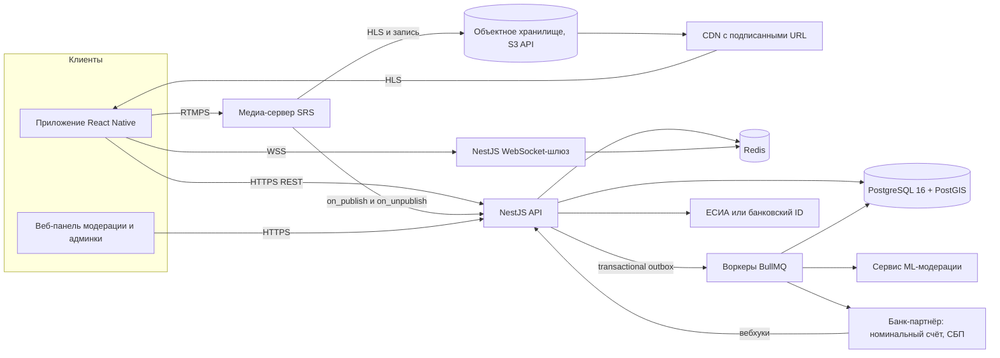
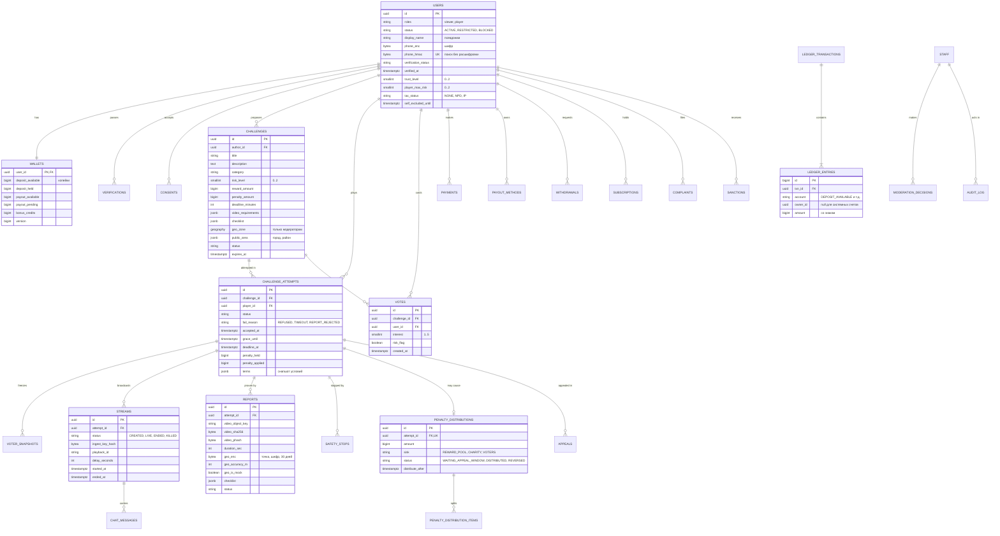
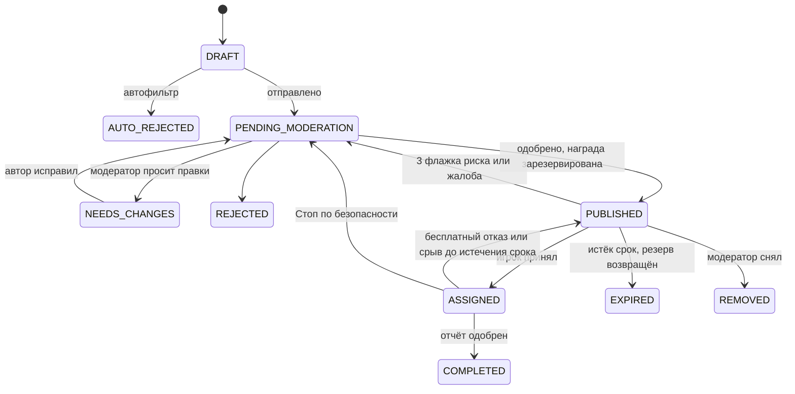
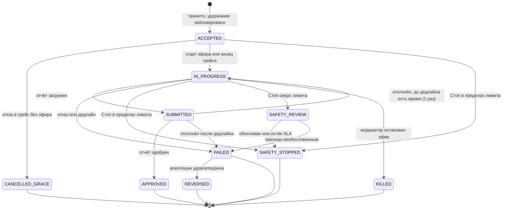

# ТЗ MVP: платформа челленджей «Смелость» (рабочее название)

> Концепт: механика в духе фильма Nerve (2016): зрители предлагают задания,
> игроки выполняют их на камеру за вознаграждение, участие — только с
> депозитом, за отказ или срыв — удержание. Отличие от фильма: риск заданий
> жёстко ограничен, а безопасность игрока важнее любой денежной механики.
>
> Версия 0.1 · 29.10.2026 · статус: черновик для команды и юриста.
> Документ — техническое задание, **не юридическое заключение**. Разделы 2
> и 12 — карта рисков для юриста, а не замена ему. Нормы указаны в действующей
> редакции на дату написания; перед запуском проверить на consultant.ru /
> pravo.gov.ru.

## Содержание

0. [Резюме](#0-резюме)
1. [Продукт: проблема, цели, не-цели, допущения](#1-продукт)
2. [Решения по механике: концепт → MVP](#2-решения-по-механике-концепт--mvp)
3. [Роли и права](#3-роли-и-права)
4. [Модель риска заданий](#4-модель-риска-заданий)
5. [UX/UI: экраны, сценарии, механики безопасности](#5-uxui)
6. [Архитектура](#6-архитектура)
7. [Данные: ER-диаграмма, сущности, состояния, проводки](#7-данные)
8. [API: эндпоинты, DTO, примеры JSON](#8-api)
9. [Алгоритмы (псевдокод)](#9-алгоритмы-псевдокод)
10. [Безопасность](#10-безопасность)
11. [Модерация](#11-модерация)
12. [Юридические риски](#12-юридические-риски)
13. [Roadmap](#13-roadmap)
14. [Метрики успеха](#14-метрики-успеха)
15. [Открытые вопросы](#15-открытые-вопросы)
16. [Чек-лист первых 2 недель](#16-чек-лист-первых-2-недель)
17. [Соответствие обязательным проверкам репозитория](#17-соответствие-обязательным-проверкам-репозитория)
- [Приложение А. Глоссарий](#приложение-а-глоссарий)
- [Приложение Б. Где проверить самостоятельно](#приложение-б-где-проверить-самостоятельно)

---

## 0. Резюме

**Твёрдый вывод.** MVP реализуем на заданном стеке примерно за 5 месяцев до
публичной беты в одном городе. Но три механики концепта в исходном виде
блокируют запуск:

1. **Раздача штрафов голосовавшим зрителям** даёт признаки пари (азартной
   игры без лицензии) и прямо вознаграждает зрителей за провал игрока.
2. **«Стоп без штрафа только при подтверждённой ЧС (112)»** заставляет игрока
   выбирать между деньгами и безопасностью и подталкивает к ложным вызовам.
3. **Хранение балансов и переводы между пользователями на счёте платформы**
   имеют признаки деятельности, которая разрешена только банкам.

ТЗ сохраняет механику концепта, но спорные части включаются переключателями,
и по умолчанию каждый стоит в безопасном положении.

**Аналогия.** Депозит игрока должен работать как залог за прокатный
велосипед: вернул вовремя — залог твой, сломал — из него вычли оговорённую
сумму. Если же залог раздают другим клиентам проката, которые «ставили» на
то, что ты велосипед сломаешь, это уже тотализатор. Ему нужна лицензия, а у
этих клиентов появляется причина подставить тебе подножку.

**Что делать первым:** письменное заключение юриста по схеме денег
(раздел 12.5), выбор банка-партнёра для номинального счёта и способа
подтверждения 18+, ответы на блокирующие открытые вопросы (раздел 15).
Разработка ядра может идти параллельно: схема денег спрятана за
переключателем `penalty.sink`.

---

## 1. Продукт

### 1.1 Проблема и ценность

- **Игрок** хочет зарабатывать на коротких творческих и публичных
  активностях: спеть, сыграть, выполнить городской квест. Сейчас для этого
  нужно растить аудиторию месяцами.
- **Зритель** хочет влиять на контент в реальном времени: предлагать
  задания и смотреть, как их выполняют. Стриминговые донаты дают это
  частично и без гарантии, что задание будет сделано.
- **Риск рынка:** механики «челленджей за деньги» исторически скатываются в
  эскалацию опасности (сюжет Nerve, «игры» с самоповреждением). Продукт
  выживет, только если безопасность встроена в экономику, а не добавлена
  поверх неё.

### 1.2 Цели MVP (измеримые, проверяются через 8 недель после публичной беты)

| # | Цель | Метрика и порог успеха |
|---|---|---|
| G1 | Ни одного вреда здоровью и ни одного правонарушения из-за задания | 0 подтверждённых инцидентов; 100% заданий прошли премодерацию |
| G2 | Честная экономика: удержания — исключение, а не источник дохода | Удержания ≤ 20% завершённых попыток; успешные выполнения ≥ 70% |
| G3 | Игроки получают деньги быстро и предсказуемо | Медиана от одобрения отчёта до зачисления на выплатный баланс ≤ 24 ч; вывод ≤ 48 ч |
| G4 | Зрители остаются | Конверсия «установка → подписка» ≥ 5%; продление подписки на 2-й месяц ≥ 60% |
| G5 | Модерация успевает | Премодерация задания ≤ 2 ч (p90) в рабочие часы; реакция на жалобу «угроза жизни» в эфире ≤ 2 мин (p95) |

Пороги — гипотезы для беты, их уточняют по первым данным.

### 1.3 Не-цели MVP

| Не делаем | Почему |
|---|---|
| Задания с уровнем риска выше L2 (раздел 4) | Основной источник вреда и юридического риска; продукт должен доказать, что работает без них |
| Денежные выплаты зрителям из удержаний | Признаки пари (раздел 12); включается только после заключения юриста и только бонусами |
| Личные сообщения зрителей игрокам | Канал для давления, преследования и выяснения местоположения |
| Задания от конкретного зрителя с его деньгами (спонсорство) | Добавляет отношения «заказчик — исполнитель» и споры; сначала призовой фонд из подписок (P2) |
| Несколько стран и валют | Сначала одна юрисдикция (РФ), один город на бете |
| Собственная биометрическая проверка (селфи против паспорта) | 572-ФЗ; используем ЕСИА или банковскую идентификацию |

### 1.4 Допущения (если неверны — см. раздел 15)

- Оператор — российское юрлицо, пользователи — граждане 18+ в РФ, валюта RUB.
- Все деньги хранятся в **копейках** (`bigint`), никаких float.
- **Вознаграждения платятся из призового фонда**, который пополняется 95%
  подписок (так прочитана фраза концепта «комиссия с подписок 5%»).
  Комиссия с выплат игрокам — 10–15% (параметр `payout_fee_bps`).
- Бета — один город, эфиры только в часы дежурства модераторов.
- Игрок и зритель — одна учётная запись с двумя ролями. Персонал
  (модераторы и админы) — отдельные учётные записи с 2FA.

---

## 2. Решения по механике: концепт → MVP

| # | В концепте | В ТЗ (по умолчанию) | Почему |
|---|---|---|---|
| 1 | Депозит фиксированный 5 000 ₽ | Минимум 5 000 ₽, максимум 15 000 ₽. Свободную часть можно вернуть в любой момент | Ст. 381.1 ГК: обеспечительный платёж возвращается, если обеспеченное обязательство не возникло. Потолок ограничивает финансовый вред |
| 2 | Штраф 30–50% от вознаграждения | **Удержание** (не «штраф»). Ставка **обратно пропорциональна риску**: L0 — 50%, L1 — 40%, L2 — 30%. Не больше свободного депозита; баланс никогда не уходит в минус | Удержание не должно толкать к выполнению рискованного задания любой ценой. Ст. 330, 333 ГК — соразмерность неустойки |
| 3 | Штраф делится между голосовавшими | Получатель задаётся переключателем `penalty.sink`: **`REWARD_POOL`** (по умолчанию — обратно в призовой фонд), `CHARITY`, `VOTERS`. `VOTERS` выключен до письменного заключения юриста; если его включат — только неденежные бонусы на оплату подписки, с лимитом | Признаки пари (244-ФЗ, ст. 171.2 УК, ст. 14.1.1 КоАП). Конфликт интересов: зритель зарабатывает, если игрок провалился |
| 4 | Выход без штрафа — только при ЧС с вызовом 112 | «Стоп» доступен всегда. **Стоп по безопасности — без удержания.** Лимит — 2 остановки за 30 дней без проверки; сверх лимита модератор смотрит запись, а при сомнении решает в пользу игрока. Злоупотребление наказывается ограничением доступа, а не деньгами. Кнопка 112 есть, но не является условием | Иначе финансовое давление в опасной ситуации — ровно сюжет фильма. Требование «вызвать 112» провоцирует ложные вызовы (ст. 19.13 КоАП) |
| 5 | Отказ — штраф сразу | 15 минут после принятия отказ бесплатный, если эфир ещё не начат | Защита от импульсивного решения; меньше споров |
| 6 | `POST /challenges/{id}/fail` | Публичного эндпоинта нет: срыв фиксирует планировщик по дедлайну или модератор | Иначе любой пользователь может «провалить» чужое задание |
| 7 | Списание с `challenge.creator_id` | Отдельная сущность `ChallengeAttempt` с `player_id` | В псевдокоде концепта удержание списывается с **автора задания**, а не с игрока (раздел 9.0) |
| 8 | Баланс в полях `users` | Учёт по двойной записи (ledger) плюс кэш `wallets` с `CHECK ≥ 0` | Аудит, сверка с банком, защита от гонок |
| 9 | Фото документа + селфи-матчинг своими силами | Подтверждение 18+ через Госуслуги (ЕСИА) или банковский ID. Фото документов и биометрию не храним | 572-ФЗ (биометрия), 152-ФЗ ст. 11 |
| 10 | Деньги на счёте платформы | Номинальный счёт (ст. 860.1 ГК) или «безопасная сделка» банка либо платёжного партнёра | 161-ФЗ: переводы денежных средств делают кредитные организации |
| 11 | AWS S3 + CloudFront | Код работает через S3-совместимое API; для РФ — российский облачный провайдер. Код от этого не меняется | 152-ФЗ ст. 18 ч. 5 (локализация баз с ПД граждан РФ). AWS с 2022 г. не принимает новых клиентов из РФ (проверить актуальность) |
| 12 | Гео-метка в ленте | Зрители видят только город и район. Точные координаты видит только модератор, с записью в аудит, хранятся 30 дней. Эфир идёт с задержкой не меньше 30 с | В фильме зрители физически находят игроков |
| 13 | Вознаграждение 3 000–15 000 ₽ без правил | Вознаграждение зависит от сложности, времени и креатива, **но не от риска**; потолок 15 000 ₽ | Эскалация «больше риск — больше денег» — двигатель сюжета фильма |
| 14 | Голос «интерес/риск» | Голос — это интерес (1–5) плюс флажок «кажется опасным». 3 флажка снимают задание на повторную модерацию | Коллективный сигнал риска вместо коллективного давления |
| 15 | — | Не больше 3 принятий в сутки; после удержания — пауза 12 ч; самоограничение по желанию игрока | Против желания «отыграться» |

---

## 3. Роли и права

| Роль | Возможности | Ограничения | Где проверяется |
|---|---|---|---|
| Гость | Описание продукта, правила, документы | Не видит эфиры и ленту | API: без токена — только `/legal/*`, `/plans` |
| Игрок | Лента и карточки заданий, принятие, подготовка, эфир, отчёт, Стоп, кошелёк, вывод (после верификации), апелляции | Верификация 18+ и депозит обязательны. Одна активная попытка. ≤ 3 принятий в сутки. Пауза 12 ч после удержания. Уровень риска открывается опытом (4.5). Нельзя принять задание, которое сам предложил или за которое голосовал; нельзя принять задание связанного аккаунта | Guard ролей и владельца, частичный уникальный индекс (7.5), RLS |
| Зритель | Подписка, каталог эфиров, просмотр, чат, предложение заданий, голосование, жалобы | Подписка обязательна. Голос и предложение — только в пределах своего уровня доверия (4.5). Один голос на задание. ≤ 5 предложений в сутки. Нет личных сообщений игрокам | Guard подписки и уровня доверия, уникальный индекс голосов |
| Модератор | Очереди заданий, отчётов, жалоб и Стопов; остановка эфира; санкции; точная гео с указанием причины | Отдельная учётная запись с 2FA. Не модерирует связанные аккаунты. Каждое действие пишется в аудит. Апелляцию разбирает другой модератор | Guard персонала, проверка `account_links`, аудит |
| Администратор | Тарифы, комиссии, лимиты, правила, ручное подтверждение выплат, метрики, сверка | Изменения `penalty.sink`, комиссий и лимитов — по правилу «двух ключей» (второй администратор подтверждает). 2FA, вход только из allowlist сетей | Guard персонала, таблица `settings_changes` |
| Сервисы (воркеры) | Дедлайны, распределения, выплаты, обработка медиа | Отдельные роли БД; деньги меняет только роль `app_ledger` | Роли PostgreSQL, RLS |

---

## 4. Модель риска заданий

### 4.1 Уровни

| Уровень | Где | С кем | Примеры (допустимо) | Ставка удержания |
|---|---|---|---|---|
| **L0 «Дом»** | Дома или в своём пространстве | Один | Спеть песню на заданном языке; нарисовать портрет зрителя за 10 минут; приготовить блюдо по рецепту из чата; выучить фокус | 50% |
| **L1 «Город»** | Общественные места, открытые для посещения | Без взаимодействия с незнакомцами | Сыграть на уличном пианино; найти и снять 5 памятников за час; станцевать на разрешённой площадке, никому не мешая | 40% |
| **L2 «Люди»** | Общественные места | Взаимодействие с незнакомцами **только с их явного согласия**, без физического контакта | Попросить прохожего научить фразе на его языке (с согласием на съёмку); уличное выступление; собрать 10 автографов для открытки другу | 30% |
| L3+ | — | — | **Запрещено в MVP** | — |

### 4.2 Запрещённые категории (автофильтр + модерация)

Задание отклоняется, если оно требует или допускает:

- угрозу жизни и здоровью: высоту, крыши, краны, воду и лёд, огонь,
  транспорт (дороги, рельсы, вождение, езду «зацепом»), экстремальные
  температуры, лишение сна, поедание и питьё на скорость или в объёме,
  острые и «опасные» продукты, лекарства, алкоголь, никотин, наркотики;
- насилие, оружие (включая игрушечное и муляжи), драки, «пранки» с испугом;
- нарушение закона: кражи (включая «вынести и вернуть»), проникновение на
  закрытую территорию, порчу имущества, граффити, нарушение ПДД, мелкое
  хулиганство, публичные мероприятия, пикеты, политическую и религиозную
  тематику, запрещённую символику;
- вторжение в частную жизнь: съёмку конкретного человека без согласия,
  поиск личных данных, задания «на» знакомого или публичное лицо,
  розыгрыши с обманом посторонних, выдачу себя за сотрудников (полиция,
  охрана, персонал);
- физический контакт с незнакомцами (объятия, поцелуи), сексуальный
  контент, обнажённость;
- самоповреждение, а также задания на страхи игрока или на его личные
  данные (в фильме задания строились на страхах, собранных из соцсетей);
- детей и животных как участников, кроме своих питомцев в бытовой
  ситуации без стресса для животного (L0, по решению модератора);
- финансовые действия: кредиты, ставки, переводы третьим лицам, покупки
  дороже 500 ₽;
- места, где съёмка запрещена законом или правилами владельца (режимные
  объекты, транспортная инфраструктура с запретом, частные помещения без
  разрешения).

### 4.3 Подсказки при формулировке (UX, раздел 5)

| Было | Стало (подсказка) | Почему |
|---|---|---|
| «Залезь на крышу и сними закат» | «Сними закат со смотровой площадки, открытой для посетителей» | Высота → L1 |
| «Поцелуй незнакомца» | «Попроси прохожего научить тебя комплименту на его языке» | Контакт → L2 с согласием |
| «Выйди из магазина в чужой одежде» | «Собери образ из вещей до 1 000 ₽ в секонд-хенде» | Кража → L1 |
| «Проедь на самокате без рук» | «Найди 3 велодорожки и расскажи про каждую» | Транспорт → L1 |

### 4.4 Требования к формулировке задания

- Конкретный результат, который можно проверить по видео (чек-лист из 1–10 пунктов).
- Длительность выполнения от 30 до 1 440 минут.
- Никаких адресов и имён частных лиц в тексте.
- Награда в коридоре уровня; удержание считается автоматически по 4.1.

### 4.5 Уровни доверия

```text
Зритель (может голосовать и предлагать задания уровня ≤ trust_level):
  T0 — новый подписчик                                → L0
  T1 — ≥ 30 дней подписки, 0 нарушений                → L0–L1
  T2 — ≥ 90 дней, ≥ 3 одобренных предложения, 0 нарушений → L0–L2

Игрок (может принимать задания уровня ≤ player_max_risk):
  старт                                               → L0
  ≥ 2 одобренных попытки                              → L1
  ≥ 5 одобренных попыток и 0 нарушений правил         → L2
Подтверждённое нарушение понижает уровень на 1 на 90 дней.
```

---

## 5. UX/UI

### 5.1 Таблица экранов

**Общие (мобильное приложение, React Native)**

| ID | Экран | Ключевые элементы | Безопасность и правила |
|---|---|---|---|
| S01 | Приветствие | Что это, кому, правила в 3 тезисах, 18+ | Маркировка 18+ (436-ФЗ) |
| S02 | Вход | Российский номер → код из SMS | Лимит запросов кода; вход только по российскому номеру или ЕСИА (149-ФЗ в ред. 406-ФЗ) |
| S03 | Документы и согласия | Оферта, политика ПД, правила удержаний, согласие на автоплатёж — **отдельные непредзаполненные чекбоксы**, версия каждого документа | Согласие до любого платежа; версия сохраняется (`consents`) |
| S04 | Подтверждение 18+ | Кнопки «Госуслуги» / «Банк ID», статус проверки | Без подтверждения нельзя внести депозит и принять задание |
| S05 | Профиль и настройки | Псевдоним, уведомления, приватность, самоограничение, удаление аккаунта | Настоящее имя нигде не показывается |
| S06 | Уведомления | Статусы, удержания, выплаты, модерация | — |
| S07 | Поддержка и жалобы | Мои обращения, статусы, SLA | — |

**Игрок**

| ID | Экран | Ключевые элементы | Безопасность и правила |
|---|---|---|---|
| P01 | Онбординг игрока | Как работают депозит, удержание, Стоп; квиз из 3 вопросов на понимание | Без пройденного квиза кнопка «Принять» недоступна |
| P02 | Внесение депозита | Сумма (5 000–15 000 ₽), карта или СБП, итог, ссылка на правила удержаний | Оплата на странице банка (PAN не попадает в приложение) |
| P03 | Кошелёк | Депозит: свободно / заблокировано. Выплатный баланс. История. «Вернуть депозит», «Вывести» | Возврат свободной части депозита — в любой момент |
| P04 | Лента заданий | Фильтры: «рядом», «быстрые», «творческие», уровень. Карточка: награда, удержание, уровень, район, дедлайн | Координаты округляются на устройстве до ~1 км перед запросом |
| P05 | Карточка задания | Описание, требования к видео, чек-лист, награда, удержание, «15 минут на бесплатный отказ». Кнопка «Принять» → подтверждение с суммой удержания | Показывается, почему задание недоступно (уровень, депозит, пауза) |
| P06 | Подготовка | Подтверждение локации (если задание гео), проверка камеры и связи, приватность (размытие лиц, задержка 30–120 с, отключение чата), чек-лист безопасности, таймер, «Отказаться без удержания» (пока идёт грейс) | Чек-лист: «никому не мешаю», «место открыто для посещения», «заряд ≥ 30%» |
| P07 | Эфир | Камера, таймер, статус, индикатор задержки, чат (с фильтром, можно скрыть), **кнопка «Стоп» всегда видна** | Стоп — максимум 2 нажатия; без «стыдящих» формулировок |
| P08 | Стоп | Причины: небезопасно / плохо себя чувствую / против посторонние / попросили полиция или охрана / технический сбой / другое. Отдельно — «Позвонить 112» | 112 — помощь, а не условие. Честный текст про лимит бесплатных Стопов |
| P09 | После Стопа | «Вы в безопасности?»: 112, поддержка, «я в порядке» | Эфир гасится на устройстве сразу, не дожидаясь сервера |
| P10 | Отчёт | Загрузка видео (возобновляемая), предпросмотр, обрезка, подтверждение гео, чек-лист | Метаданные с координатами вырезаются из публичной копии |
| P11 | Результат | «На проверке», прогресс модерации, решение, «Обжаловать» (7 дней) | — |
| P12 | История | Попытки, удержания, основания, апелляции | Каждое удержание со ссылкой на условия попытки (снапшот) |
| P13 | Вывод средств | Реквизиты (карта/СБП на своё имя), налоговый статус (НПД/ИП), сумма, комиссия, итог | Вывод только на реквизиты верифицированного владельца |

**Зритель**

| ID | Экран | Ключевые элементы | Безопасность и правила |
|---|---|---|---|
| V01 | Подписка | Цена, дата следующего списания, **как отменить — до оплаты**, отдельное согласие на автоплатёж | Без пробного периода; первое списание сразу |
| V02 | Каталог эфиров | Фильтры: категория, город, рейтинг; превью-нарезки | Только город и район, без карты |
| V03 | Плеер | Видео с задержкой, чат, реакции, «Пожаловаться» | Чат блокирует адреса, телефоны, «где ты», побуждение к опасному |
| V04 | Предложить задание | Категория, уровень (только доступные), описание, требования, награда в коридоре; подсказки безопасных формулировок по мере ввода | Автофильтр до отправки (`/challenges/precheck`) |
| V05 | Мои предложения | Статусы модерации, причины отказа, правки | — |
| V06 | Голосование | Карточки опубликованных заданий, интерес 1–5, флажок «кажется опасным» | Только задания уровня ≤ уровня доверия |
| V07 | Управление подпиской | Отмена автопродления в 2 нажатия, история списаний | Отменить так же просто, как подписаться |
| V08 | Бонусы | Только если включён `VOTERS`: бонусы на оплату подписки | Неденежные, не выводятся |

**Модератор и администратор (веб-панель, React)**

| ID | Экран | Ключевые элементы |
|---|---|---|
| M01 | Очереди | Задания, отчёты, жалобы, ревью Стопов, апелляции; SLA-таймеры; приоритет по оценке ML |
| M02 | Задание на модерации | Текст, срабатывания автофильтра, оценка ML, история автора, решение, уровень, награда, гео-зона, публичный район |
| M03 | Проверка отчёта | Видео, чек-лист, гео на карте с точностью, дубли по perceptual hash, решение |
| M04 | Live-стена | Сетка эфиров, алерты ML и жалоб, «Остановить эфир» |
| M05 | Пользователь | История, связанные аккаунты, санкции, уровень доверия |
| A01 | Настройки | Комиссии, лимиты, тарифы, `penalty.sink`; критичные изменения — с подтверждением второго админа |
| A02 | Финансы | Фонды, выплаты на ручное подтверждение, ежедневная сверка с банком |
| A03 | Метрики | Раздел 14 |
| A04 | Аудит | Журнал действий персонала, фильтры, экспорт |

### 5.2 Сценарии

**Игрок: первый успешный цикл**

1. S01 → S02 (вход) → S03 (согласия) → S04 (Госуслуги, 18+) → P01 (онбординг, квиз).
2. P02: вносит 5 000 ₽ через СБП → банк присылает вебхук → баланс обновляется по WebSocket.
3. P04 → P05: задание L0 с наградой 3 000 ₽ и удержанием 1 500 ₽ → «Принять» → подтверждение.
4. Сервер блокирует 1 500 ₽ депозита и запускает грейс 15 минут и дедлайн.
5. P06 → P07: эфир (необязателен, если задание его не требует) → P10: загружает видео, отмечает чек-лист.
6. Модератор одобряет (M03) → игроку зачисляется 3 000 ₽ − 12% = 2 640 ₽, блокировка снимается.
7. P13: вывод на свою карту через СБП (самозанятый — чек в «Мой налог»).

**Игрок: отказ, срыв, Стоп**

- Отказ в течение 15 минут без эфира → блокировка снята, задание вернулось в ленту.
- Отказ после грейса → удержание по правилам, право апелляции 7 дней.
- Дедлайн прошёл, отчёта нет → удержание (если в окне попытки был сбой платформы, дедлайн один раз продлевается).
- Стоп по безопасности → эфир погашен, удержания нет (в пределах лимита), задание уходит на повторную модерацию.

**Зритель**

1. V01: подписка 499 ₽ (оплата сразу) → V02 → V03: смотрит, пишет в чат, жалуется при необходимости.
2. V04: предлагает задание → автофильтр подсказывает формулировку → отправка → V05: статус.
3. V06: голосует; флажок «кажется опасным» → при 3 флажках задание снимается и уходит на повторную модерацию.
4. V07: отменяет автопродление в 2 нажатия; доступ сохраняется до конца оплаченного периода.

**Модератор**

1. M01 → M02: одобряет задание, задаёт уровень, награду и гео-зону → задание опубликовано.
2. M04: ML-алерт «дорога в кадре» → смотрит → «Остановить эфир» → игроку уходит запрос «Вы в безопасности?».
3. M03: проверяет отчёт; при гео-несоответствии смотрит карту и точность. Решение не принимается автоматически.

### 5.3 Механики безопасности в интерфейсе

- **Кнопка «Стоп»**: на экранах P06 и P07 всегда в зоне большого пальца, 1
  нажатие и 1 подтверждение, без удержания кнопки. В пределах лимита нет
  текста про деньги. Сверх лимита текст честный: «Удержание заморозится до
  проверки. Если остановка была из-за безопасности — сумму вернём».
- **Автоотмена без удержания**: потеря связи больше 3 минут ставит таймер
  на паузу; больше 15 минут — попытка отменяется без удержания (с учётом
  лимита). Эфиры с L1/L2 — только с 10:00 до 22:00 по местному времени.
  Новые эфиры не стартуют, если на смене нет дежурного модератора.
- **Подсказки**: в форме предложения — подсказки безопасных формулировок по
  мере ввода (4.3); перед эфиром — чек-лист безопасности.
- **Приватность эфира**: задержка 30–120 с, размытие лиц прохожих (P1),
  только город и район в карточке, чат можно скрыть.
- **Против давления**: чат скрывает «слабо?», «залезь выше», «давай
  быстрее»; повтор ведёт к страйку. Таймер спокойный, без мигания.
- **Против «отыграться»**: пауза 12 ч после удержания, ≤ 3 принятий в
  сутки, самоограничение на 7/30/90 дней.
- **Терминология**: «удержание из депозита», «залог», «вознаграждение»,
  «задание». Не используются «штраф», «ставка», «выигрыш», «пари» — и в
  интерфейсе, и в документах.

---

## 6. Архитектура

### 6.1 Компоненты



### 6.2 Стек

| Слой | Выбор | Комментарий |
|---|---|---|
| Мобильный клиент | React Native (Expo, prebuild), TypeScript strict | Нативные модули: RTMP-публикация (HaishinKit для iOS, RootEncoder для Android), камера, геолокация с признаком mock, Keychain/Keystore, App Attest / Play Integrity |
| Веб-панель | React + Vite, TypeScript | Отдельный домен, 2FA, allowlist сетей |
| API | NestJS (Node.js LTS), TypeScript strict | Модули — 6.3; валидация DTO через class-validator; OpenAPI из кода |
| Доступ к БД | Kysely поверх node-postgres | Явные транзакции, `SET LOCAL` для RLS, `SELECT … FOR UPDATE` |
| БД | PostgreSQL 16 + PostGIS | RLS + FORCE на каждой таблице (10.4) |
| Кэш и очереди | Redis 7, BullMQ | Rate limit, presence, pub/sub для WebSocket, отложенные задачи |
| Видео | SRS (ingest RTMPS) → ffmpeg (ABR 720p/480p/360p) → HLS → CDN | Задержка 30–120 с — намеренно; запись в хранилище для модерации и споров |
| Хранилище | S3-совместимое API (в концепте — AWS S3 + CloudFront; для РФ — российский провайдер) | Приватные бакеты, только presigned URL |
| Push | FCM / APNs, RuStore Push как резерв | Без ПД в тексте push |
| Наблюдаемость | OpenTelemetry, Prometheus, Grafana, Sentry (self-hosted) | Логи без ПД и секретов (10.7) |

### 6.3 Модули NestJS

`auth`, `users`, `verification`, `consents`, **`ledger`** (единственный
модуль с ролью БД `app_ledger`), `wallet`, `payments`, `payouts`,
`challenges`, `autofilter`, `moderation`, `attempts` (машина состояний),
`streams`, `reports`, `votes`, `penalties`, `subscriptions`, `chat`,
`complaints`, `notifications`, `admin`, `audit`, `outbox`.

Воркеры: грейс и дедлайны, распределение удержаний после окна апелляции,
обработка видео (транскодинг, превью, perceptual hash, вырезание
метаданных), ML-оценка, отправка выплат, ежедневная сверка, очистка по
срокам хранения (гео — 30 дней, записи эфиров — 90 дней без спора).

### 6.4 Видео

- Игрок получает адрес ingest и **одноразовый ключ эфира** при
  `POST /attempts/{id}/streams`. Ключ показывается один раз; в БД хранится
  только его хэш. Ключ не пишется в логи (ни URL, ни заголовки).
- Только RTMPS (RTMP поверх TLS): в обычном RTMP ключ идёт открытым текстом.
- `on_publish`: медиа-сервер спрашивает API, разрешён ли эфир. API
  сравнивает хэш ключа за постоянное время, проверяет статус попытки,
  игрока, окно эфиров и наличие дежурного модератора.
- Kill switch: `POST /mod/streams/{id}/kill` → API → медиа-сервер рвёт
  сессию → клиенту уходит событие `stream.status=KILLED`.
- Зрители получают HLS по подписанному URL CDN (TTL 5 минут, продлевается
  с сервера, пока жива подписка).

### 6.5 WebSocket

- Socket.IO с Redis-адаптером, токен доступа проверяется при подключении.
- Комнаты: `stream:{id}` (подписчики), `attempt:{id}` (владелец и персонал),
  `user:{id}` (только владелец), `staff` (персонал). **Каждый вход в
  комнату проверяется на сервере**; чужая комната — отказ.
- Сервер → клиент: `stream.status`, `chat.message`, `chat.hidden`,
  `attempt.status`, `attempt.timer {deadlineAt, serverNow}`,
  `wallet.updated`, `mod.alert`.
- Клиент → сервер: `chat.send {streamId, text, clientMsgId}` (1 сообщение
  в 3 с, slow mode по решению модератора), `reaction.send`.
- События не содержат координат.

### 6.6 Окружения

`dev` → `stage` (sandbox банка и провайдера идентификации, тестовые
телефоны) → `prod`. Секреты — только в менеджере секретов облака; у каждого
окружения свои. Миграции БД — в CI, с проверкой, что у каждой таблицы
включены RLS и FORCE (10.4).

---

## 7. Данные

### 7.1 ER-диаграмма



### 7.2 Сущности

| Сущность | Ключевые поля | Примечания и отличия от концепта |
|---|---|---|
| `users` | см. ER | Балансов здесь нет (концепт: `deposit_balance`, `payout_balance` → `wallets` + ledger). Телефон зашифрован, поиск по HMAC |
| `staff` | id, role (`moderator`/`admin`), totp/webauthn, allowed_networks | Персонал отделён от клиентских аккаунтов |
| `wallets` | балансы в копейках, `version` | Кэш над ledger; меняется только в той же транзакции, что и проводка |
| `ledger_transactions` / `ledger_entries` | txn: kind, ref_type, ref_id, created_at; entries: account, owner_id, amount | Двойная запись: сумма по транзакции = 0 |
| `verifications` | provider, status, external_ref, is_adult, checked_at | Без фото документов и биометрии |
| `consents` | user_id, doc_type, doc_version, accepted_at, ip_hmac, user_agent | Доказательство явного согласия до депозита и подписки |
| `challenges` | см. ER | `creator_id` → `author_id`; кто выполняет — в `challenge_attempts` |
| `challenge_attempts` | см. ER | Новая сущность: исправляет ошибку концепта (удержание с автора) |
| `voter_snapshots` | attempt_id, user_id, interest, voted_at | Голоса, замороженные в момент принятия (нужны только для `VOTERS`) |
| `votes` | см. ER | `value` → `interest` + `risk_flag` |
| `streams` | см. ER | `rtmp_url` с ключом не хранится — только хэш ключа и `playback_id` |
| `reports` | см. ER | `stream_id` → `attempt_id` (отчёт возможен без эфира) |
| `safety_stops` | attempt_id, reason, comment, review_status, decided_by | Новая сущность |
| `penalty_distributions` / `_items` | см. ER; items: user_id, amount | `UNIQUE(attempt_id)` — повторное удержание невозможно |
| `appeals` | attempt_id, kind, status, first_moderator_id, second_moderator_id | Второй модератор ≠ первый |
| `payments` | type, amount, provider, provider_payment_id `UNIQUE`, status, idempotency_key | Вебхук идемпотентен по `provider_payment_id` / id события |
| `payout_methods` | user_id, type (card/SBP), masked, bank_token, holder_name_match | Токен банка, не номер карты |
| `withdrawals` | user_id, amount, payout_method_id, status, tax_mode | — |
| `plans` / `subscriptions` | price, period / status, current_period_end, auto_renew, recurring_consent_id | — |
| `chat_messages` | stream_id, user_id, body, status, created_at | Хранение по требованиям ОРИ (12.2) |
| `complaints` | reporter_id, target_type, target_id, reason, priority, sla_due_at, status | — |
| `moderation_decisions` | target_type, target_id, source (rule/ml/human), score, decision, reason_code, staff_id | — |
| `sanctions` | user_id, type, until, reason_code, staff_id | — |
| `account_links` | user_a, user_b, signal (device, card, phone, IP-подсеть), strength | Антифрод, конфликт интересов |
| `idempotency_keys` | user_id, scope, key, response_hash, created_at | `UNIQUE(user_id, scope, key)` |
| `outbox` | topic, payload, created_at, sent_at | Задачи ставятся в той же транзакции, что и изменение |
| `audit_log` | actor, action, target, reason, ip_hmac, created_at | Только INSERT; UPDATE и DELETE запрещены правами |
| `settings` / `settings_changes` | key, value / proposed_by, approved_by | Правило «двух ключей» |

### 7.3 Состояния

**Задание**



**Попытка**



`KILLED`: вознаграждения нет, удержания нет, санкция по тяжести нарушения
(11.6). Удержание за остановку модератором создало бы стимул продолжать
опасное действие, лишь бы не остановили.

### 7.4 Проводки

| Операция | Откуда | Куда | Сумма |
|---|---|---|---|
| Пополнение депозита (вебхук банка) | `EXTERNAL_BANK` | `DEPOSIT_AVAILABLE(u)` | amount |
| Принятие задания | `DEPOSIT_AVAILABLE(p)` | `DEPOSIT_HELD(p)` | penalty |
| Бесплатный отказ / Стоп / одобрение отчёта | `DEPOSIT_HELD(p)` | `DEPOSIT_AVAILABLE(p)` | penalty_held |
| Удержание | `DEPOSIT_HELD(p)` | `PENALTY_CLEARING` | penalty |
| Распределение после окна апелляции | `PENALTY_CLEARING` | `PRIZE_FUND` / `CHARITY_PAYABLE` / `BONUS_CREDITS(v)` | по sink |
| Апелляция удовлетворена (до распределения) | `PENALTY_CLEARING` | `DEPOSIT_AVAILABLE(p)` | penalty |
| Оплата подписки | `EXTERNAL_BANK` | `PLATFORM_REVENUE` 5% + `PRIZE_FUND` 95% | price |
| Публикация задания | `PRIZE_FUND` | `PRIZE_FUND_RESERVED` | reward |
| Истечение или снятие задания | `PRIZE_FUND_RESERVED` | `PRIZE_FUND` | reward |
| Одобрение отчёта | `PRIZE_FUND_RESERVED` | `PAYOUT_AVAILABLE(p)` (reward − fee) + `PLATFORM_REVENUE` (fee) | reward |
| Заявка на вывод | `PAYOUT_AVAILABLE(u)` | `PAYOUT_PENDING(u)` | amount |
| Вывод исполнен / отклонён | `PAYOUT_PENDING(u)` | `EXTERNAL_BANK` / `PAYOUT_AVAILABLE(u)` | amount |
| Возврат депозита | `DEPOSIT_AVAILABLE(u)` | `EXTERNAL_BANK` | amount |

Сверка раз в сутки: сумма клиентских счетов и фондов в ledger равна
остатку номинального счёта по выписке банка. Расхождение — алерт и
остановка выплат до разбора.

**Пример юнит-экономики (допущения, не прогноз).** 1 000 подписчиков ×
499 ₽ = 499 000 ₽: платформе 5% = 24 950 ₽, в призовой фонд 474 050 ₽ ≈
47 заданий по 10 000 ₽. Комиссия 12% с выплат = 56 886 ₽. Итого ≈ 81 800 ₽
в месяц до эквайринга, налогов и модерации. Каждое задание проходит две
ручные проверки (задание и отчёт), плюс дежурство на эфирах, поэтому **на
малой базе модерация дороже выручки**. Точку безубыточности посчитать по
реальным ставкам банка и стоимости смены модератора.

### 7.5 Инварианты в БД

```sql
create table wallets (
  user_id           uuid primary key references users(id),
  deposit_available bigint not null default 0 check (deposit_available >= 0),
  deposit_held      bigint not null default 0 check (deposit_held >= 0),
  payout_available  bigint not null default 0 check (payout_available >= 0),
  payout_pending    bigint not null default 0 check (payout_pending >= 0),
  bonus_credits     bigint not null default 0 check (bonus_credits >= 0),
  version           bigint not null default 0
);

-- Одна активная попытка у игрока и одна у задания
create unique index one_active_attempt_per_player on challenge_attempts (player_id)
  where status in ('ACCEPTED', 'IN_PROGRESS', 'SUBMITTED', 'SAFETY_REVIEW');
create unique index one_active_attempt_per_challenge on challenge_attempts (challenge_id)
  where status in ('ACCEPTED', 'IN_PROGRESS', 'SUBMITTED', 'SAFETY_REVIEW');

create unique index one_vote_per_user        on votes (challenge_id, user_id);
create unique index one_penalty_per_attempt  on penalty_distributions (attempt_id);
create unique index one_idempotency_key      on idempotency_keys (user_id, scope, key);
create unique index one_provider_payment     on payments (provider, provider_payment_id);

-- Удержание не больше награды и соответствует уровню
alter table challenges add constraint penalty_le_half_reward
  check (penalty_amount * 2 <= reward_amount);
alter table challenges add constraint reward_in_range
  check (reward_amount between 300000 and 1500000);

-- Сбалансированность проводки: отложенный constraint trigger
-- проверяет sum(amount) = 0 по txn_id в момент COMMIT.
```

---

## 8. API

### 8.1 Соглашения

- Базовый путь `/api/v1`. JSON, UTF-8, время — ISO 8601 UTC, деньги —
  целые копейки.
- Аутентификация: `Authorization: Bearer <access>` (JWT, 15 мин) плюс
  refresh-токен (30 дней, ротация при каждом использовании; повторное
  использование старого refresh отзывает все сессии устройства).
- **Идентификатор пользователя никогда не берётся из URL или тела запроса**
  — только из токена (`/me/...`). Вместо концептного `POST /api/users/deposit`
  — `POST /api/v1/me/deposit`.
- **Объект с чужим владельцем → `404 Not Found`** (а не 403), чтобы не
  подтверждать его существование.
- Все денежные POST требуют заголовок `Idempotency-Key` (UUID). Повтор с
  тем же ключом возвращает сохранённый ответ; тот же ключ с другим телом —
  `422`.
- Ошибки — RFC 9457 (`application/problem+json`) с полем `code`.
- Пагинация курсором: `?cursor=…&limit=20` (максимум 100).
- Rate limit: Redis token bucket на пользователя и IP; ответ `429` с
  `Retry-After`.

### 8.2 Эндпоинты

Колонка «Владелец» — что сервер проверяет помимо роли; ✔ в колонке «Идемп.»
— нужен `Idempotency-Key`.

**Вход и профиль**

| Метод | Путь | Кто | Владелец | Идемп. |
|---|---|---|---|---|
| POST | `/auth/otp` | гость | — (лимит на номер и IP) | |
| POST | `/auth/otp/verify` | гость | код привязан к номеру | |
| POST | `/auth/refresh` | любой | refresh принадлежит устройству | |
| POST | `/auth/logout` | любой | своя сессия | |
| GET | `/me` | любой | из токена | |
| DELETE | `/me` | любой | из токена; отказ, если есть активная попытка или деньги на балансах | |
| POST | `/me/verification` | любой | из токена | |
| GET | `/legal/documents` | все | — | |
| POST | `/me/consents` | любой | из токена | ✔ |

**Кошелёк и платежи**

| Метод | Путь | Кто | Владелец | Идемп. | В концепте |
|---|---|---|---|---|---|
| GET | `/me/wallet` | любой | из токена | | |
| GET | `/me/ledger` | любой | из токена | | |
| POST | `/me/deposit` | игрок (верифицирован, согласия приняты) | из токена | ✔ | `POST /api/users/deposit` |
| GET | `/me/payments/{id}` | любой | платёж свой, иначе 404 | | |
| POST | `/me/deposit/refund` | игрок | из токена; ≤ свободного депозита | ✔ | |
| GET, POST | `/me/payout-methods` | игрок | из токена | ✔ | |
| DELETE | `/me/payout-methods/{id}` | игрок | реквизиты свои, иначе 404 | | |
| POST | `/me/withdrawals` | игрок | `payoutMethodId` свой, иначе 404 | ✔ | `POST /api/payments/withdraw` |
| GET | `/me/withdrawals/{id}` | игрок | своя заявка, иначе 404 | | |

**Задания и голоса**

| Метод | Путь | Кто | Владелец | Идемп. | В концепте |
|---|---|---|---|---|---|
| GET | `/challenges` | игрок, зритель | видны только `PUBLISHED`; гео — только район | | `GET /api/challenges?geo=…` |
| GET | `/challenges/{id}` | аутентифицированный | `PUBLISHED`, или автор, или персонал; иначе 404 | | |
| POST | `/challenges/precheck` | зритель | — | | |
| POST | `/challenges` | зритель с подпиской | автор = из токена; уровень ≤ доверия | ✔ | |
| GET | `/me/challenges` | зритель | из токена | | |
| PATCH | `/challenges/{id}` | автор | автор и статус `DRAFT`/`NEEDS_CHANGES`; иначе 404/409 | | |
| DELETE | `/challenges/{id}` | автор | автор и статус до `PUBLISHED`; иначе 404/409 | | |
| PUT | `/challenges/{id}/vote` | зритель с подпиской | голос от имени токена; уровень доверия ≥ уровня задания | по природе | |
| DELETE | `/challenges/{id}/vote` | зритель | свой голос | | |
| POST | `/challenges/{id}/accept` | игрок | создаёт попытку от имени токена (9.1–9.2) | ✔ | `POST /api/challenges/{id}/accept` |

**Попытки, эфир, отчёт**

| Метод | Путь | Кто | Владелец | Идемп. | В концепте |
|---|---|---|---|---|---|
| GET | `/me/attempts` | игрок | из токена | | |
| GET | `/attempts/{id}` | владелец, персонал | попытка своя, иначе 404 | | |
| POST | `/attempts/{id}/cancel` | владелец | своя, иначе 404 | ✔ | |
| POST | `/attempts/{id}/safety-stop` | владелец | своя, иначе 404 | ✔ | |
| POST | `/attempts/{id}/streams` | владелец | своя; статус `ACCEPTED`/`IN_PROGRESS` | ✔ | `POST /api/streams` |
| POST | `/streams/{id}/end` | владелец | эфир своей попытки | | |
| POST | `/attempts/{id}/report/uploads` | владелец | своя; ключ объекта генерирует сервер | | |
| POST | `/attempts/{id}/report` | владелец | своя; `uploadId` своей попытки | ✔ | `POST /api/reports` |
| POST | `/attempts/{id}/appeal` | владелец | своя; ≤ 7 дней после решения | ✔ | |

`POST /api/challenges/{id}/fail` из концепта **убран из публичного API**:
срыв по дедлайну фиксирует воркер (9.5), иначе — модератор через
`/mod/attempts/{id}/fail`.

**Эфиры, подписка, жалобы**

| Метод | Путь | Кто | Владелец | Идемп. |
|---|---|---|---|---|
| GET | `/streams` | подписчик | только `LIVE`, не скрытые | |
| GET | `/streams/{id}` | подписчик | `LIVE` и не скрыт; иначе 404 | |
| GET | `/streams/{id}/playback` | подписчик | подписанный URL CDN, 5 минут | |
| GET | `/plans` | все | — | |
| POST | `/me/subscription` | любой | из токена; согласие на автоплатёж | ✔ |
| GET | `/me/subscription` | любой | из токена | |
| DELETE | `/me/subscription` | любой | из токена (отмена автопродления) | |
| POST | `/complaints` | любой | автор = из токена | ✔ |
| GET | `/me/complaints/{id}` | любой | своя жалоба, иначе 404 | |

**Модерация (персонал, 2FA)**

| Метод | Путь | Проверки |
|---|---|---|
| GET | `/mod/queue?type=challenge\|report\|complaint\|safety_stop\|appeal` | роль `moderator` |
| POST | `/mod/challenges/{id}/decision` | автор не связан с модератором |
| POST | `/mod/reports/{id}/decision` | игрок не связан с модератором |
| POST | `/mod/streams/{id}/kill` | роль `moderator` |
| POST | `/mod/safety-stops/{id}/decision` | при сомнении — в пользу игрока |
| POST | `/mod/attempts/{id}/fail` | обязательная причина; аудит |
| POST | `/mod/appeals/{id}/decision` | модератор ≠ принявшему исходное решение |
| POST | `/mod/users/{id}/sanctions` | обязательная причина; аудит |
| GET | `/mod/attempts/{id}/precise-geo` | обязательная причина; аудит; доступ на 15 минут |

**Администрирование**

| Метод | Путь | Проверки |
|---|---|---|
| GET | `/admin/settings` | роль `admin` |
| POST | `/admin/settings/changes` | создаёт предложение изменения |
| POST | `/admin/settings/changes/{id}/approve` | второй админ ≠ инициатору |
| POST | `/admin/withdrawals/{id}/approve` | роль `admin` |
| GET | `/admin/metrics`, `/admin/audit`, `/admin/reconciliation` | роль `admin` |

**Вебхуки (сервер — сервер)**

| Метод | Путь | Проверки |
|---|---|---|
| POST | `/webhooks/payments/{provider}` | HMAC-подпись, сравнение за постоянное время, метка времени ± 5 мин, идемпотентность по id события |
| POST | `/webhooks/verification/{provider}` | то же |
| POST | `/webhooks/media/on_publish`, `/on_unpublish` | общий секрет или mTLS; доступ только из сети медиа-сервера |

### 8.3 DTO (TypeScript, class-validator)

```ts
// Деньги — целые копейки. 5 000 ₽ = 500000.
export class CreateDepositDto {
  @IsInt() @Min(500_000) @Max(1_500_000) amount!: number;
  @IsIn(['CARD', 'SBP']) method!: 'CARD' | 'SBP';
  @IsString() consentVersion!: string;        // версия принятых правил удержаний
}

export class WalletDto {
  depositAvailable!: number;
  depositHeld!: number;
  payoutAvailable!: number;
  payoutPending!: number;
  bonusCredits!: number;
  currency!: 'RUB';
}

export class ProposeChallengeDto {
  @IsString() @Length(5, 80) title!: string;
  @IsString() @Length(20, 1000) description!: string;
  @IsIn(CATEGORIES) category!: Category;
  @IsInt() @Min(0) @Max(2) riskLevel!: 0 | 1 | 2;
  @IsInt() @Min(300_000) @Max(1_500_000) rewardAmount!: number; // удержание считает сервер
  @IsInt() @Min(30) @Max(1440) deadlineMinutes!: number;
  @ValidateNested() @Type(() => VideoRequirementsDto) videoRequirements!: VideoRequirementsDto;
  @IsArray() @ArrayMinSize(1) @ArrayMaxSize(10) @IsString({ each: true }) checklist!: string[];
  @IsOptional() @ValidateNested() @Type(() => GeoZoneDto) geoZone?: GeoZoneDto; // GeoJSON Polygon, ≤ 2 км²
}

export class ChallengeCardDto {
  id!: string;
  title!: string;
  category!: Category;
  riskLevel!: 0 | 1 | 2;
  rewardAmount!: number;
  penaltyAmount!: number;
  deadlineMinutes!: number;
  area!: { city: string; district: string | null };   // без координат
  distanceKm!: number | null;                          // округлено до 0,5 км
  tags!: string[];
  votes!: { count: number; interestAvg: number };
  expiresAt!: string;
}

export class AcceptChallengeResponseDto {
  attemptId!: string;
  status!: 'ACCEPTED';
  graceUntil!: string;
  deadlineAt!: string;
  penaltyHeld!: number;
  wallet!: WalletDto;
}

export class SafetyStopDto {
  @IsIn(['UNSAFE_ENVIRONMENT', 'FEEL_UNWELL', 'THIRD_PARTY_OBJECTS',
         'ASKED_BY_AUTHORITIES', 'TECHNICAL', 'OTHER'])
  reason!: SafetyStopReason;
  @IsOptional() @IsString() @MaxLength(500) comment?: string;
}

export class SubmitReportDto {
  @IsString() uploadId!: string;
  @IsInt() @Min(5) @Max(1800) durationSec!: number;
  @IsOptional() @ValidateNested() @Type(() => ReportGeoDto) geo?: ReportGeoDto;
  @IsArray() @ValidateNested({ each: true }) @Type(() => ChecklistItemDto) checklist!: ChecklistItemDto[];
  @IsString() deviceAttestation!: string;      // Play Integrity / App Attest, проверяется на сервере
}

export class ReportGeoDto {
  @IsLatitude() lat!: number;
  @IsLongitude() lon!: number;
  @IsInt() @Min(0) accuracyM!: number;
  @IsISO8601() capturedAt!: string;
  @IsBoolean() isMock!: boolean;
}

export class VoteDto {
  @IsInt() @Min(1) @Max(5) interest!: number;
  @IsBoolean() riskFlag!: boolean;
}

export class CreateWithdrawalDto {
  @IsInt() @Min(50_000) amount!: number;
  @IsUUID() payoutMethodId!: string;
}
```

### 8.4 Примеры запросов и ответов

**Внесение депозита**

```http
POST /api/v1/me/deposit
Authorization: Bearer <access>
Idempotency-Key: 6f1c2d0e-3b7a-4c55-9a43-0c1b7e2f9d10
Content-Type: application/json

{ "amount": 500000, "method": "SBP", "consentVersion": "deposit-rules-2026-10" }
```

```json
{
  "paymentId": "pay_01JC3P4Q7R",
  "status": "PENDING",
  "confirmationUrl": "https://pay.bank-partner.example/checkout/01JC3P4Q7R",
  "wallet": { "depositAvailable": 0, "depositHeld": 0, "payoutAvailable": 0,
              "payoutPending": 0, "bonusCredits": 0, "currency": "RUB" }
}
```

После вебхука банка клиент получает `wallet.updated` по WebSocket, а
`GET /me/payments/pay_01JC3P4Q7R` возвращает `"status": "SUCCEEDED"`.

**Лента заданий**

```http
GET /api/v1/challenges?near=55.79,49.13&radiusKm=5&level=0,1&tag=quick&limit=20
```

```json
{
  "items": [
    {
      "id": "ch_01JC3Q8ZK5",
      "title": "Сыграй мелодию на уличном пианино",
      "category": "CREATIVE",
      "riskLevel": 1,
      "rewardAmount": 600000,
      "penaltyAmount": 240000,
      "deadlineMinutes": 120,
      "area": { "city": "Казань", "district": "Вахитовский" },
      "distanceKm": 1.5,
      "tags": ["quick", "creative"],
      "votes": { "count": 37, "interestAvg": 4.3 },
      "expiresAt": "2026-11-05T18:00:00Z"
    }
  ],
  "nextCursor": "eyJpZCI6ImNoXzAxSkMzUThaSzUifQ"
}
```

Координаты в запросе округлены клиентом до двух знаков (~1 км), сервер их
не логирует и не сохраняет.

**Принятие задания: успех и отказ**

```http
POST /api/v1/challenges/ch_01JC3Q8ZK5/accept
Idempotency-Key: 0b8e7c1a-9d2f-4e61-8a77-5c3d2b1f0e99
```

```json
{
  "attemptId": "at_01JC3R2M7Q",
  "status": "ACCEPTED",
  "graceUntil": "2026-11-02T12:15:00Z",
  "deadlineAt": "2026-11-02T14:00:00Z",
  "penaltyHeld": 240000,
  "wallet": { "depositAvailable": 260000, "depositHeld": 240000, "payoutAvailable": 0,
              "payoutPending": 0, "bonusCredits": 0, "currency": "RUB" }
}
```

```json
{
  "type": "https://api.example.ru/errors/insufficient-deposit",
  "title": "Недостаточно свободного депозита",
  "status": 409,
  "code": "INSUFFICIENT_DEPOSIT",
  "required": 240000,
  "available": 150000
}
```

Другие коды `409`/`403`: `VERIFICATION_REQUIRED`, `CONSENT_REQUIRED`,
`ACTIVE_ATTEMPT_EXISTS`, `RISK_LEVEL_LOCKED`, `COOLDOWN_ACTIVE`,
`DAILY_LIMIT_REACHED`, `SELF_EXCLUDED`, `CONFLICT_OF_INTEREST`,
`CHALLENGE_UNAVAILABLE`.

**Стоп по безопасности**

```http
POST /api/v1/attempts/at_01JC3R2M7Q/safety-stop
Idempotency-Key: 3a0f…
{ "reason": "UNSAFE_ENVIRONMENT", "comment": "Рядом начали ремонт дороги" }
```

```json
{
  "status": "SAFETY_STOPPED",
  "penaltyApplied": 0,
  "holdReleased": 240000,
  "freeStopsLeft30d": 1,
  "help": { "emergency": "112", "supportChat": "/support/new?topic=safety" }
}
```

Сверх лимита: `"status": "SAFETY_REVIEW"`, `"holdFrozen": 240000`,
`"reviewDueAt": "…"` — удержание заморожено, но не списано.

**Отчёт**

```http
POST /api/v1/attempts/at_01JC3R2M7Q/report
Idempotency-Key: 9c41…
{
  "uploadId": "up_01JC3S5T1V",
  "durationSec": 74,
  "geo": { "lat": 55.7903, "lon": 49.1347, "accuracyM": 12,
           "capturedAt": "2026-11-02T13:21:05Z", "isMock": false },
  "checklist": [ { "itemId": "c1", "done": true }, { "itemId": "c2", "done": true } ],
  "deviceAttestation": "<токен Play Integrity или App Attest>"
}
```

```json
{ "reportId": "rp_01JC3S9W2X", "status": "PROCESSING", "attemptStatus": "SUBMITTED" }
```

**Предложение задания, отклонённое автофильтром**

```json
{
  "type": "https://api.example.ru/errors/unsafe-challenge",
  "title": "Задание нарушает правила безопасности",
  "status": 422,
  "code": "UNSAFE_CHALLENGE",
  "reasons": [ { "category": "HEIGHT", "fragment": "залезь на крышу" } ],
  "suggestions": [ "Сними закат со смотровой площадки, открытой для посетителей" ],
  "appeal": "Если фильтр ошибся, отправьте задание на ручную проверку"
}
```

**Решение модератора по заданию**

```json
{
  "decision": "APPROVE",
  "riskLevel": 1,
  "rewardAmount": 600000,
  "deadlineMinutes": 120,
  "geoZone": { "type": "Polygon", "coordinates": [[[49.120,55.785],[49.140,55.785],[49.140,55.795],[49.120,55.795],[49.120,55.785]]] },
  "publicArea": { "city": "Казань", "district": "Вахитовский" },
  "note": "Уточнил: только пианино в сквере, не в ТЦ"
}
```

**Вывод средств**

```http
POST /api/v1/me/withdrawals
Idempotency-Key: 7e22…
{ "amount": 528000, "payoutMethodId": "5b7d0a3e-4c1f-4e8a-9f20-1d6c3b2a7e11" }
```

```json
{
  "withdrawalId": "wd_01JC4A1B2C",
  "status": "MANUAL_REVIEW",
  "amount": 528000,
  "taxMode": "NPD",
  "expectedBy": "2026-11-04T12:00:00Z"
}
```

(528 000 = 600 000 − 12% комиссии; первый вывод и выводы выше порога
подтверждаются вручную.)

---

## 9. Алгоритмы (псевдокод)

### 9.0 Что не так с псевдокодом концепта

| # | Проблема | Последствие | Исправление |
|---|---|---|---|
| 1 | `DB.users.update(challenge.creator_id, deposit_balance -= penalty)` | Удержание списывается с **автора задания**, а не с игрока | Удержание с `attempt.player_id` |
| 2 | `penalty / count(voters)` | Деление на ноль, если голосов нет | Нет голосов — в призовой фонд |
| 3 | Дробные деньги | Потерянные и «лишние» копейки | `bigint` копейки, остаток — методом наибольших остатков |
| 4 | Нет транзакции и идемпотентности | Двойной `fail` — двойное удержание; частичная запись при сбое | Одна транзакция, `UNIQUE(attempt_id)`, проверка статуса под блокировкой |
| 5 | Делится между всеми голосовавшими | Деньги получают и те, кто голосовал «против» или поставил флажок риска | Только голоса «за» (интерес ≥ 4, без флажка), если `VOTERS` вообще включён |
| 6 | Голоса учитываются на момент срыва | Можно проголосовать, увидев, что игрок не успевает | Снапшот голосов в момент принятия |
| 7 | Любые аккаунты | Фермы фейковых голосующих | Только верифицированные; связанные с игроком исключаются |
| 8 | Баланс может уйти в минус | Долг игрока перед платформой | Списание ≤ заблокированного; `CHECK ≥ 0` |
| 9 | `canAcceptChallenge` не учитывает блокировки и гонки | Два параллельных принятия на один депозит | Блокировка строки кошелька, частичный уникальный индекс |
| 10 | `fail` вызывается клиентом | Любой может сорвать чужое задание | Только воркер или модератор |

### 9.1 Проверка перед принятием

```ts
// Все суммы — целые копейки. Вызывается дважды: для подсказки в UI
// и повторно внутри транзакции принятия под блокировками (9.2).
function canAcceptChallenge(player, challenge, now, tx): Check {
  if (!player.isVerifiedAdult)                         return deny('VERIFICATION_REQUIRED')
  if (player.status !== 'ACTIVE')                      return deny('ACCOUNT_RESTRICTED')
  if (player.selfExcludedUntil > now)                  return deny('SELF_EXCLUDED')
  if (!consents.hasCurrent(tx, player.id, ['TERMS', 'DEPOSIT_RULES', 'PD']))
                                                       return deny('CONSENT_REQUIRED')
  if (challenge.status !== 'PUBLISHED' || challenge.expiresAt <= now)
                                                       return deny('CHALLENGE_UNAVAILABLE')
  if (challenge.authorId === player.id
      || votes.exists(tx, challenge.id, player.id)
      || links.areLinked(tx, player.id, challenge.authorId))
                                                       return deny('CONFLICT_OF_INTEREST')
  if (challenge.riskLevel > player.playerMaxRisk)      return deny('RISK_LEVEL_LOCKED')
  if (attempts.hasActive(tx, player.id))               return deny('ACTIVE_ATTEMPT_EXISTS')
  if (attempts.lastPenaltyAt(tx, player.id) > now - COOLDOWN_AFTER_PENALTY /* 12 ч */)
                                                       return deny('COOLDOWN_ACTIVE')
  if (attempts.acceptedSince(tx, player.id, now - 24h) >= DAILY_ACCEPT_LIMIT /* 3 */)
                                                       return deny('DAILY_LIMIT_REACHED')
  wallet = wallets.get(tx, player.id)
  if (wallet.depositAvailable < challenge.penaltyAmount)
    return deny('INSUFFICIENT_DEPOSIT', { required: challenge.penaltyAmount,
                                          available: wallet.depositAvailable })
  return allow()
}
```

### 9.2 Принятие задания

```ts
function acceptChallenge(playerId, challengeId, idemKey) {
  return idempotent(playerId, 'challenge.accept', idemKey, () =>
    db.transaction(tx => {
      // Единый порядок блокировок во всём коде: задание → кошелёк → попытка.
      ch     = tx.challenges.lockForUpdate(challengeId) ?? throw NotFound()
      wallet = tx.wallets.lockForUpdate(playerId)
      player = tx.users.get(playerId)

      check = canAcceptChallenge(player, ch, now(), tx)
      if (!check.ok) throw check.error

      attempt = tx.attempts.insert({        // частичный уникальный индекс — последняя линия защиты
        challengeId, playerId, status: 'ACCEPTED',
        acceptedAt: now(), graceUntil: now() + GRACE /* 15 мин */,
        deadlineAt: now() + ch.deadlineMinutes,
        penaltyHeld: ch.penaltyAmount,
        terms: snapshot(ch, settings.versions()),   // условия, с которыми игрок согласился
      })
      ledger.transfer(tx, DEPOSIT_AVAILABLE(playerId), DEPOSIT_HELD(playerId),
                      ch.penaltyAmount, 'PENALTY_HOLD', attempt.id)
      tx.challenges.update(ch.id, { status: 'ASSIGNED' })

      if (settings.penaltySink === 'VOTERS')
        tx.voterSnapshots.freeze(attempt.id, ch.id, now())

      outbox.add(tx, 'attempt.grace_end', attempt.id, at: attempt.graceUntil)
      outbox.add(tx, 'attempt.deadline',  attempt.id, at: attempt.deadlineAt)
      audit(tx, playerId, 'ATTEMPT_ACCEPTED', attempt.id)
      return toDto(attempt, wallet)
    }))
}
```

### 9.3 Отказ игрока

```ts
function cancelAttempt(playerId, attemptId, idemKey) {
  return idempotent(playerId, 'attempt.cancel', idemKey, () =>
    db.transaction(tx => {
      a = tx.attempts.lockForUpdate(attemptId)
      if (!a || a.playerId !== playerId) throw NotFound()      // чужой id → 404

      if (a.status === 'ACCEPTED' && now() <= a.graceUntil && !streams.everStarted(tx, a.id)) {
        ledger.transfer(tx, DEPOSIT_HELD(playerId), DEPOSIT_AVAILABLE(playerId),
                        a.penaltyHeld, 'HOLD_RELEASE', a.id)
        tx.attempts.update(a.id, { status: 'CANCELLED_GRACE', finishedAt: now() })
        reopenOrExpireChallenge(tx, a.challengeId)
        return { status: 'CANCELLED_GRACE', penaltyApplied: 0 }
      }
      if (a.status in ['ACCEPTED', 'IN_PROGRESS']) {
        applyPenalty(tx, a.id, 'REFUSED')
        return { status: 'FAILED', penaltyApplied: a.penaltyHeld }
      }
      throw Conflict('ATTEMPT_NOT_CANCELLABLE')
    }))
}
```

### 9.4 Стоп по безопасности

```ts
// Клиент гасит эфир локально сразу, не дожидаясь ответа сервера.
function safetyStop(playerId, attemptId, dto, idemKey) {
  return idempotent(playerId, 'attempt.safety_stop', idemKey, () =>
    db.transaction(tx => {
      a = tx.attempts.lockForUpdate(attemptId)
      if (!a || a.playerId !== playerId) throw NotFound()
      if (!(a.status in ['ACCEPTED', 'IN_PROGRESS']))
        throw Conflict('ATTEMPT_NOT_ACTIVE')

      streams.endIfLive(tx, a.id, 'SAFETY_STOP')              // до любых денежных решений
      usedFree = tx.safetyStops.countFree(playerId, since: now() - 30d)
      stop = tx.safetyStops.insert({ attemptId: a.id, playerId, ...dto })
      challenges.sendToReModeration(tx, a.challengeId, 'SAFETY_STOP')

      if (usedFree < settings.freeSafetyStopsPer30d /* 2 */) {
        ledger.transfer(tx, DEPOSIT_HELD(playerId), DEPOSIT_AVAILABLE(playerId),
                        a.penaltyHeld, 'HOLD_RELEASE', a.id)
        tx.attempts.update(a.id, { status: 'SAFETY_STOPPED', finishedAt: now() })
        tx.safetyStops.update(stop.id, { reviewStatus: 'NOT_REQUIRED' })
      } else {
        // Удержание заморожено, но НЕ списано. Нет решения за 24 ч — в пользу игрока.
        tx.attempts.update(a.id, { status: 'SAFETY_REVIEW' })
        moderation.enqueue(tx, 'SAFETY_STOP_REVIEW', stop.id, sla: 24h)
        outbox.add(tx, 'safety_review.timeout', stop.id, at: now() + 24h)
      }
      notify(playerId, 'ARE_YOU_SAFE', { emergency: '112' })
    }))
}

function decideSafetyReview(moderatorId, stopId, justified /* bool */) {
  // justified или сомнение → HOLD_RELEASE и SAFETY_STOPPED.
  // Явно необоснованно (например, запись показывает, что задание просто не успели) →
  // applyPenalty(tx, attemptId, 'REFUSED') с правом апелляции к другому модератору.
}
```

### 9.5 Дедлайн (воркер)

```ts
job 'attempt.deadline' (attemptId) {
  db.transaction(tx => {
    a = tx.attempts.lockForUpdate(attemptId)
    if (!(a.status in ['ACCEPTED', 'IN_PROGRESS'])) return     // уже сдан, отменён, остановлен
    if (!a.deadlineExtended && incidents.platformOutageOverlaps(a.acceptedAt, a.deadlineAt)) {
      tx.attempts.update(a.id, { deadlineAt: a.deadlineAt + OUTAGE_EXTENSION, deadlineExtended: true })
      outbox.add(tx, 'attempt.deadline', a.id, at: a.deadlineAt + OUTAGE_EXTENSION)
      return
    }
    applyPenalty(tx, a.id, 'TIMEOUT')
  })
}
```

### 9.6 Удержание (исправленный `applyPenalty`)

```ts
function applyPenalty(tx, attemptId, reason /* REFUSED | TIMEOUT | REPORT_REJECTED */) {
  a = tx.attempts.lockForUpdate(attemptId)
  if (a.status in FINAL_STATUSES) return                    // повторный вызов ничего не делает

  amount = min(a.terms.penaltyAmount, a.penaltyHeld)        // никогда больше заблокированного
  dist = tx.penaltyDistributions.insert({                   // UNIQUE(attempt_id): второй раз не вставится
    attemptId: a.id, challengeId: a.challengeId, playerId: a.playerId,
    amount, sink: settings.penaltySink, reason,
    status: 'WAITING_APPEAL_WINDOW',
    distributeAfter: now() + APPEAL_WINDOW /* 7 дней */,
  })
  ledger.transfer(tx, DEPOSIT_HELD(a.playerId), PENALTY_CLEARING, amount, 'PENALTY', a.id)
  if (a.penaltyHeld > amount)
    ledger.transfer(tx, DEPOSIT_HELD(a.playerId), DEPOSIT_AVAILABLE(a.playerId),
                    a.penaltyHeld - amount, 'HOLD_RELEASE', a.id)

  tx.attempts.update(a.id, { status: 'FAILED', failReason: reason,
                             penaltyApplied: amount, finishedAt: now() })
  reopenOrExpireChallenge(tx, a.challengeId)
  outbox.add(tx, 'penalty.distribute', dist.id, at: dist.distributeAfter)
  outbox.add(tx, 'notify', { userId: a.playerId, type: 'PENALTY_APPLIED',
                             amount, reason, appealUntil: dist.distributeAfter })
  audit(tx, SYSTEM_OR_MODERATOR, 'PENALTY_APPLIED', a.id)
}
```

### 9.7 Распределение удержания

```ts
job 'penalty.distribute' (distributionId) {
  db.transaction(tx => {
    d = tx.penaltyDistributions.lockForUpdate(distributionId)
    if (d.status !== 'WAITING_APPEAL_WINDOW') return
    if (appeals.isOpen(tx, d.attemptId)) { reschedule(after: 24h); return }  // ждём решения

    switch (d.sink) {
      case 'REWARD_POOL': ledger.transfer(tx, PENALTY_CLEARING, PRIZE_FUND, d.amount, 'PENALTY_SINK', d.id); break
      case 'CHARITY':     ledger.transfer(tx, PENALTY_CLEARING, CHARITY_PAYABLE, d.amount, 'PENALTY_SINK', d.id); break
                          // перечисление фонду — раз в месяц, публичный отчёт
      case 'VOTERS':      distributeToVoters(tx, d); break     // только после заключения юриста
    }
    tx.penaltyDistributions.update(d.id, { status: 'DISTRIBUTED', distributedAt: now() })
  })
}

function distributeToVoters(tx, d) {
  // Голоса заморожены в момент принятия (9.2): поздние голоса не участвуют.
  eligible = tx.voterSnapshots.list(d.attemptId).filter(v =>
       v.interest >= 4 && !v.riskFlag                         // голосовал «за»
    && users.isVerifiedAdult(tx, v.userId)
    && !links.areLinked(tx, v.userId, d.playerId)
    && bonusReceivedThisMonth(tx, v.userId) < settings.voterMonthlyCap)
    .sortBy(v => [v.votedAt, v.userId])                       // детерминированный порядок

  pool = min(d.amount, settings.voterPoolMaxPerPenalty)       // сверх лимита — в призовой фонд
  if (eligible.length === 0 || pool === 0) {
    ledger.transfer(tx, PENALTY_CLEARING, PRIZE_FUND, d.amount, 'PENALTY_SINK', d.id)
    return
  }
  base = floor(pool / eligible.length)
  rest = pool - base * eligible.length                        // остаток копеек: по 1 первым rest
  paid = 0
  for (i, v) in eligible {
    share = min(base + (i < rest ? 1 : 0),
                settings.voterMonthlyCap - bonusReceivedThisMonth(tx, v.userId))
    if (share <= 0) continue
    ledger.transfer(tx, PENALTY_CLEARING, BONUS_CREDITS(v.userId), share, 'PENALTY_SINK', d.id)
    tx.penaltyDistributionItems.insert({ distributionId: d.id, userId: v.userId, amount: share })
    paid += share
  }
  if (d.amount - paid > 0)
    ledger.transfer(tx, PENALTY_CLEARING, PRIZE_FUND, d.amount - paid, 'PENALTY_SINK', d.id)
}
```

`BONUS_CREDITS` тратятся только на оплату подписки, не выводятся и не
переводятся. Это снижает, но **не снимает** риск квалификации как выигрыша
(244-ФЗ относит к выигрышу и «иное имущество»), поэтому без заключения
юриста `VOTERS` не включается.

### 9.8 Одобрение отчёта и выплата

```ts
function approveReport(moderatorId, reportId, idemKey) {
  return idempotent(moderatorId, 'report.approve', idemKey, () =>
    db.transaction(tx => {
      r = tx.reports.lockForUpdate(reportId)
      a = tx.attempts.lockForUpdate(r.attemptId)
      if (r.status !== 'UNDER_REVIEW' || a.status !== 'SUBMITTED') throw Conflict()
      if (links.areLinked(tx, moderatorId, a.playerId)) throw Conflict('CONFLICT_OF_INTEREST')

      reward = a.terms.rewardAmount
      fee    = roundHalfUp(reward * settings.payoutFeeBps / 10_000)     // 10–15%
      ledger.transfer(tx, PRIZE_FUND_RESERVED, PAYOUT_AVAILABLE(a.playerId), reward - fee, 'REWARD', a.id)
      ledger.transfer(tx, PRIZE_FUND_RESERVED, PLATFORM_REVENUE, fee, 'PAYOUT_FEE', a.id)
      ledger.transfer(tx, DEPOSIT_HELD(a.playerId), DEPOSIT_AVAILABLE(a.playerId),
                      a.penaltyHeld, 'HOLD_RELEASE', a.id)

      tx.reports.update(r.id, { status: 'APPROVED', reviewerId: moderatorId })
      tx.attempts.update(a.id, { status: 'APPROVED', finishedAt: now() })
      tx.challenges.update(a.challengeId, { status: 'COMPLETED' })
      trust.onApprovedAttempt(tx, a.playerId)
      audit(tx, moderatorId, 'REPORT_APPROVED', r.id)
    }))
}
```

### 9.9 Гео-проверка отчёта

```ts
// Гео никогда не отклоняет отчёт автоматически: GPS ошибается, решает человек.
function checkReportGeo(report, challenge, attempt): GeoVerdict {
  if (!challenge.geoZone)                         return OK
  if (!report.geo)                                return NEEDS_REVIEW('NO_GEO')
  if (report.geo.isMock || !attestation.ok(report.deviceAttestation))
                                                  return NEEDS_REVIEW('MOCK_OR_UNTRUSTED_DEVICE')
  if (report.geo.accuracyM > 100)                 return NEEDS_REVIEW('LOW_ACCURACY')
  if (!(attempt.acceptedAt <= report.geo.capturedAt && report.geo.capturedAt <= attempt.deadlineAt))
                                                  return NEEDS_REVIEW('OUT_OF_TIME_WINDOW')
  d = postgis.distanceMeters(report.geo, challenge.geoZone)   // ST_Distance(geography)
  return d <= max(report.geo.accuracyM, 30) ? OK : NEEDS_REVIEW('OUT_OF_ZONE', { distanceM: d })
}
```

### 9.10 Автофильтр заданий

```ts
function autoFilterChallenge(dto): FilterResult {
  text = normalize(dto.title + ' ' + dto.description + ' ' + dto.checklist.join(' '))
  // normalize: нижний регистр, ё→е, латинские двойники → кириллица (a→а, o→о, 0→о, 3→з),
  // склейка «р а з р я д к и», удаление повторов букв, стемминг.
  hits = DENYLIST.match(text)                 // словари по категориям 4.2, с весами BLOCK / WARN
  if (hits.some(h => h.severity === 'BLOCK'))
    return { decision: 'AUTO_REJECT', reasons: hits, suggestions: rewriteHints(hits) }

  score = ml.unsafeScore(text)                // вероятность «опасно / незаконно / вторжение»
  if (score >= 0.85) return { decision: 'AUTO_REJECT', reasons: [{ category: 'ML' }] }

  // В MVP всё прошедшее фильтр всё равно идёт к человеку; оценка задаёт приоритет.
  return { decision: 'HUMAN_REVIEW', priority: score >= 0.5 ? 'HIGH' : 'NORMAL',
           hints: hits.filter(h => h.severity === 'WARN') }
}
```

Автоотказ можно оспорить: задание уходит к человеку с пометкой
«оспорено». Регрессионный набор — минимум 200 формулировок (100 опасных,
100 безопасных), прогоняется в CI.

### 9.11 Вывод средств

```ts
function requestWithdrawal(userId, dto, idemKey) {
  return idempotent(userId, 'withdrawal.create', idemKey, () =>
    db.transaction(tx => {
      u  = tx.users.get(userId)
      w  = tx.wallets.lockForUpdate(userId)
      pm = tx.payoutMethods.get(dto.payoutMethodId)
      if (!pm || pm.userId !== userId) throw NotFound()           // чужие реквизиты → 404
      if (!u.isVerifiedAdult || u.status !== 'ACTIVE') throw Forbidden('VERIFICATION_REQUIRED')
      if (!pm.holderNameMatchesVerified) throw Conflict('PAYOUT_HOLDER_MISMATCH')  // сверку делает банк
      if (!(u.taxStatus in ['NPD', 'IP']) && !settings.allowNdflWithholding)
        throw Conflict('TAX_STATUS_REQUIRED')
      if (dto.amount < MIN_WITHDRAWAL || dto.amount > w.payoutAvailable) throw Conflict('INVALID_AMOUNT')
      if (!withinDailyLimit(tx, userId, dto.amount)) throw Conflict('DAILY_LIMIT_REACHED')

      ledger.transfer(tx, PAYOUT_AVAILABLE(userId), PAYOUT_PENDING(userId), dto.amount, 'WITHDRAWAL', null)
      wd = tx.withdrawals.insert({ userId, amount: dto.amount, payoutMethodId: pm.id,
                                   taxMode: u.taxStatus,
                                   status: needsManualReview(tx, u, dto.amount) ? 'MANUAL_REVIEW' : 'QUEUED' })
      if (wd.status === 'QUEUED') outbox.add(tx, 'payout.send', wd.id)
      return wd
    }))
}
```

### 9.12 Возврат депозита

```ts
// Свободная часть возвращается всегда; заблокированная — после завершения попытки.
function refundDeposit(userId, amount, idemKey) {
  return idempotent(userId, 'deposit.refund', idemKey, () =>
    db.transaction(tx => {
      w = tx.wallets.lockForUpdate(userId)
      if (amount <= 0 || amount > w.depositAvailable) throw Conflict('INVALID_AMOUNT')
      ledger.transfer(tx, DEPOSIT_AVAILABLE(userId), EXTERNAL_BANK, amount, 'DEPOSIT_REFUND', null)
      outbox.add(tx, 'refund.send', { userId, amount })   // на исходный способ оплаты, FIFO по платежам
    }))
}
```

### 9.13 Уровни доверия

```ts
function viewerTrustLevel(u, now): 0 | 1 | 2 {
  if (!u.isVerifiedAdult || sanctions.active(u.id, now)) return 0
  days    = daysBetween(u.firstPaidSubscriptionAt, now)
  strikes = violations.confirmed(u.id, since: now - 90d)
  if (days >= 90 && u.approvedProposals >= 3 && strikes === 0) return 2
  if (days >= 30 && strikes === 0) return 1
  return 0
}
```

---

## 10. Безопасность

### 10.1 Возраст и личность

- Вход — только по российскому номеру телефона (OTP) или ЕСИА: 149-ФЗ в
  ред. 406-ФЗ от 31.07.2023 (с 01.12.2023) ограничивает способы
  авторизации пользователей из РФ.
- 18+ — через ЕСИА или банковский ID (ФИО и дата рождения подтверждены
  банком). Мы храним `is_adult`, ФИО (шифр) и дату проверки; **фото
  документов и биометрию не храним**.
- Если продукт всё же требует собственный liveness, это биометрическая
  идентификация (572-ФЗ): только через ЕБС или аккредитованного
  провайдера, по заключению юриста.
- Остаточный риск: взрослый верифицирует аккаунт, а играет
  несовершеннолетний. Меры: модератор оценивает внешний возраст на
  отчётах и в эфирах, жалобы с высоким приоритетом, блокировка при
  подтверждении. Автоматическая оценка возраста по лицу — P2, только после
  юридической оценки.

### 10.2 Гео и приватность

- Зрители видят только город и район; расстояние в ленте округлено до 0,5 км.
- Точная точка отчёта хранится зашифрованной 30 дней и доступна
  модератору по запросу с указанием причины (`/mod/attempts/{id}/precise-geo`,
  аудит, доступ на 15 минут).
- Из публичной копии видео вырезаются метаданные (GPS, модель устройства).
- Задержка эфира 30–120 с; карты эфиров нет; чат блокирует адреса,
  телефоны и вопросы о местоположении.
- Запрещены задания, раскрывающие место жительства игрока.
- Mock-локация: Android `Location.isMock()` (`isFromMockProvider()` на
  старых версиях), iOS `CLLocationSourceInformation.isSimulatedBySoftware`
  (iOS 15+), плюс App Attest / Play Integrity на отчёте.

### 10.3 Шифрование

- В транзите: TLS 1.3 (минимум 1.2), HSTS; ingest — только RTMPS;
  certificate pinning в приложении — P1.
- В покое: шифрование дисков БД и бакетов ключами KMS. Поля с ПД (телефон,
  ФИО, точная гео, банковские токены) — дополнительно шифруются на уровне
  приложения (envelope encryption, ключ данных на запись, мастер-ключ в
  KMS). Поиск по телефону — HMAC с секретным «перцем» из менеджера
  секретов.
- Резервные копии зашифрованы; ключи ротируются раз в год и при инциденте.
- Номера карт в систему не попадают: оплата на странице банка, у нас
  только токены. Это сужает объём требований PCI DSS.

### 10.4 Права доступа

- **API**: глобальный guard аутентификации; guard ролей (`player`,
  `viewer`, `moderator`, `admin`); guard владельца на каждом маршруте с
  `{id}`. Чужой объект → 404. Персонал — отдельные учётные записи с 2FA
  (TOTP/WebAuthn), вход в панель только из allowlist сетей.
- **БД — второй рубеж (RLS)**: RLS включён и принудителен (`FORCE`) на
  **каждой** таблице; приложение ходит ролью без `BYPASSRLS` и не владеет
  таблицами. Миграция в CI падает, если у таблицы нет RLS или нет ни
  одной политики.

```sql
create role app_api    login nobypassrls;   -- обычные запросы API
create role app_ledger login nobypassrls;   -- только модуль ledger

alter table challenge_attempts enable row level security;
alter table challenge_attempts force  row level security;

-- В начале каждой транзакции API выполняет:
--   select set_config('app.user_id', $1, true), set_config('app.role', $2, true);
-- Не выставлено → current_setting(..., true) = NULL → политика ложна → доступа нет.

create policy attempts_select on challenge_attempts for select to app_api
  using (player_id = nullif(current_setting('app.user_id', true), '')::uuid
         or current_setting('app.role', true) in ('moderator', 'admin'));

create policy attempts_insert on challenge_attempts for insert to app_api
  with check (player_id = nullif(current_setting('app.user_id', true), '')::uuid);

-- WITH CHECK повторяет USING: нельзя «переписать» попытку на другого игрока.
-- Допустимость перехода состояний проверяет машина состояний в коде.
create policy attempts_update on challenge_attempts for update to app_api
  using (player_id = nullif(current_setting('app.user_id', true), '')::uuid
         or current_setting('app.role', true) in ('moderator', 'admin'))
  with check (player_id = nullif(current_setting('app.user_id', true), '')::uuid
              or current_setting('app.role', true) in ('moderator', 'admin'));

-- Деньги: app_api только читает свою строку; пишет только app_ledger,
-- и только в кошельки участников текущей проводки. Модуль ledger перед
-- проводкой объявляет их: set_config('app.ledger_parties', '<uuid>,<uuid>', true).
-- Не объявлены → NULL → политика ложна → запись запрещена.
alter table wallets enable row level security;
alter table wallets force  row level security;
create policy wallets_select_own on wallets for select to app_api
  using (user_id = nullif(current_setting('app.user_id', true), '')::uuid);
create policy wallets_ledger_parties on wallets for all to app_ledger
  using      (user_id = any (string_to_array(current_setting('app.ledger_parties', true), ',')::uuid[]))
  with check (user_id = any (string_to_array(current_setting('app.ledger_parties', true), ',')::uuid[]));
revoke insert, update, delete on wallets, ledger_entries, ledger_transactions from app_api;
-- ledger_entries: та же политика по owner_id (системные счета — owner_id is null,
-- запись в них разрешена только app_ledger и только внутри объявленной проводки).

-- Аудит: только вставка.
revoke update, delete on audit_log from app_api, app_ledger;
```

- **Хранилище**: все бакеты приватные, публичного доступа нет. Загрузка —
  presigned PUT/multipart на 10 минут, ключ объекта генерирует сервер
  (`reports/{attemptId}/{uuid}`). Выдача — подписанные URL CDN на 5 минут.
- **Ключи эфира**: одноразовые, хранится хэш, сравнение за постоянное время.

### 10.5 Секреты

- В приложении React Native и веб-панели — **только публичное**: базовый
  URL API, публичные ключи (например, для pinning). Ключи банка,
  провайдера идентификации, ML, KMS, секреты вебхуков, пароли БД — только
  на сервере, в менеджере секретов облака или в файлах с правами `600`.
- CI на каждом пуше: gitleaks по диффу и истории. Перед выпуском — поиск
  по собранным APK/AAB/IPA и JS-бандлу: `sk-`, `service_role`,
  `PRIVATE KEY`, `private_key_id`, токены вида `123456:AA…`, `AKIA…`,
  а также имена наших серверных переменных.
- Логи и ошибки не цитируют секреты: middleware редактирует `Authorization`,
  cookie, ключи эфира, presigned URL, телефоны, ФИО.

### 10.6 Антифрод

- Один человек — один аккаунт: телефон, ЕСИА/банковский ID, устройство
  (App Attest / Play Integrity), платёжные токены → `account_links`.
- Связанные аккаунты не голосуют за задания друг друга, не принимают их и
  не модерируют друг друга.
- Лимиты скорости: принятия, предложения, голоса, сообщения в чате, выводы.
- Первый вывод и выводы выше порога — вручную; вывод только на реквизиты
  на имя верифицированного владельца.
- Повторное использование видео — perceptual hash по прошлым отчётам.

### 10.7 Логи и аудит

- Аудит (только вставка): все действия персонала, изменения настроек,
  доступ к точной гео, решения по деньгам — кто, что, когда, причина.
- Технические логи — без ПД и секретов; IP — HMAC; срок хранения 30 дней.
- Хэш-цепочка записей аудита (защита от подмены задним числом) — P2.

### 10.8 Обязательные тесты «чужой id»

Каждый тест: пользователь B обращается к объекту пользователя A → ответ
отклонён, состояние A не изменилось (балансы, статусы, эфир).

| Эндпоинт | Ожидаемый ответ |
|---|---|
| `GET /attempts/{id}` | 404 |
| `POST /attempts/{id}/cancel` | 404; удержание A не списано |
| `POST /attempts/{id}/safety-stop` | 404; эфир A не остановлен |
| `POST /attempts/{id}/streams`, `POST /streams/{id}/end` | 404 |
| `POST /attempts/{id}/report/uploads`, `POST /attempts/{id}/report` | 404; `uploadId` попытки A в попытке B → 404 |
| `POST /attempts/{id}/appeal` | 404 |
| `PATCH`, `DELETE /challenges/{id}` | не автор → 404; автор, но статус `PUBLISHED` → 409 |
| `GET /challenges/{id}` (черновик A) | 404 |
| `GET /me/payments/{id}`, `GET /me/withdrawals/{id}` | 404 |
| `DELETE /me/payout-methods/{id}` | 404 |
| `POST /me/withdrawals` с `payoutMethodId` A | 404; балансы A и B не изменились |
| `GET /me/complaints/{id}` | 404 |
| WebSocket: вход в `attempt:{id}`, `user:{id}` A | отказ подписки |
| `GET /streams/{id}/playback` эфира `KILLED`/`ENDED` | 404 |
| `/mod/*` с ролью игрока или зрителя | 403 |
| `/mod/reports/{id}/decision` по связанному аккаунту | 409 |
| `/mod/appeals/{id}/decision` тем же модератором | 409 |
| `/admin/*` с ролью модератора | 403 |
| `/admin/settings/changes/{id}/approve` инициатором | 409 |
| `/webhooks/*` без подписи или с неверной | 401; состояние не изменилось |
| `/webhooks/payments/*` — повтор того же события | 200; повторного зачисления нет |
| `on_publish` с ключом чужой или завершённой попытки | 403 |
| RLS: прямой SQL ролью `app_api` с `app.user_id` = B к строкам A | 0 строк; UPDATE затрагивает 0 строк |

Плюс тесты гонок: 50 параллельных `accept` на один депозит — проходит
ровно столько, сколько покрывает депозит (с учётом лимита одной активной
попытки — ровно одно); 2 параллельных `applyPenalty` — одно удержание.

### 10.9 Инциденты

- Утечка ПД: уведомление РКН в течение 24 часов о факте и 72 часов о
  результатах расследования (152-ФЗ ст. 21 ч. 3.1).
- Угроза жизни в эфире: остановка эфира, звонок игроку от дежурного,
  при необходимости — 112 силами дежурного; запись сохраняется.
- Плейбуки: компрометация ключа, утечка, сбой выплат, массовые жалобы.

---

## 11. Модерация

### 11.1 Премодерация заданий (100% заданий)

1. Автор пишет задание → `/challenges/precheck` подсказывает формулировки (4.3).
2. Отправка → автофильтр (9.10): правила + ML. Блокирующее совпадение — автоотказ с подсказкой.
3. Всё остальное → очередь людей с приоритетом по оценке ML.
4. Модератор: уровень риска, итоговая награда (удержание считается по уровню), дедлайн, гео-зона, публичный район, правка формулировки (с согласия автора). SLA ≤ 2 ч в 08:00–23:00.
5. Публикация резервирует награду в призовом фонде; если фонда не хватает, задание ждёт в очереди публикации.
6. Повторная модерация: 3 флажка «кажется опасным», любой Стоп по безопасности, жалоба.

### 11.2 Эфиры (live-модерация и постмодерация)

- Эфир не стартует без дежурного модератора на смене; на одного дежурного —
  не больше N одновременных эфиров (стартовое значение N = 10).
- ML на кадрах каждые 5 с: оружие, обнажённость, насилие, опасная среда
  (проезжая часть, рельсы, высота, вода) → алерт на live-стену (P1;
  в MVP — жалобы + выборочный просмотр).
- Чат: фильтр токсичности, адресов, телефонов, «где ты», побуждения к
  опасному; сообщения с риском скрываются до проверки; slow mode.
- Kill switch останавливает эфир за ≤ 5 с от нажатия.
- Запись хранится 90 дней (дольше — при споре или жалобе).

### 11.3 Проверка отчётов

- Видео против чек-листа, гео-вердикт (9.9), дубли по perceptual hash,
  соблюдение правил (4.2). SLA ≤ 24 ч.
- Отклонение до дедлайна — один повтор; после дедлайна — удержание
  (`REPORT_REJECTED`) с правом апелляции.

### 11.4 ML

- MVP: словари + готовые модели классификации текста и изображений,
  развёрнутые у себя или у российского провайдера (152-ФЗ — ПД не уходят
  за рубеж без оснований). Решения людей сохраняются как разметка.
- После беты: дообучение на собственной разметке; целевые метрики —
  полнота по опасным заданиям ≥ 0,98 при точности ≥ 0,7 (оценка на
  отложенной выборке).
- ML никогда не выносит окончательных денежных решений.

### 11.5 Жалобы и апелляции

| Тип | SLA реакции |
|---|---|
| Угроза жизни или здоровью в эфире | ≤ 2 мин |
| Несовершеннолетний, насилие, сексуальный контент | ≤ 15 мин |
| Частная жизнь, раскрытие местоположения | ≤ 2 ч |
| Прочее | ≤ 72 ч |

- Апелляция на удержание или отклонение отчёта — 7 дней, решает другой
  модератор, решение мотивированное. Пока апелляция открыта, удержание не
  распределяется.
- Злоупотребление жалобами → ограничение права жаловаться.

### 11.6 Санкции

Предупреждение → ограничение на 24 ч → 7 дней → бессрочная блокировка.
Сразу бессрочно: задания с насилием, с несовершеннолетними, раскрытие чужих
персональных данных, давление на игрока с целью опасного действия.

### 11.7 Метрики модерации

SLA по очередям (p50/p90), доля автоотказов, доля оспоренных и
отменённых автоотказов, доля апелляций в пользу игрока (норма ≤ 10%),
пропуски опасного контента по выборочному аудиту (раз в неделю — 100
случайных опубликованных заданий).

---

## 12. Юридические риски

### 12.1 Красные флаги из фильма и меры

| В фильме | Риск | Мера в ТЗ |
|---|---|---|
| Деньги растут вместе с опасностью (езда на мотоцикле с завязанными глазами, переход между зданиями по лестнице) | Эскалация риска ради денег | L0–L2, запретные категории, награда не зависит от риска, ставка удержания обратно пропорциональна риску |
| Игроки — старшеклассники | Вовлечение несовершеннолетних | 18+ через ЕСИА или банковский ID, маркировка 18+ |
| «Доносчиков» превращают в «пленников», выйти нельзя | Давление, отсутствие свободного выхода | Стоп всегда доступен и бесплатен по безопасности; бесплатный отказ в грейс; поддержка и 112 на экране |
| Игре доступны личные данные и счета, банковский счёт героини опустошают | Финансовое принуждение, утечки | Депозит ограничен потолком; без доступа к внешним счетам; минимизация ПД; возврат свободного депозита в любой момент |
| Задания строятся на страхах из соцсетей игрока | Манипуляция | Запрет заданий на страхи и личные данные игрока |
| Зрители физически находят игроков | Преследование | Задержка эфира, только район, фильтр чата, нет карты эфиров |
| Анонимные зрители голосуют за смертельный финал | Безответственность толпы | Только верифицированные зрители; голос не решает ничего необратимого — только приоритет в ленте; решения принимают модераторы |
| Задание на кражу (выйти из магазина в чужой одежде) | Правонарушение | Запрет категорий «кража», «вынести и вернуть» |
| Поцелуй незнакомца | Нарушение неприкосновенности | Запрет физического контакта; L2 только с согласием |
| Зрители зарабатывают на происходящем с игроком | Стимул желать провала | Удержания по умолчанию не уходят зрителям (`REWARD_POOL`) |
| Название «Nerve» | Права на товарный знак или название произведения | Не использовать «Nerve» в названии и маркетинге; проверить по реестру ФИПС |

### 12.2 Разбор по праву РФ

Колонка «Тип»: **Н** — норма права, **СП/ВС** — судебная практика или
разъяснение Верховного Суда, **П** — правила площадки, **Г** — 2024 г. и
позже: гипотетически, уточните.

| Сфера | Норма | Тип | Риск | Мера |
|---|---|---|---|---|
| Азартные игры | 244-ФЗ ст. 4 (понятия «азартная игра», «пари», «ставка», «выигрыш»); ГК ст. 1062, 1063; КоАП ст. 14.1.1; УК ст. 171.2 | Н | Схема «депозит игрока → выплаты зрителям при провале» похожа на пари без лицензии. Букмекерская деятельность возможна только с лицензией и через единый регулятор азартных игр — это не путь для MVP | `VOTERS` выключен; денег зрителям нет; терминология без «ставок» и «выигрышей» |
| Конструкция договора | ГК ст. 779–783 (возмездное оказание услуг), ст. 1235 (лицензионный договор на видео), ст. 157 и п. 52 Постановления Пленума ВС РФ от 23.06.2015 № 25 (условие может зависеть от поведения стороны) | Н, ВС | Нужно показать, что это оплата услуги и лицензии на видео, а не игра на исход. Довод «исход зависит от действий игрока, а не от случая» помогает, но не гарантирует квалификацию | Оферта игрока: услуга по созданию видео + лицензия; вознаграждение — оплата; удержание — неустойка |
| Депозит и удержание | ГК ст. 381.1 (обеспечительный платёж), ст. 330, 333 (неустойка и её снижение судом); Постановление Пленума ВС РФ от 24.03.2016 № 7 | Н, ВС | Несоразмерное удержание суд может снизить | Удержание ≤ 50% награды и ≤ заблокированного; формула заранее; апелляция |
| Отказ от задания | ГК ст. 782 (односторонний отказ от договора услуг) | Н | Исполнитель вправе отказаться, возместив убытки; удержание за отказ должно быть заранее оговорённой неустойкой | Бесплатный грейс; снапшот условий в попытке |
| Договор присоединения | ГК ст. 428 п. 2 | Н | Явно обременительные условия оферты можно оспорить | Простые правила, квиз на понимание, лимиты, потолок депозита |
| Деньги пользователей | 161-ФЗ «О национальной платёжной системе»; ГК ст. 860.1 (номинальный счёт) | Н | Хранение балансов и переводы между пользователями на своём счёте — признаки деятельности по переводу денежных средств или электронных денег | Номинальный счёт или «безопасная сделка» банка; ledger — учёт, а не «деньги платформы» |
| ПОД/ФТ | 115-ФЗ | Н | Вывод третьим лицам, дробление | Вывод только на реквизиты верифицированного владельца, лимиты; идентификацию делает банк-партнёр |
| Персональные данные | 152-ФЗ ст. 6, 9, 11, 12, 18 ч. 5, 19, 21, 22 | Н | Гео, видео, ФИО; трансграничная передача; утечки | Минимизация, локализация в РФ, уведомление РКН о начале обработки, уведомление об инцидентах 24/72 ч |
| Биометрия | 572-ФЗ (с 01.06.2023) | Н | Своя сверка селфи с документом — биометрическая идентификация | ЕСИА или банковский ID; биометрию не обрабатываем |
| Авторизация | 149-ФЗ в ред. 406-ФЗ от 31.07.2023 | Н | Вход по e-mail или иностранным сервисам для пользователей из РФ не допускается | Российский номер или ЕСИА |
| Чат | 149-ФЗ ст. 10.1 (организатор распространения информации) | Н | Обязанности ОРИ: учёт в реестре по требованию, хранение сообщений и метаданных в РФ, предоставление по запросу уполномоченных органов | Заложить хранение и процедуры до запуска чата |
| Дети и опасные челленджи | 436-ФЗ; УК ст. 110.1, 110.2, 151.2 | Н | «Игры-челленджи» ассоциируются с «группами смерти» → блокировка, уголовные риски | 18+, запрет самоповреждения и опасных действий, мониторинг |
| Общественный порядок | КоАП ст. 20.1, 20.2; УК ст. 213; 54-ФЗ | Н | Задания в общественных местах | Запрещённые категории, правила L1/L2 |
| Ложный вызов | КоАП ст. 19.13 | Н | Условие «Стоп только при вызове 112» стимулирует ложные вызовы | 112 — не условие отмены |
| Изображение и частная жизнь | ГК ст. 152.1, 152.2; УК ст. 137 | Н | Прохожие как основной объект съёмки без согласия | L2 только с согласием; размытие лиц; запрет заданий «на» человека |
| Подписчики-потребители | Закон РФ «О защите прав потребителей» ст. 16, 32; Постановление Пленума ВС РФ от 28.06.2012 № 17 | Н, ВС | Условие «без возврата» и сложная отмена ущемляют права потребителя | Отмена в 2 нажатия; возврат за неиспользованный период за вычетом фактических расходов; отдельное согласие на автоплатёж |
| Автоплатежи и подписки | Поправки 2024–2025 гг. о подписках и автосписаниях | Г | Возможны обязательные уведомления до списания и отдельное согласие | Уведомление за 1–3 дня до списания; отдельный чекбокс; история списаний |
| Налоги на выплаты игрокам | НК ст. 207, 208, 226, 420; 422-ФЗ (НПД) | Н | Выплаты физлицам по договору услуг или лицензии → платформа — налоговый агент по НДФЛ и плательщик страховых взносов | Вывод самозанятым или ИП (проверка статуса); иначе удержание НДФЛ и взносы в юнит-экономике |
| Ставки НДФЛ | Прогрессивная шкала с 01.01.2025 (176-ФЗ от 12.07.2024) | Г | Расчёт удержания для не-самозанятых | Ставки — из настроек, не из кода |
| Доходы зрителей (если `VOTERS`) | НК ст. 208, 226 | Н | Денежные доли — облагаемый доход зрителя | Только неденежные бонусы |
| Платформенная экономика | Закон о платформенной экономике (2025) | Г | Обязанности оператора посреднической платформы | Прозрачные правила, история, апелляции уже в ТЗ; проверить применимость и даты |
| Ответственность за утечки | Оборотные штрафы КоАП ст. 13.11 и УК ст. 272.1 (законы от 30.11.2024) | Г | Крупные штрафы за утечку ПД | Шифрование, минимизация, тесты доступа, аудит |
| Магазины приложений | App Store Review Guidelines (1.2 UGC, 3.1 платежи, 5.3 азартные игры); политики Google Play и RuStore | П, Г | Выплаты зрителям = real-money gambling → отказ в публикации. Платежи за цифровые подписки — через биллинг магазина; биллинг Apple и Google для российских карт с 2022 г. фактически недоступен | Без `VOTERS`; инструменты UGC (жалоба, блок, фильтр); выбрать путь оплаты подписки до Ф2 |
| Название | ГК ст. 1229, 1484 | Н | Использование чужого товарного знака | Проверка по ФИПС, своё название |

### 12.3 Документы до запуска

Оферта для игроков (услуга + лицензия + правила удержаний), оферта для
зрителей (подписка, автоплатёж, возвраты), правила сообщества и запретных
категорий, политика обработки ПД, согласия (ПД, автоплатёж), уведомление
РКН о начале обработки ПД, договор с банком (номинальный счёт или
безопасная сделка), договор с провайдером идентификации, регламент
модерации и инцидентов, публичный отчёт по призовому фонду (ежемесячно).

### 12.4 Сроки давности и обжалование

| Вид | Срок давности | Обжалование |
|---|---|---|
| Административная (КоАП) | Общий — 60 дней, при рассмотрении судьёй — 90 дней; по ряду составов — 1 год и больше (ст. 4.5) | Жалоба на постановление — 10 дней со дня вручения или получения копии (ст. 30.3) |
| Уголовная (УК) | 2 года — небольшой тяжести, 6 лет — средней, 10 лет — тяжкие (ст. 78) | По УПК |
| Налоговая (НК) | 3 года (ст. 113); выездная проверка — 3 года, предшествующих году решения (ст. 89) | Досудебный порядок обязателен (ст. 138); апелляционная жалоба — до вступления решения в силу, в течение месяца со дня вручения (ст. 101 п. 9, ст. 139.1); затем суд — 3 месяца (ч. 4 ст. 198 АПК) |
| Гражданская (споры об удержаниях) | 3 года (ГК ст. 196) | Претензия, затем суд |

### 12.5 Вопросы юристу (письменное заключение до запуска с деньгами)

1. Квалификация схемы «депозит — удержание — вознаграждение» при каждом
   значении `penalty.sink`: есть ли признаки азартной игры или пари?
2. Удержание как обеспечительный платёж и неустойка в договоре услуг:
   допустимые размеры, формулировки, риск снижения по ст. 333.
3. Схема денег с банком: номинальный счёт или безопасная сделка; нужен
   ли статус платёжного агента.
4. Налоги: НПД или НДФЛ и взносы; обязанности платформы как налогового агента.
5. Подтверждение 18+: достаточно ли ЕСИА или банковского ID; можно ли
   оценивать возраст по лицу на модерации.
6. ОРИ: с какого момента обязанности, сроки и объём хранения чата.
7. Съёмка в общественных местах, согласие прохожих (форма, хранение).
8. Применимость закона о платформенной экономике и новых правил о подписках.

---

## 13. Roadmap

Старт 02.11.2026. Команда (допущение): 2 backend, 2 React Native, 1
fullstack (веб-панель), 1 QA, 0,5 DevOps, 1 дизайнер, PM, внешний юрист;
с Ф3 — 3–5 модераторов посменно.

| Фаза | Даты | Результат (критерий готовности) |
|---|---|---|
| **Ф0. Фундамент** | 02.11–15.11.2026 | Чек-лист раздела 16 выполнен; заказано заключение юриста; выбраны банк и провайдер идентификации; схема БД v1 с RLS; CI с секрет-сканером |
| **Ф1. Ядро без эфира** | 16.11–27.12.2026 | Вход, 18+, согласия, депозит (sandbox банка), ledger, задания + премодерация, лента, принятие, отказ, дедлайны, отчёт видео-файлом, проверка отчётов, удержания (`REWARD_POOL`), апелляции, вывод с ручным подтверждением, веб-панель v1, аудит. **Демо**: полный цикл на тестовых деньгах, все тесты «чужой id» зелёные |
| Буфер | 28.12.2026–10.01.2027 | Праздники, стабилизация, без релизов |
| **Ф2. Эфир и подписки** | 11.01–14.02.2027 | RTMPS → HLS с задержкой, чат (WebSocket), Стоп, kill switch, live-стена, подписки с автоплатежом и отменой, голосование, уровни доверия, push |
| **Ф3. Защита и закрытая бета** | 15.02–14.03.2027 | Внешний пентест, нагрузочный тест (50 эфиров × 500 зрителей), ML-фильтры v1, антифрод, процедуры ОРИ, документы (12.3), публикация в сторах/RuStore. Закрытая бета: 50 игроков, 500 зрителей, реальные деньги с пониженными лимитами |
| **Ф4. Публичная бета, один город** | 15.03–11.04.2027 | Метрики раздела 14, решение о `VOTERS` по заключению юриста и данным беты, план масштабирования |

---

## 14. Метрики успеха

**Ограничения (нарушение — стоп-сигнал для запуска и роста)**

- 0 подтверждённых случаев вреда здоровью и правонарушений из-за заданий.
- Реакция на жалобу «угроза жизни» ≤ 2 мин (p95).
- Опасные задания, прошедшие в публикацию (по еженедельному аудиту
  выборки), — 0.

**Опережающие (дни и недели)**

| Метрика | Цель беты |
|---|---|
| Установка → подтверждение 18+ | ≥ 40% |
| Подтверждение 18+ → депозит (игроки) | ≥ 30% |
| Установка → подписка (зрители) | ≥ 5% |
| Принятые попытки, выполненные успешно | ≥ 70% |
| Попытки с удержанием | ≤ 20% (рост — сигнал, что задания или дедлайны нечестные) |
| Стопы по безопасности | ≤ 5% попыток; каждый разбирается |
| Премодерация задания | ≤ 2 ч (p90) |
| От одобрения отчёта до зачисления | ≤ 24 ч (медиана) |

**Запаздывающие (недели и месяцы)**

| Метрика | Цель |
|---|---|
| Продление подписки на 2-й месяц | ≥ 60% |
| Игроки, выполнившие ≥ 3 задания за 30 дней | ≥ 30% активных игроков |
| Апелляции, решённые в пользу игрока | ≤ 10% (больше — проблема модерации) |
| Доля выручки из удержаний | 0% (удержания не являются доходом платформы) |

---

## 15. Открытые вопросы

| # | Вопрос | Кто отвечает | Блокирует |
|---|---|---|---|
| 1 | Кто финансирует вознаграждения: призовой фонд из подписок (допущение ТЗ) или конкретный зритель-спонсор? | Владелец продукта | Да — ledger в Ф1 |
| 2 | «Комиссия с подписок 5%»: подписка на платформу (95% в призовой фонд) или на канал конкретного игрока? | Владелец продукта | Да — ledger в Ф1 |
| 3 | Квалификация схемы удержаний и значение `penalty.sink` | Юрист | Да — запуск с реальными деньгами (не разработку) |
| 4 | Банк-партнёр: номинальный счёт или безопасная сделка, СБП-выплаты, тарифы | Финансы | Да — интеграция в Ф1 |
| 5 | Вывод только самозанятым и ИП или и физлицам с НДФЛ и взносами? | Финансы, юрист | Нет — до Ф3 |
| 6 | Подтверждение 18+: ЕСИА (регистрация информационной системы, сроки) или банковский ID? | Инженеры, юрист | Да — Ф1 |
| 7 | Оплата подписки в iOS и Android: биллинг магазина, RuStore или веб-оплата? | Продукт, юрист | Нет — до Ф2 |
| 8 | Город беты и часы эфиров | Продукт | Нет — до Ф3 |
| 9 | Эфир обязателен для каждого задания или достаточно отчётного видео? | Продукт | Нет — до Ф2 |
| 10 | Сроки хранения записей эфиров и чата | Юрист | Нет — до Ф2 |
| 11 | Модерация: штат или аутсорс, график, стоимость смены | Операции | Нет — до Ф3 |

---

## 16. Чек-лист первых 2 недель

**Юридическое и бизнес**

- [ ] Заказать письменное заключение по вопросам 12.5 (срок — конец недели 2, хотя бы по пунктам 1–3).
- [ ] Выбрать банк-партнёра (номинальный счёт или безопасная сделка + СБП-выплаты), получить sandbox.
- [ ] Выбрать путь подтверждения 18+ (ЕСИА или банковский ID), подать заявки.
- [ ] Ответить на открытые вопросы 1, 2, 6.
- [ ] Проверить рабочее название по реестру ФИПС.
- [ ] Утвердить с юристом список запрещённых категорий v1 (4.2).

**Инженерия**

- [ ] Монорепо: `apps/mobile` (React Native), `apps/api` (NestJS), `apps/admin` (React), `packages/contracts` (DTO, OpenAPI).
- [ ] CI: lint, typecheck, unit-тесты, gitleaks на каждом пуше; проверка бандла и APK на секреты в release-сборке; в RN-конфиге только публичный URL API.
- [ ] Окружения dev и stage в российском облаке: PostgreSQL 16 + PostGIS, Redis, приватное объектное хранилище, менеджер секретов.
- [ ] Миграции v1: `users`, `staff`, `wallets`, `ledger_*`, `consents`, `challenges`, `challenge_attempts`, `votes`, `idempotency_keys`, `outbox`, `audit_log`. RLS + FORCE на всех таблицах; роли `app_api` и `app_ledger` без `BYPASSRLS`; проверка в CI, что у каждой таблицы есть RLS и хотя бы одна политика.
- [ ] Модуль ledger с тестами инвариантов: сумма проводки = 0, балансы ≥ 0, тест гонки (50 параллельных принятий).
- [ ] Вход: OTP по телефону с лимитами, JWT access 15 мин + refresh с ротацией и отзывом при повторном использовании; guard'ы ролей и владельца.
- [ ] Эндпоинты `/me`, `/me/wallet`, `/challenges` (CRUD автора), `/challenges/{id}/accept` — каждый с тестом «чужой id» из 10.8.
- [ ] Автофильтр v0: словари + нормализация, регрессионный набор из 200 формулировок в CI.
- [ ] Middleware редактирования логов: `Authorization`, ключи эфира, presigned URL, телефон, ФИО.

**Дизайн и продукт**

- [ ] Wireframes: P02, P05, P07, P08, P09, V01, V04, M01–M03.
- [ ] Тексты простым языком: правила удержаний, экран согласий, экран Стопа, «Вы в безопасности?».
- [ ] План событий аналитики без ПД (для метрик раздела 14).

**Критерий готовности через 2 недели:** на stage можно войти по тестовому
номеру, пройти заглушку подтверждения 18+, принять согласия, внести
тестовый депозит через sandbox банка, предложить задание и увидеть его в
очереди модерации. Все тесты «чужой id» по готовым эндпоинтам зелёные;
gitleaks чистый; у каждой таблицы включён RLS.

---

## 17. Соответствие обязательным проверкам репозитория

| Правило (CLAUDE.md) | Где в ТЗ | Как проверяется в разработке |
|---|---|---|
| 1. Никаких секретов на клиенте и в репозитории | 10.5, 6.4 (ключ эфира), 10.3 | gitleaks в CI на каждом пуше; поиск по APK/AAB/IPA и JS-бандлу перед выпуском; редактирование логов |
| 2. Хранилища закрыты по умолчанию | 10.4 (RLS + FORCE на каждой таблице, роли без BYPASSRLS, приватные бакеты) | Проверка миграций в CI: у каждой таблицы RLS и политики; тест прямого SQL ролью `app_api` |
| 3. Проверка владельца на каждом запросе по id | 8.1, 8.2 (колонка «Владелец»), 10.8 | Тест «чужой id» на каждый такой эндпоинт, тест гонок, тесты вебхуков |

---

## Приложение А. Глоссарий

| Термин | Значение |
|---|---|
| Депозит | Обеспечительный платёж игрока (ст. 381.1 ГК). Свободная часть возвращается по запросу |
| Блокировка | Часть депозита, закреплённая за активной попыткой (= сумма удержания) |
| Удержание | Списание заблокированной суммы при отказе после грейса, срыве дедлайна или окончательном отклонении отчёта |
| Призовой фонд | 95% подписок; из него платятся вознаграждения; в него по умолчанию идут удержания |
| Попытка | Принятие задания конкретным игроком; хранит снапшот условий |
| Грейс | 15 минут после принятия, когда отказ бесплатный (если эфир не начат) |
| Стоп по безопасности | Остановка без удержания (в пределах лимита — без проверки) |
| Sink | Получатель удержаний: `REWARD_POOL`, `CHARITY`, `VOTERS` |

## Приложение Б. Где проверить самостоятельно

- Тексты законов в актуальной редакции: pravo.gov.ru, consultant.ru, garant.ru.
- Постановления Пленума ВС РФ (№ 25 от 23.06.2015, № 7 от 24.03.2016, № 17 от 28.06.2012): vsrf.ru.
- Персональные данные, реестр операторов, ОРИ: rkn.gov.ru.
- НПД, налоговые агенты: nalog.gov.ru.
- Товарные знаки: fips.ru (открытые реестры).
- Правила магазинов: developer.apple.com/app-store/review/guidelines, политики Google Play, правила RuStore.
